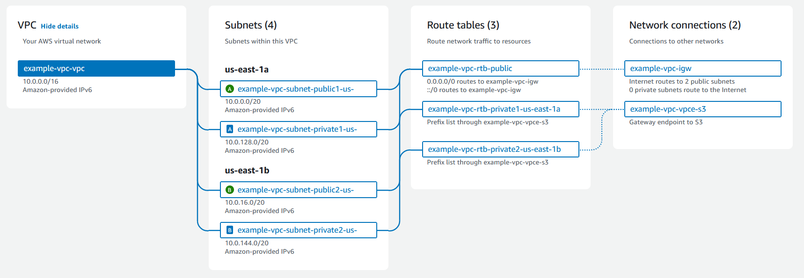
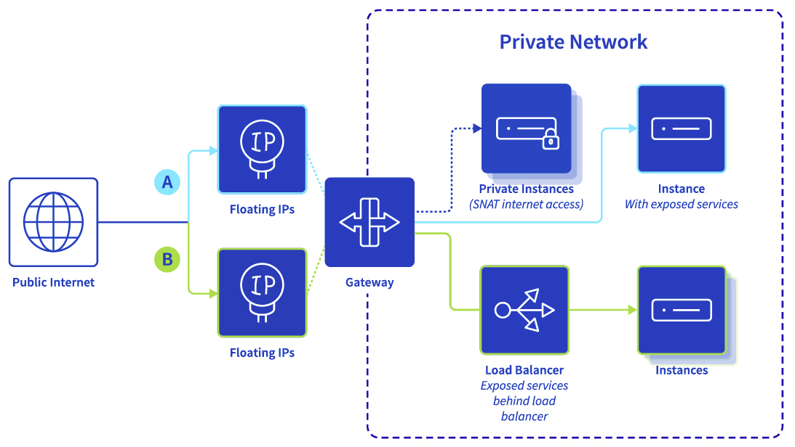
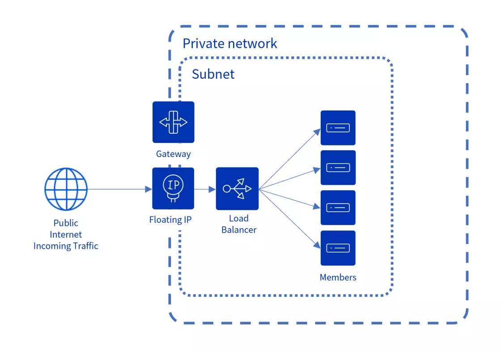

# Cloud Networking

See also: [Azure](azure.md), [Fly.io](fly.md), [Build your own cloud provider](cloudprovider.md).

## Virtual networks

| Provider      | Name                         |
| ------------- | ---------------------------- |
| AWS           | VPC (Virtual Private Cloud)  |
| Azure         | VNet (Virtual Network)       |
| Google Cloud  | VPC Network                  |

Building blocks:

- **Virtual switches (vSwitches)** — software connecting VMs together on the same host.
- **Virtual routers** — route traffic between subnets or virtual networks.
- **Virtual firewalls** — control and secure data flow within and between virtual networks.
- **Network interfaces (vNICs)** — virtual adapters that let VMs send and receive traffic.
- **Overlay networks** — logical networks on top of physical ones using tunneling protocols (VXLAN, GRE). See [VXLAN](vxlan.md).

VPCs operate at **layer 3**. VPCs and VLANs both isolate a tenant's network from other tenants in the same data center.

## Regions and availability zones

A **region** is a geographic area where a cloud provider has deployed infrastructure. Each region contains multiple **Availability Zones (AZs)**, and each AZ consists of one or more data centers.

## AWS VPC

- A VPC is scoped per **region**; the subnets within it each live in one **Availability Zone**.
- A **public subnet** is one connected to an internet gateway (its route table sends traffic to the IGW).

This VPC is configured with an IPv4 CIDR and an Amazon-provided IPv6 CIDR, subnets in two Availability Zones, three route tables, an internet gateway, and a gateway endpoint. Because the internet gateway is selected, the visualization shows that traffic from the public subnets is routed to the internet: the corresponding route table sends the traffic to the internet gateway.

### Route tables

A route table contains a set of rules, called **routes**, that determine where network traffic from your VPC is directed. You can explicitly associate a subnet with a particular route table; otherwise, the subnet is implicitly associated with the **main** route table.

Each route specifies the range of IP addresses where you want the traffic to go (the **destination**) and the gateway, network interface, or connection through which to send it (the **target**).

## OVHcloud

### Private network

Example: private network `10.2.0.0/16` with gateway `10.2.0.1`, and a DHCP/allocation range of `10.2.2` to `10.2.25.254`.

### Load Balancer

**Public to private:** incoming traffic from the internet goes to the Floating IP attached to the Load Balancer. The instances behind it are on a private network with no public IP, keeping them completely isolated from the internet.

**SNAT Gateway:** configured in the private network for outbound access — enables internet access without exposing any private resources.

Benefits:

- **Deployable in regions** — deploy the Load Balancer closer to your customers.
- **Connected to private networks** — paired with the OVHcloud vRack, it can act as a gateway between public and private networks, isolating application nodes on the private network.
- **Simplified management** — OpenStack Horizon UI, or API.
- **Private workloads** — can be configured for private use only, accessible only within your private network.
- **Integrated with the Public Cloud ecosystem** — Octavia API support and compatible tools (Terraform, Ansible, Salt, etc.).
- **Multiple health check protocols** — choose when an instance or node is excluded: standard TCP verification, HTTP code, and other options from the OpenStack Load Balancer docs.
- **SSL/TLS encryption** — free Let's Encrypt DV certificates included with any plan, or upload your own from a specific CA.
- **Compatible with Public Cloud instances** — standard OpenStack instances and Kubernetes containers; over the private network, Hosted Private Cloud VMs and Bare Metal servers can be backends too.
