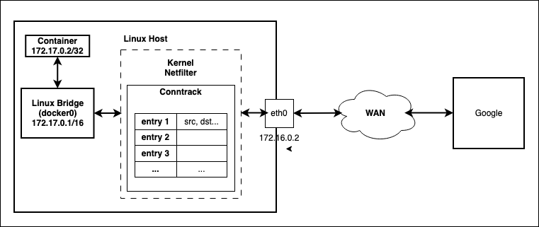
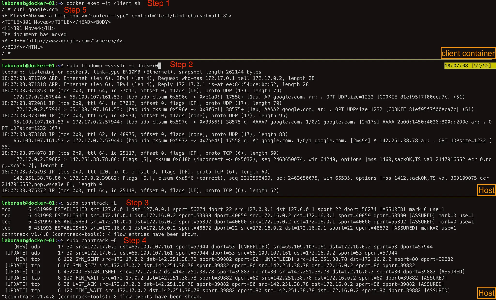
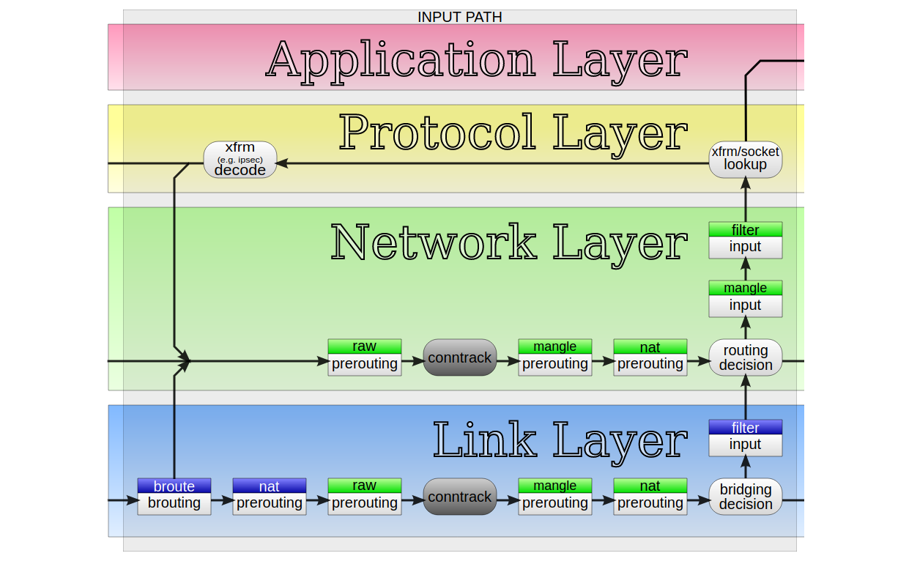
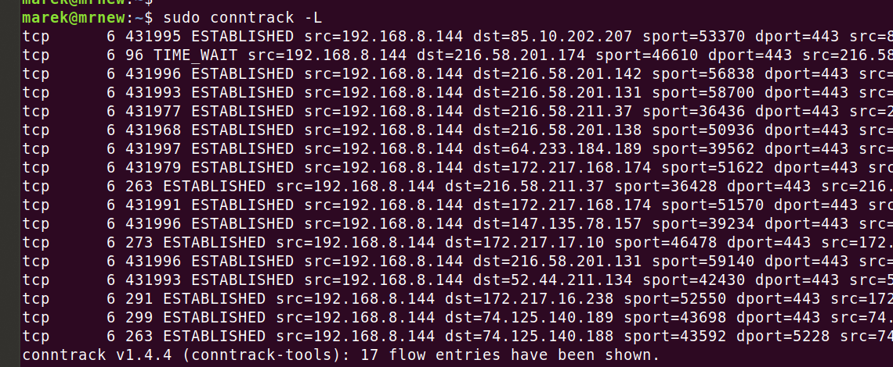
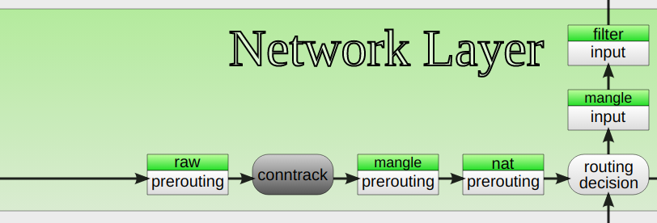

# Connection Tracking (conntrack)

**Conntrack**, short for **connection tracking**, is a core feature of the Linux kernel's **Netfilter** subsystem.

It records and manages the state of every network connection and data flow, so the kernel knows whether a packet belongs to a new, established, or related connection. This mechanism is fundamental for implementing **stateful firewalls** and **Network Address Translation (NAT)**, and forms the backbone of higher-level networking systems such as container networking and Kubernetes Services.

## The connection tracking table

A table maintained by the kernel that records the state and NAT mappings of each *flow*, keyed by the five-tuple (`src IP`, `dst IP`, `src port`, `dst port`, `protocol`). Each record is called an **entry**. Conntrack continuously maintains this table and uses it to determine which existing connection each packet belongs to.

Common connection states (`ctstate`):

| State         | Meaning                                                                                           |
| ------------- | ------------------------------------------------------------------------------------------------- |
| `NEW`         | The first packet of a flow (no existing entry).                                                   |
| `ESTABLISHED` | A bidirectional connection that has been fully established.                                       |
| `RELATED`     | A connection related to an existing one (e.g. an FTP data channel or an ICMP error).              |
| `INVALID`     | A packet that cannot be associated with any existing connection (possibly malformed or tampered). |

Who relies on it:

- **NAT** (SNAT / DNAT / MASQUERADE) uses conntrack to create and maintain address and port mappings, so return packets can be translated back correctly.
- **Stateful firewalls** (filter tables) use conntrack's connection states to decide whether packets should be allowed or dropped.

### Reading `conntrack -L`

```sh
laborant@docker-01:~$ sudo conntrack -L
tcp      6 431999 ESTABLISHED src=172.16.0.1 dst=172.16.0.2 sport=45536 dport=40060 src=172.16.0.2 dst=172.16.0.1 sport=40060 dport=45536 [ASSURED] mark=0 use=1
tcp      6 431986 ESTABLISHED src=172.16.0.1 dst=172.16.0.2 sport=40968 dport=22 src=172.16.0.2 dst=172.16.0.1 sport=22 dport=40968 [ASSURED] mark=0 use=1
tcp      6 431999 ESTABLISHED src=127.0.0.1 dst=127.0.0.1 sport=34364 dport=22 src=127.0.0.1 dst=127.0.0.1 sport=22 dport=34364 [ASSURED] mark=0 use=1
tcp      6 431998 ESTABLISHED src=172.16.0.1 dst=172.16.0.2 sport=39536 dport=40059 src=172.16.0.2 dst=172.16.0.1 sport=40059 dport=39536 [ASSURED] mark=0 use=1
conntrack v1.4.8 (conntrack-tools): 4 flow entries have been shown.
```

The table contains 4 stable TCP connections:

- 1 local SSH connection
- 1 external SSH connection
- 2 application-layer service connections (ports 40059 and 40060)

Conntrack always stores a connection in **both directions**:

```sh
tcp      6 431999 ESTABLISHED src=172.16.0.1 dst=172.16.0.2 sport=45536 dport=40060 src=172.16.0.2 dst=172.16.0.1 sport=40060 dport=45536
```

- **First tuple** = original direction (the packet that created the connection).
- **Second tuple** = reply direction (the expected reverse traffic).

## Where conntrack runs

Conntrack is invoked in only **two** netfilter hooks, where it checks whether the packet belongs to an existing connection or creates a new entry:

- **`PREROUTING`** — any packet entering the system, whether destined for the local host (`INPUT`) or routed elsewhere (`FORWARD`).
- **`OUTPUT`** — locally generated packets.

The state (`NEW`, `ESTABLISHED`, `RELATED`, …) is cached and available in all later hooks/chains, so a rule like this uses the state already determined in `PREROUTING`:

```sh
iptables -A INPUT -m conntrack --ctstate RELATED,ESTABLISHED -j ACCEPT
```

## Example: accessing google.com from a container




First-time connection:

```sh
Container (172.17.0.2)
   │
   ▼
docker0 bridge (172.17.0.1)
   │
   ▼
NAT: SNAT 172.17.0.2 → 172.16.0.2
   │
   ▼
[conntrack outbound]  ← create/update connection entry, record NAT mapping
Host eth0 (172.16.0.2)
   │
   ▼
Internet (Google, DNS)
   │
   ▼
Packet Reply to Host (Target 172.16.0.2 eth0)
   │
   ▼
[conntrack inbound]  ← lookup connection entry, determine DNAT
DNAT back to Container 172.17.0.2
   │
   ▼
Container receives reply
```

Subsequent packets (same connection):

```sh
Container → Internet
   │
   ▼
docker0 bridge
   │
   ▼
[conntrack looks up entry]  ← existing mapping found
   │
   ▼
SNAT applied using existing mapping
   │
   ▼
Host eth0 → Internet
```



## The dark side: a full conntrack table drops packets

From Cloudflare's [Conntrack tales: one thousand and one flows](https://blog.cloudflare.com/conntrack-tales-one-thousand-and-one-flows/).



**How large can the table be?** The setting lives in `/proc/sys/net/nf_conntrack_max` (here: `262144`). It is a global setting, but the limit is per container: each container ("network namespace") can have up to 256K conntrack entries.

**When is conntrack active?** Traditionally, just loading the kernel module turned it on. With containers and network namespaces, conntrack needed to be active in some namespaces and inactive in others. So it is tied to usage: rules referencing conntrack must exist in the namespace's iptables for conntrack to be active inside the container.

**Experiment:** set `nf_conntrack_max` to `7` and send 10 inbound `SYN` packets.

- The `-t raw PREROUTING` table still receives 10 packets.
- The `-t mangle PREROUTING` table sees only 7.
- The three missing `SYN` packets were hard-dropped. Conntrack on overfill does exactly that.



`-t raw PREROUTING` runs **before** conntrack, while `-t mangle PREROUTING` runs just **after** it — which is why the iptables counters report 10 and 7 packets.

> Just the fact of using conntrack means that, when it's full, packets creating new flows will be dropped. No questions asked. If you use it, you absolutely must make sure it doesn't get filled.

## Further reading

- [A Brief Introduction to Conntrack](https://baconyao.notion.site/11-A-Brief-Introduction-to-Conntrack-29d8a3a7d9d4809ca671e61e37ff300c)
- [Deep Dive: How Linux Conntrack Determines Performance and Security in Docker Containers](https://baconyao.notion.site/12-Deep-Dive-How-Linux-Conntrack-Determines-Performance-and-Security-in-Docker-Containers-2d78a3a7d9d480a58442c6f06c1ce838)
- [Conntrack tales: one thousand and one flows](https://blog.cloudflare.com/conntrack-tales-one-thousand-and-one-flows/)
