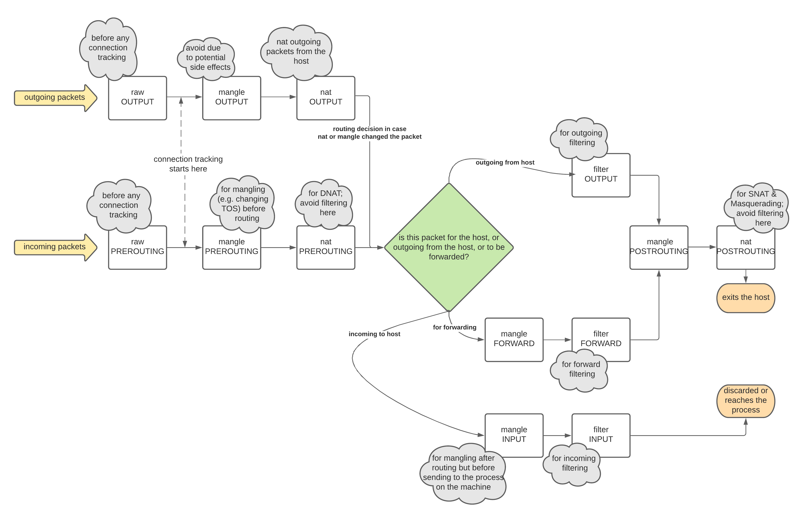
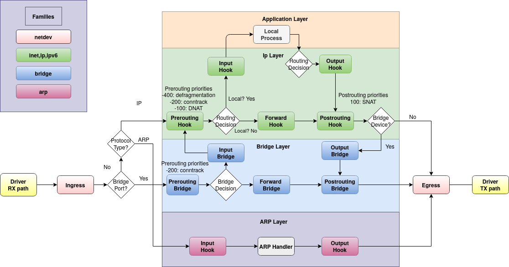
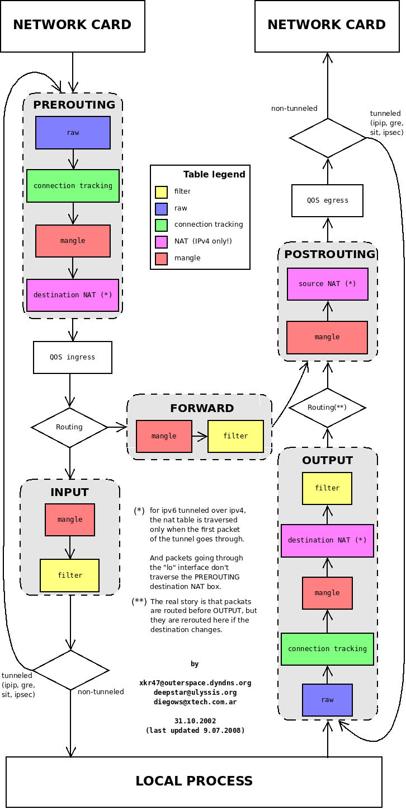
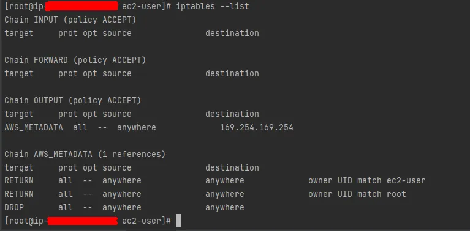
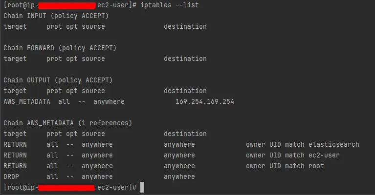

# iptables

## Concepts

- **Tables** — the highest level of organization; define the type of operation performed on packets (`filter`, `nat`, `mangle`, `raw`). Each table contains multiple chains.
- **Chains** — ordered lists of rules that packets traverse. When a packet arrives at (or leaves) a specific point in the network stack, it passes through the relevant chain.
- **Rules** — individual statements that define conditions for matching a packet and a **target** (action) to take if it matches.

Two things to keep in mind:

- **Order of rules:** rules are processed sequentially within a chain. The first rule a packet matches is applied, and further rules in that chain (or subsequent chains) might be skipped. Place more specific rules before more general ones.
- **Connection tracking (`-m state`):** using `ESTABLISHED,RELATED` automatically permits return traffic for connections initiated by your system, and related connections (like FTP data). It's a cornerstone of modern firewalling. See [conntrack](conntrack.md).

## How iptables sits on netfilter

A packet hits a **netfilter hook** during its journey through the kernel. **The hook activates tables**, which contain **chains**, which contain **rules**. See the hook definitions in [Routing: netfilter hook points](routing.md#netfilter-hook-points).

There are five hooks that kernel modules can register with. As packets progress through the stack they trigger the modules registered at those hooks; which hooks a packet triggers depends on whether it's incoming or outgoing, its destination, and whether it was dropped or rejected earlier. Modules registering at a hook supply a **priority**, giving deterministic ordering when several modules (or several instances of one) sit on the same hook; each returns a decision to netfilter about what to do with the packet.

### Tables

Tables classify rules by the kind of decision they make: an address-translation rule goes in `nat`; a rule deciding whether a packet may continue goes in `filter`.

```text
┌─────────────────────────────────────────────────┐
│                  NETFILTER                      │
├─────────────────────────────────────────────────┤
│                                                 │
│  HOOKS (5 points in packet path)                │
│  ├─ NF_INET_PRE_ROUTING                         │
│  ├─ NF_INET_LOCAL_IN                            │
│  ├─ NF_INET_FORWARD                             │
│  ├─ NF_INET_LOCAL_OUT                           │
│  └─ NF_INET_POST_ROUTING                        │
│                                                 │
│  TABLES (by functionality)                      │
│  ├─ raw (connection tracking bypass)            │
│  ├─ mangle (packet modification)                │
│  ├─ nat (address translation)                   │
│  └─ filter (packet filtering) ◄─ DEFAULT        │
│                                                 │
│  CHAINS (rule containers)                       │
│  ├─ Built-in:                                   │
│  │   ├─ PREROUTING                              │
│  │   ├─ INPUT                                   │
│  │   ├─ FORWARD                                 │
│  │   ├─ OUTPUT                                  │
│  │   └─ POSTROUTING                             │
│  └─ User-defined:  custom chains                │
│                                                 │
│  RULES (match + action)                         │
│  └─ Each rule:  match criteria → target/jump    │
│                                                 │
└─────────────────────────────────────────────────┘
```

**The `raw` table:** iptables is **stateful** — connection tracking (built on netfilter) lets it view packets as part of an ongoing connection rather than discrete, unrelated packets, and runs very soon after a packet hits the interface. The `raw` table has one narrow purpose: marking packets to **opt out** of connection tracking.

### Chains

While tables are defined by the aim of their rules, the **built-in chains represent the netfilter hooks that trigger them** — chains decide *when* rules are evaluated. Their names mirror the hooks:

| Chain         | Hook                  | Packets                                    |
| ------------- | --------------------- | ------------------------------------------ |
| `PREROUTING`  | `NF_IP_PRE_ROUTING`   | Just entered the stack, before routing     |
| `INPUT`       | `NF_IP_LOCAL_IN`      | Destined for the local system              |
| `FORWARD`     | `NF_IP_FORWARD`       | Being routed through the system            |
| `OUTPUT`      | `NF_IP_LOCAL_OUT`     | Originating from the local system          |
| `POSTROUTING` | `NF_IP_POST_ROUTING`  | Any outgoing/forwarded, just before the wire |

There are two types of chains:

- **Built-in** — predefined, each tied to one hook.
- **User-defined** — custom; never run automatically. They run only when a rule jumps to them with `-j <chain>` (they're not registered with a hook), and return to the calling chain unless a terminating target (`DROP`, `ACCEPT`, …) is hit.

When a hook fires, the kernel walks the tables registered for that hook in a fixed priority order, and in each runs only the chain bound to that hook. Not every table has a chain at every hook — certain decisions only make sense at certain points. E.g. when a packet has just entered the stack, `NF_IP_PRE_ROUTING` fires and runs the `PREROUTING` chains of:

```text
[Packet]
   ↓
[Hook: PRE_ROUTING]
   ↓
raw:PREROUTING  →  mangle:PREROUTING  →  nat:PREROUTING
```

Three tables have `PREROUTING` chains; each registers with a priority dictating the order, and all rules in the highest-priority chain are evaluated before moving to the next.

Priority values (lower = earlier):

```text
- NF_IP_PRI_RAW = -300
- NF_IP_PRI_CONNTRACK = -200
- NF_IP_PRI_MANGLE = -150
- NF_IP_PRI_NAT_DST = -100
- NF_IP_PRI_FILTER = 0         ← filter table
- NF_IP_PRI_SECURITY = 50
- NF_IP_PRI_NAT_SRC = 100
```

Table processing order per chain:

| Chain         | Tables, in order                                           |
| ------------- | ---------------------------------------------------------- |
| `PREROUTING`  | raw → conntrack → mangle → nat (DNAT)                      |
| `INPUT`       | mangle → filter → security → nat (SNAT)                    |
| `OUTPUT`      | raw → conntrack → mangle → nat (DNAT) → filter → security  |
| `FORWARD`     | mangle → filter → security                                 |
| `POSTROUTING` | mangle → nat (SNAT)                                        |

Example — a packet for the local host reaching the `INPUT` hook runs `mangle → INPUT` then `filter → INPUT`. `raw` doesn't run (not registered for `INPUT`), and on most kernels `nat` doesn't either.

If you're dealing with **bridged** traffic, packets may hit the bridge hooks first (ebtables / `NF_BR_*`) and are passed to iptables only if `br_netfilter` is enabled. See [Linux bridge](linux-bridge.md).

### Traversal paths

Assuming the server can route the packet and the rules permit it:

- **Incoming, for the local system:** `PREROUTING → INPUT`
- **Incoming, for another host:** `PREROUTING → FORWARD → POSTROUTING`
- **Locally generated:** `OUTPUT → POSTROUTING`

So an incoming packet for the local system is evaluated against the `PREROUTING` chains of `raw`, `mangle` and `nat`, then the `INPUT` chains of `mangle`, `filter`, `security` and `nat`, before reaching the local socket.

```text
                        PACKET ARRIVES
                             ↓
         ┌──────────────────────────────────────┐
         │   HOOK: NF_INET_PRE_ROUTING (0)      │
         │   Tables: raw → mangle → nat         │
         │   Chains:  PREROUTING                │
         └──────────────────────────────────────┘
                             ↓
                      ROUTING DECISION
                      ↙            ↘
              LOCAL DELIVERY    FORWARD
                   ↓                ↓
       ┌──────────────────┐   ┌──────────────────┐
       │ HOOK: LOCAL_IN   │   │ HOOK:  FORWARD   │
       │ (1)              │   │ (2)              │
       │ Tables: mangle,  │   │ Tables: mangle,  │
       │         filter   │   │         filter   │
       │ Chains: INPUT    │   │ Chains: FORWARD  │
       └──────────────────┘   └──────────────────┘
              ↓                        ↓
       LOCAL PROCESS              ┌──────────────────┐
              ↓                  │ HOOK:             │
       ┌──────────────────┐      │ POST_ROUTING (4)  │
       │ HOOK:  LOCAL_OUT │      │ Tables: mangle,   │
       │ (3)              │      │         nat       │
       │ Tables: raw,     │      │ Chains:           │
       │    mangle, nat,  │      │ POSTROUTING       │
       │    filter        │      └──────────────────┘
       │ Chains: OUTPUT   │              ↓
       └──────────────────┘         NETWORK OUT
              ↓
       ROUTING DECISION
              ↓
       ┌──────────────────┐
       │ HOOK:            │
       │ POST_ROUTING (4) │
       │ Tables: mangle,  │
       │         nat      │
       │ Chains:          │
       │ POSTROUTING      │
       └──────────────────┘
              ↓
         NETWORK OUT
```





The three scenarios (from [iptables chains and tables traversal (Baeldung)](https://www.baeldung.com/linux/iptables-chains-tables-traversal)):

1. A packet arrives at the interface, passes through the stack, and reaches a user-space process.
2. A packet is created by a user-space process, sent to the stack, and delivered to the interface.
3. A packet arrives at the interface and, per the routing rules, is forwarded to another interface.

Writing a non-zero value to `/proc/sys/net/ipv4/ip_forward` enables forwarding between interfaces, turning the machine into a (virtual) router.

#### Example: a Linux box as a router

```text
      [Internet] eth0         eth1 [LAN]
          ───────▶  Linux  ───────▶
                (forwarding)
```

1. Packet enters on `eth0`.
2. **`PREROUTING`** hook (raw, mangle, nat): conntrack runs (tracks NEW/ESTABLISHED); DNAT may change the destination IP.
3. **Routing decision** — is it for me? No → route to another interface (e.g. `eth1`).
4. **`FORWARD`** hook (mangle, filter, security): `iptables -A FORWARD ...` rules apply; use `-m conntrack --ctstate` to match.
5. **`POSTROUTING`** hook (mangle, nat): SNAT (e.g. replace the source IP with `eth0`'s).
6. Packet is sent out via `eth1`.

### Rules, matching and targets

Rules live in a specific chain of a specific table; as a chain is called, the packet is checked against each rule in order. Each rule has a **matching** component (criteria the packet must meet) and an **action** component (the **target**).

Targets are iptables' own (`ACCEPT`, `DROP`, `RETURN`) or extension targets (39 at the time of writing; popular ones: `DNAT`, `LOG`, `MASQUERADE`, `REJECT`, `SNAT`, `TRACE`, `TTL`). They're divided into:

- **Terminating targets** — end evaluation within the chain and return control to the netfilter hook; depending on the return value, the hook drops the packet or lets it continue to the next stage.
- **Non-terminating targets** — act on the packet and continue evaluation within the chain. Each chain must eventually return a terminating decision, but any number of non-terminating targets can run first.
- **Jump targets** — a special non-terminating class: evaluation moves to a different (user-defined) chain for additional processing. User-defined chains are reached only by jumping to them, for organizational purposes.

**Only the `filter` table makes allow/deny decisions:**

- `filter:INPUT` → packets destined for the local host (drop incoming packets to the host);
- `filter:FORWARD` → packets being routed through the host (drop routed packets);
- `filter:OUTPUT` → locally generated packets (drop packets generated by the host).

`-m` loads an iptables extension (see `man iptables-extensions`); e.g. `limit` restricts the number of packets matched by a rule, and `conntrack` matches connection state.

## Managing rules

```sh
# Allow incoming SSH (port 22) connections
sudo iptables -A INPUT -p tcp --dport 22 -j ACCEPT

# Allow established and related connections (crucial for normal network operation)
sudo iptables -A INPUT -m state --state ESTABLISHED,RELATED -j ACCEPT
sudo iptables -A OUTPUT -m state --state ESTABLISHED,RELATED -j ACCEPT

# Insert rule to allow SSH at the beginning (position 1) of the INPUT chain
sudo iptables -I INPUT 1 -p tcp --dport 22 -j ACCEPT

# Delete rule number 3 from the INPUT chain (first list with -L --line-numbers)
sudo iptables -D INPUT 3
```

### Default policy (`-P`)

Determines what happens to packets that don't match any rule in the chain:

```sh
# Set default policy for INPUT chain to DROP
sudo iptables -P INPUT DROP
```

### Custom chains (`-N`)

```sh
# Create a new chain
sudo iptables -N SSH_ALLOWED

# Add rules to the custom chain
sudo iptables -A SSH_ALLOWED -s 192.168.1.0/24 -j ACCEPT
sudo iptables -A SSH_ALLOWED -j LOG --log-prefix "SSH_DENY: "
sudo iptables -A SSH_ALLOWED -j DROP

# Jump to the custom chain from a built-in chain
sudo iptables -A INPUT -p tcp --dport 22 -j SSH_ALLOWED

# Another example
sudo iptables -N MYCHAIN
sudo iptables -A MYCHAIN -s 10.0.0.5 -j DROP
```

## NAT targets

- **Source NAT (SNAT)** modifies the source IP address or port of packets, letting internal hosts reach external networks using a single public IP address.
- **Destination NAT (DNAT)** modifies the destination IP or port of packets entering the internal network (inbound traffic), directing external requests to an internal host or service. Also known as **port forwarding** or **reverse-proxy-style NAT**.

### SNAT — static source NAT

- Changes the source IP address.
- Used when the IP is known/static.

```sh
iptables -t nat -A POSTROUTING -o eth0 -j SNAT --to-source 203.0.113.1
```

All outbound traffic on `eth0` — whether forwarded or generated locally — appears to come from `203.0.113.1`.

Restricting to a source subnet and pinning a source port (a port requires `-p tcp` or `-p udp`):

```sh
iptables -t nat -A POSTROUTING -s 192.168.1.0/24 -o eth0 -p tcp -j SNAT --to-source 203.0.113.5:8877
```

### MASQUERADE — dynamic source NAT

- Dynamic form of SNAT.
- Used with dynamic IPs (e.g. PPPoE, DHCP).

```sh
iptables -t nat -A POSTROUTING -o eth0 -j MASQUERADE
```

All outgoing traffic on `eth0` has its source IP rewritten to whatever IP `eth0` has at the moment. It is slightly slower than SNAT because it must check the interface's IP for each packet.

```sh
iptables -t nat -A POSTROUTING -s 192.168.1.0/24 -o eth0 -j MASQUERADE
```

### DNAT — destination NAT

Applied in the nat table's `PREROUTING` chain (incoming packets) or `OUTPUT` chain (locally generated packets). See the port-forwarding recipe below.

### NAT in depth

One `nat` table, many chains:

- `PREROUTING` and `OUTPUT` → destination NAT (before routing).
- `POSTROUTING` → source NAT (after routing).
- NAT chains don't exist at `FORWARD`.



```sh
# DNAT rule in PREROUTING
iptables -t nat -A PREROUTING -p tcp --dport 8080 \
  -j DNAT --to-destination 192.168.1.100:80

# SNAT rule in POSTROUTING
iptables -t nat -A POSTROUTING -o eth0 \
  -j SNAT --to-source 203.0.113.5
```

#### SNAT in `OUTPUT` vs `POSTROUTING`

| Chain         | Applies to          | When                                                                   |
| ------------- | ------------------- | ---------------------------------------------------------------------- |
| `OUTPUT`      | Locally generated   | The packet is generated by the host itself.                            |
| `POSTROUTING` | All outbound traffic | After the routing decision, before leaving the host — locally generated **or** forwarded. |

`POSTROUTING` SNAT is the classic internet-sharing setup, where internal clients' source IPs are changed to the gateway's public IP:

```sh
iptables -t nat -A POSTROUTING -o eth0 -j SNAT --to-source 203.0.113.1
```

(Strictly, the `nat` table's `OUTPUT` chain does DNAT for locally generated packets; recent kernels also allow SNAT in `nat INPUT`.)

#### NAT rules run only for the first packet

NAT rules are consulted only when a connection is created; the translation is then stored in conntrack and applied automatically to every later packet. Moving NAT rules after a connection is established won't affect existing flows.

```sh
iptables -t nat -A PREROUTING -p tcp --dport 80 \
  -j DNAT --to 192.168.1.10:80
```

**TCP SYN (NEW):**

1. Packet arrives at `PREROUTING`; the kernel sees no conntrack entry exists.
2. `nat:PREROUTING` rules are evaluated; the DNAT rule matches.
3. The kernel rewrites the destination IP/port, creates a conntrack entry, and stores the mapping: `original dst: 203.0.113.5:80 → translated dst: 192.168.1.10:80`.
4. The routing decision uses the translated address.

**Packets 2, 3, 4, … (SYN-ACK, ACK, data):**

1. Packet arrives at `PREROUTING`; the kernel finds the existing conntrack entry.
2. NAT rules are **not** evaluated — the stored translation is applied directly, skipping `nat` table traversal.

This is why packet counters in `nat` barely increment compared to `filter`.

#### Virtual states: SNAT and DNAT in conntrack

- **SNAT** — a virtual state set when the source address was altered by NAT, so conntrack knows to change the source back in reply packets.
- **DNAT** — set when the destination address was altered, so conntrack knows to change the destination back when routing replies.

These aren't packet states like `NEW` or `ESTABLISHED`, but annotations on the conntrack entry telling the kernel how to transform packets: apply NAT on outbound traffic, reverse it on inbound replies.

```sh
iptables -t nat -A PREROUTING -d 203.0.113.5 -p tcp --dport 80 \
         -j DNAT --to-destination 192.168.1.10:80
```

When the packet comes in, the destination becomes `192.168.1.10`, conntrack tags the connection with DNAT, and reverse DNAT is applied automatically to replies (`192.168.1.10 → 203.0.113.5`).

```sh
iptables -t nat -A POSTROUTING -o eth0 -j SNAT --to-source 198.51.100.99
```

The source becomes `198.51.100.99`, conntrack tags the connection with SNAT, and remembers to revert the source on return traffic.

Reverse SNAT doesn't happen in `PREROUTING`, because at `PREROUTING` the routing decision hasn't been made yet, and reverse SNAT needs to know the packet's direction (local vs forwarded).

#### Why not just one of them?

- Only SNAT: the outside world can't initiate connections to internal hosts.
- Only DNAT: replies from internal servers would carry private IPs — remote clients wouldn't know how to respond.

So: **DNAT for ingress, SNAT for egress.** DNAT is mostly for incoming traffic — port forwarding and reverse proxying — and is needed only when connections are initiated from outside to expose internal services (e.g. a web server behind NAT). If internal clients only initiate outgoing connections, you only need SNAT.

#### Worked example: DNAT without a FORWARD rule

```sh
iptables -t nat -A PREROUTING -d 203.0.113.5 -p tcp --dport 80 -j DNAT --to 192.168.1.10:80
```

1. **Packet arrives:** `SRC 1.2.3.4`, `DST 203.0.113.5:80`.
2. **`PREROUTING` (nat):** the DNAT rule matches; destination rewritten to `192.168.1.10:80`.
3. **Routing decision:** destination is not local → forward → `FORWARD` hook.
4. **`filter:FORWARD`:** no `ACCEPT` rule, default policy `DROP` → **packet dropped here**.

DNAT alone isn't enough — you also need a `FORWARD` rule (see the recipes below).

## Recipes

### Port forwarding

The machine has two interfaces: `eth0` (external/public) and `eth1` (internal/private). Forward incoming HTTP on `eth0` to an internal web server at `192.168.0.100`:

```sh
# Enable IP forwarding in the kernel (if not already enabled)
sudo sysctl -w net.ipv4.ip_forward=1
# Make it persistent across reboots (add to /etc/sysctl.conf)
# net.ipv4.ip_forward = 1

# DNAT rule: redirect incoming traffic on port 80 to the internal server
sudo iptables -t nat -A PREROUTING -i eth0 -p tcp --dport 80 -j DNAT --to-destination 192.168.0.100:80

# Allow the forwarded traffic through the filter table
sudo iptables -A FORWARD -i eth0 -o eth1 -p tcp --dport 80 -d 192.168.0.100 -j ACCEPT
```

### Masquerading (share an internet connection)

Allow hosts on the private network (`eth1`) to reach the internet through this machine, which has a dynamic public IP on `eth0`:

```sh
# Enable IP forwarding (same as above)
sudo sysctl -w net.ipv4.ip_forward=1

# Masquerade outgoing traffic from the internal network
sudo iptables -t nat -A POSTROUTING -o eth0 -j MASQUERADE

# Allow forwarded traffic through the filter table
sudo iptables -A FORWARD -i eth1 -o eth0 -j ACCEPT
sudo iptables -A FORWARD -i eth0 -o eth1 -m state --state RELATED,ESTABLISHED -j ACCEPT
```

### Common rule sets by chain

Port forwarding / DNAT (external → internal host) — `PREROUTING` (nat):

```sh
# Forward TCP port 80 received on eth0 to 192.168.1.10:80
iptables -t nat -A PREROUTING -i eth0 -p tcp --dport 80 -j DNAT --to-destination 192.168.1.10:80
# Allow forwarding
iptables -A FORWARD -d 192.168.1.10/32 -p tcp --dport 80 -m state --state NEW,ESTABLISHED -j ACCEPT
iptables -A FORWARD -s 192.168.1.10/32 -m state --state ESTABLISHED -j ACCEPT
```

Source NAT / masquerade (LAN → internet) — `POSTROUTING` (nat):

```sh
# Masquerade traffic from LAN out via eth0
iptables -t nat -A POSTROUTING -o eth0 -s 192.168.1.0/24 -j MASQUERADE
```

Filtering incoming to local services — `INPUT` (filter):

```sh
# Allow SSH to the host
iptables -A INPUT -i eth0 -p tcp --dport 22 -m state --state NEW,ESTABLISHED -j ACCEPT
# Allow established replies
iptables -A INPUT -m state --state ESTABLISHED,RELATED -j ACCEPT
# Drop everything else by default (be careful when applying remotely!)
iptables -P INPUT DROP
```

Filtering forwarded traffic — `FORWARD` (filter):

```sh
# Allow forwarded established/related
iptables -A FORWARD -m state --state ESTABLISHED,RELATED -j ACCEPT
# Allow new forward from LAN to Internet
iptables -A FORWARD -i lan0 -o eth0 -s 192.168.1.0/24 -j ACCEPT
```

### SSH as a client and as a server

From [Layman's iptables 101 (iximiuz)](https://iximiuz.com/en/posts/laymans-iptables-101/).

**Your computer is the client** — you need rules in both directions:

```sh
iptables -A OUTPUT -p tcp --dport 22 -j ACCEPT
iptables -A INPUT -m conntrack --ctstate RELATED,ESTABLISHED -j ACCEPT
```

SSH isn't one-directional: you send packets to destination port 22, and the replies come back with state `RELATED`/`ESTABLISHED`. The connection tracker distinguishes them for you.

**Your computer is the server** — the opposite direction: accept packets to port 22, and send replies with state `RELATED`/`ESTABLISHED` back to the client:

```sh
iptables -A INPUT -p tcp --dport 22 -j ACCEPT
iptables -A OUTPUT -m conntrack --ctstate RELATED,ESTABLISHED -j ACCEPT
```

DNAT for locally generated traffic (in `nat OUTPUT`):

```sh
iptables -t nat -A OUTPUT -p tcp --dport 22 --destination 192.168.40.40 -j DNAT --to-destination 123.123.123.123:4040
```

### Docker-style user-defined chain

```sh
$ iptables -P INPUT ACCEPT
# drop all forwards by default
$ iptables -P FORWARD DROP
$ iptables -P OUTPUT ACCEPT

# create a new chain
$ iptables -N DOCKER  # or --new-chain

# if outgoing interface is docker0, jump to DOCKER chain
$ iptables -A FORWARD -o docker0 -j DOCKER

# add some specific to Docker rules to the user-defined chain
$ iptables -A DOCKER ...
$ iptables -A DOCKER ...
$ iptables -A DOCKER ...

# jump back to the caller (i.e. FORWARD) chain
$ iptables -A DOCKER -j RETURN
```

See [Kafka in Docker Compose](kafka.md#kafka-in-docker-compose-what-the-nat-table-shows) for a real `nat` table with Docker's `DOCKER` chain, DNAT and MASQUERADE rules.

### Masquerading a pod/container CIDR (CNI bridge)

```sh
iptables -A FORWARD -s 10.240.0.0/16 -j ACCEPT # traffic originating from the range is accepted
iptables -A FORWARD -d 10.240.0.0/16 -j ACCEPT # traffic destined to the range is accepted

# Every packet from 10.240.0.0/16 that is NOT going out the cnio bridge
# (i.e. going to the internet) is masqueraded (SNAT)
iptables -t nat -A POSTROUTING -s 10.240.0.0/16 ! -o cnio -j MASQUERADE
```

## Matching by process owner (`-m owner`)

iptables doesn't directly see the user ID of the process initiating a connection the way it sees an IP address, but the `owner` module (`iptables -m owner`) can match packets created by a specific user, group, or process ID. This is particularly useful for **outgoing** connections.

Block all outgoing HTTP from a specific user (requires kernel support):

```sh
sudo iptables -A OUTPUT -m owner --uid-owner username -p tcp --dport 80 -j DROP
```

## Case study: Elasticsearch blocked from the EC2 metadata service

Source: [AWS SDK for Java: authenticating with instance profile credentials on EC2](https://servian.dev/aws-sdk-for-java-authenticating-with-instance-profile-credentials-on-ec2-70b462c193cf)

The Elasticsearch process ran as the `elasticsearch` user, but that user wasn't allowed to send requests to the **Instance Metadata Service** (IMDS).

It's good practice to limit IMDS access for unauthorized users: Linux firewalls can block traffic from or to specific users or destinations. Listing the existing rules:



The `OUTPUT` chain decides which outbound calls from the EC2 instance are allowed. All calls are allowed by default (`ACCEPT`), but a custom chain `AWS_METADATA` handles all traffic to `169.254.169.254` (the IMDS). Inside it, calls made by `ec2-user` or `root` hit `RETURN`, which falls back to the parent chain, where the default `ACCEPT` lets them succeed.

The fix was to add the `elasticsearch` user to that list:

```sh
sudo iptables -I AWS_METADATA -m owner --uid-owner $(id -u elasticsearch) -j RETURN
```



Now traffic to `169.254.169.254` is allowed only for processes running as `elasticsearch`, `ec2-user` or `root`. The full rule set:

```sh
# Create custom chain
iptables -N AWS_METADATA

# Send metadata traffic to it
iptables -A OUTPUT -d 169.254.169.254 -j AWS_METADATA

# Allow elasticsearch, ec2-user and root
iptables -A AWS_METADATA -m owner --uid-owner elasticsearch -j RETURN
iptables -A AWS_METADATA -m owner --uid-owner ec2-user -j RETURN
iptables -A AWS_METADATA -m owner --uid-owner root -j RETURN

# Drop all other access
iptables -A AWS_METADATA -j DROP
```

### How `RETURN` works here

When a packet hits a `RETURN` rule, it stops traversing the current chain (e.g. `AWS_METADATA`) and control goes back to the chain that called it (e.g. `OUTPUT`), resuming after the jump.

1. Any outgoing packet destined for `169.254.169.254` is sent to the `AWS_METADATA` chain.
2. If the packet came from a process with UID `elasticsearch`, `ec2-user` or `root`, it hits a `RETURN` rule:
   - control goes back to `OUTPUT`;
   - there are no further rules in `OUTPUT` and its policy is `ACCEPT`, so the packet proceeds.
3. If the UID doesn't match any listed, it hits the final `DROP` rule.

### Variant: default-deny `OUTPUT`

```sh
# Default policy: deny everything outbound
iptables -P OUTPUT DROP

# Accept already-established connections
iptables -A OUTPUT -m state --state ESTABLISHED,RELATED -j ACCEPT

# Custom chain
iptables -N AWS_METADATA
iptables -A AWS_METADATA -m owner --uid-owner elasticsearch -j RETURN
iptables -A AWS_METADATA -m owner --uid-owner ec2-user -j RETURN
iptables -A AWS_METADATA -m owner --uid-owner root -j RETURN
iptables -A AWS_METADATA -j DROP

# For the metadata service, jump to the custom filter
iptables -A OUTPUT -d 169.254.169.254 -j AWS_METADATA

# If AWS_METADATA allows it (RETURN), explicitly allow it
iptables -A OUTPUT -d 169.254.169.254 -j ACCEPT
```

After `RETURN`, control resumes at the next rule in `OUTPUT` — here the explicit `ACCEPT`, since the policy is now `DROP`.

## Further reading

- [A deep dive into iptables and netfilter architecture (DigitalOcean)](https://www.digitalocean.com/community/tutorials/a-deep-dive-into-iptables-and-netfilter-architecture)
- [iptables chains and tables traversal (Baeldung)](https://www.baeldung.com/linux/iptables-chains-tables-traversal)
- [Layman's iptables 101 (iximiuz)](https://iximiuz.com/en/posts/laymans-iptables-101/)
- [Understanding netfilter and iptables (sobyte)](https://www.sobyte.net/post/2022-04/understanding-netfilter-and-iptables/)
- [AWS SDK for Java: instance profile credentials on EC2](https://servian.dev/aws-sdk-for-java-authenticating-with-instance-profile-credentials-on-ec2-70b462c193cf)

## Quick reference

- **DNS:** domain name → IP address
- **ARP:** IP address → MAC address
