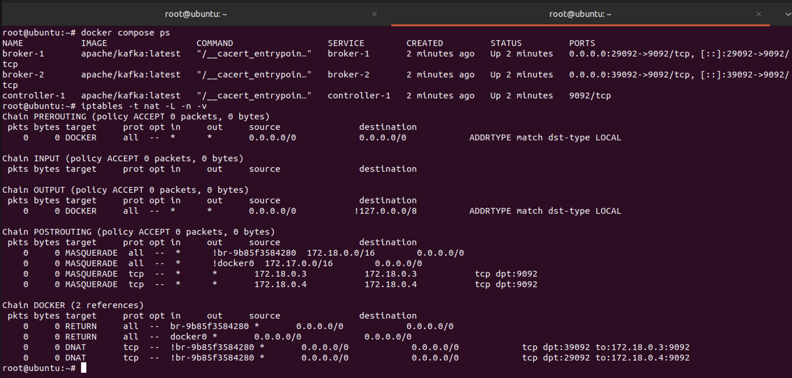
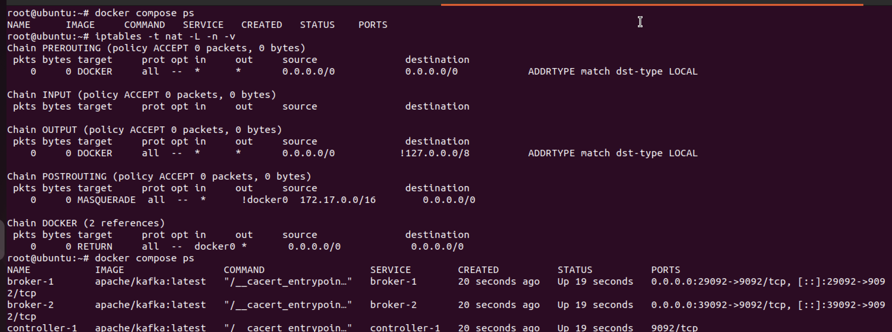
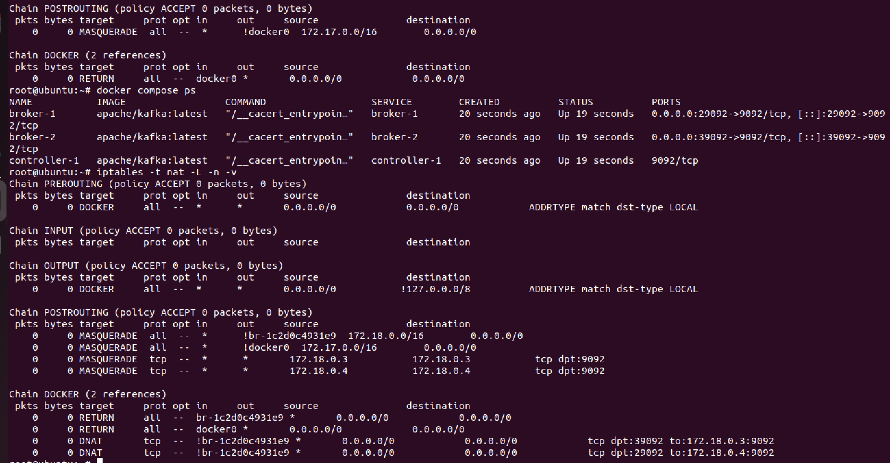
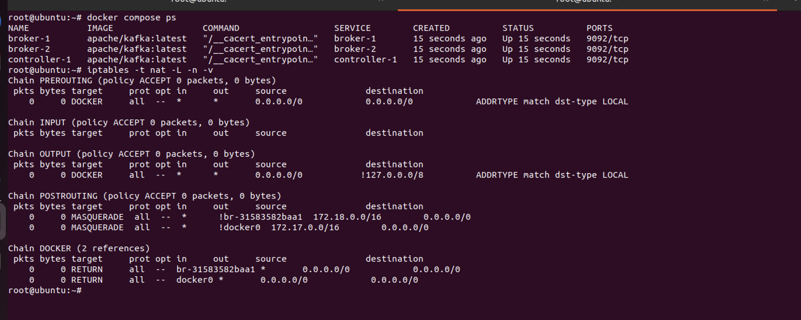

# Kafka

## KRaft: broker and controller in one process

The Controller and the Broker serve different purposes, so Kafka uses **listeners** to separate their traffic, even though both run inside the same JVM process.

```properties
# Identify the roles this process plays
process.roles=broker,controller

# Define the two different ports/listeners
listeners=PLAINTEXT://:9092,CONTROLLER://:9093
inter.broker.listener.name=PLAINTEXT
controller.listener.names=CONTROLLER

# Map the listener names to security protocols
listener.security.protocol.map=CONTROLLER:PLAINTEXT,PLAINTEXT:PLAINTEXT

# Tell the process where the quorum (the Raft "voters") is
controller.quorum.voters=1@localhost:9093
```

You can apply strict firewall rules to the Controller port (`9093`) so only your internal nodes can reach it, while keeping `9092` open to your application clients.

## Internal and external listeners

```properties
listeners=INTERNAL://0.0.0.0:9092,EXTERNAL://0.0.0.0:9094
listener.security.protocol.map=INTERNAL:PLAINTEXT,EXTERNAL:SSL
advertised.listeners=INTERNAL://kafka.internal.local:9092,EXTERNAL://broker.yourdomain.com:9094
```

- `0.0.0.0` means Kafka listens on all interfaces.
- `advertised.listeners` tells clients how to connect to the broker — DNS names matter here.
- Internal apps use the internal DNS (`kafka.internal.local`); external clients use something public like `broker.yourdomain.com`, e.g. `bootstrap.servers=broker.yourdomain.com:9094`.

## Kafka in Docker Compose: what the NAT table shows

The `nat` table before any containers start:



### Internal listener only, with published ports

```yaml
services:
  controller-1:
    image: apache/kafka:latest
    container_name: controller-1
    environment:
      KAFKA_NODE_ID: 1
      KAFKA_PROCESS_ROLES: controller
      KAFKA_LISTENERS: CONTROLLER://:9093
      KAFKA_INTER_BROKER_LISTENER_NAME: PLAINTEXT
      KAFKA_CONTROLLER_LISTENER_NAMES: CONTROLLER
      KAFKA_CONTROLLER_QUORUM_VOTERS: 1@controller-1:9093
      KAFKA_GROUP_INITIAL_REBALANCE_DELAY_MS: 0

  broker-1:
    image: apache/kafka:latest
    container_name: broker-1
    ports:
      - 29092:9092
    environment:
      KAFKA_NODE_ID: 4
      KAFKA_PROCESS_ROLES: broker
      KAFKA_LISTENERS: 'PLAINTEXT://:19092'
      KAFKA_ADVERTISED_LISTENERS: 'PLAINTEXT://broker-1:19092'
      KAFKA_INTER_BROKER_LISTENER_NAME: PLAINTEXT
      KAFKA_CONTROLLER_LISTENER_NAMES: CONTROLLER
      KAFKA_LISTENER_SECURITY_PROTOCOL_MAP: CONTROLLER:PLAINTEXT,PLAINTEXT:PLAINTEXT
      KAFKA_CONTROLLER_QUORUM_VOTERS: 1@controller-1:9093
      KAFKA_GROUP_INITIAL_REBALANCE_DELAY_MS: 0
    depends_on:
      - controller-1
 
  broker-2:
    image: apache/kafka:latest
    container_name: broker-2
    ports:
      - 39092:9092
    environment:
      KAFKA_NODE_ID: 5
      KAFKA_PROCESS_ROLES: broker
      KAFKA_LISTENERS: 'PLAINTEXT://:19092'
      KAFKA_ADVERTISED_LISTENERS: 'PLAINTEXT://broker-2:19092'
      KAFKA_INTER_BROKER_LISTENER_NAME: PLAINTEXT
      KAFKA_CONTROLLER_LISTENER_NAMES: CONTROLLER
      KAFKA_LISTENER_SECURITY_PROTOCOL_MAP: CONTROLLER:PLAINTEXT,PLAINTEXT:PLAINTEXT
      KAFKA_CONTROLLER_QUORUM_VOTERS: 1@controller-1:9093
      KAFKA_GROUP_INITIAL_REBALANCE_DELAY_MS: 0
    depends_on:
      - controller-1
  
```





### Internal listener only, no published ports

It's the **port publishing** (`ports:`) that creates the DNAT rules seen above — without it, there are none:

```yaml
services:
  controller-1:
    image: apache/kafka:latest
    container_name: controller-1
    environment:
      KAFKA_NODE_ID: 1
      KAFKA_PROCESS_ROLES: controller
      KAFKA_LISTENERS: CONTROLLER://:9093
      KAFKA_INTER_BROKER_LISTENER_NAME: PLAINTEXT
      KAFKA_CONTROLLER_LISTENER_NAMES: CONTROLLER
      KAFKA_CONTROLLER_QUORUM_VOTERS: 1@controller-1:9093
      KAFKA_GROUP_INITIAL_REBALANCE_DELAY_MS: 0

  broker-1:
    image: apache/kafka:latest
    container_name: broker-1
    environment:
      KAFKA_NODE_ID: 4
      KAFKA_PROCESS_ROLES: broker
      KAFKA_LISTENERS: 'PLAINTEXT://:19092'
      KAFKA_ADVERTISED_LISTENERS: 'PLAINTEXT://broker-1:19092'
      KAFKA_INTER_BROKER_LISTENER_NAME: PLAINTEXT
      KAFKA_CONTROLLER_LISTENER_NAMES: CONTROLLER
      KAFKA_LISTENER_SECURITY_PROTOCOL_MAP: CONTROLLER:PLAINTEXT,PLAINTEXT:PLAINTEXT
      KAFKA_CONTROLLER_QUORUM_VOTERS: 1@controller-1:9093
      KAFKA_GROUP_INITIAL_REBALANCE_DELAY_MS: 0
    depends_on:
      - controller-1
 
  broker-2:
    image: apache/kafka:latest
    container_name: broker-2
    environment:
      KAFKA_NODE_ID: 5
      KAFKA_PROCESS_ROLES: broker
      KAFKA_LISTENERS: 'PLAINTEXT://:19092'
      KAFKA_ADVERTISED_LISTENERS: 'PLAINTEXT://broker-2:19092'
      KAFKA_INTER_BROKER_LISTENER_NAME: PLAINTEXT
      KAFKA_CONTROLLER_LISTENER_NAMES: CONTROLLER
      KAFKA_LISTENER_SECURITY_PROTOCOL_MAP: CONTROLLER:PLAINTEXT,PLAINTEXT:PLAINTEXT
      KAFKA_CONTROLLER_QUORUM_VOTERS: 1@controller-1:9093
      KAFKA_GROUP_INITIAL_REBALANCE_DELAY_MS: 0
    depends_on:
      - controller-1
```



### With an external (host) listener

```yaml
services:
  controller-1:
    image: apache/kafka:latest
    container_name: controller-1
    environment:
      KAFKA_NODE_ID: 1
      KAFKA_PROCESS_ROLES: controller
      KAFKA_LISTENERS: CONTROLLER://:9093
      KAFKA_INTER_BROKER_LISTENER_NAME: PLAINTEXT
      KAFKA_CONTROLLER_LISTENER_NAMES: CONTROLLER
      KAFKA_CONTROLLER_QUORUM_VOTERS: 1@controller-1:9093
      KAFKA_GROUP_INITIAL_REBALANCE_DELAY_MS: 0

  broker-1:
    image: apache/kafka:latest
    container_name: broker-1
    ports:
      - 29092:9092
    environment:
      KAFKA_NODE_ID: 4
      KAFKA_PROCESS_ROLES: broker
      KAFKA_LISTENERS: 'PLAINTEXT://:19092,PLAINTEXT_HOST://:9092'
      KAFKA_ADVERTISED_LISTENERS: 'PLAINTEXT://broker-1:19092,PLAINTEXT_HOST://localhost:29092'
      KAFKA_INTER_BROKER_LISTENER_NAME: PLAINTEXT
      KAFKA_CONTROLLER_LISTENER_NAMES: CONTROLLER
      KAFKA_LISTENER_SECURITY_PROTOCOL_MAP: CONTROLLER:PLAINTEXT,PLAINTEXT:PLAINTEXT,PLAINTEXT_HOST:PLAINTEXT
      KAFKA_CONTROLLER_QUORUM_VOTERS: 1@controller-1:9093
      KAFKA_GROUP_INITIAL_REBALANCE_DELAY_MS: 0
    depends_on:
      - controller-1
 
  broker-2:
    image: apache/kafka:latest
    container_name: broker-2
    ports:
      - 39092:9092
    environment:
      KAFKA_NODE_ID: 5
      KAFKA_PROCESS_ROLES: broker
      KAFKA_LISTENERS: 'PLAINTEXT://:19092,PLAINTEXT_HOST://:9092'
      KAFKA_ADVERTISED_LISTENERS: 'PLAINTEXT://broker-2:19092,PLAINTEXT_HOST://localhost:39092'
      KAFKA_INTER_BROKER_LISTENER_NAME: PLAINTEXT
      KAFKA_CONTROLLER_LISTENER_NAMES: CONTROLLER
      KAFKA_LISTENER_SECURITY_PROTOCOL_MAP: CONTROLLER:PLAINTEXT,PLAINTEXT:PLAINTEXT,PLAINTEXT_HOST:PLAINTEXT
      KAFKA_CONTROLLER_QUORUM_VOTERS: 1@controller-1:9093
      KAFKA_GROUP_INITIAL_REBALANCE_DELAY_MS: 0
    depends_on:
      - controller-1
  
```


### Reading the rules

- **MASQUERADE** is used in the `POSTROUTING` chain of the `nat` table to rewrite outgoing packets' source IPs (SNAT).
- **DNAT** is used in the `PREROUTING` chain of the `nat` table to rewrite incoming packets' destination IPs.
- `PREROUTING` modifies packets before routing decisions; here its only rule is Docker's (jump to the `DOCKER` chain).
- `POSTROUTING` modifies packets just before they leave the system.

```text
Chain POSTROUTING (policy ACCEPT 0 packets, 0 bytes)
 pkts bytes target     prot opt in     out     source               destination         
    0     0 MASQUERADE  all  --  *      !br-9b85f3584280  172.18.0.0/16        0.0.0.0/0           
    0     0 MASQUERADE  all  --  *      !docker0  172.17.0.0/16        0.0.0.0/0           
    0     0 MASQUERADE  tcp  --  *      *       172.18.0.3           172.18.0.3           tcp dpt:9092
    0     0 MASQUERADE  tcp  --  *      *       172.18.0.4           172.18.0.4           tcp dpt:9092
```

1. `MASQUERADE` for `172.18.0.0/16`: rewrites the source of packets from the Compose network to the outgoing interface's IP — except when going out `br-9b85f3584280` (the Docker bridge itself; `!` = not). Traffic staying inside the Docker network doesn't need SNAT.
2. The same for the default `docker0` network, `172.17.0.0/16`.
3. The per-container `MASQUERADE` rules (`172.18.0.3 → 172.18.0.3 dpt:9092`) handle hairpin traffic to the published ports.

```text
Chain DOCKER (2 references)
 pkts bytes target     prot opt in     out     source               destination         
    0     0 RETURN     all  --  br-9b85f3584280 *       0.0.0.0/0            0.0.0.0/0           
    0     0 RETURN     all  --  docker0 *       0.0.0.0/0            0.0.0.0/0           
    0     0 DNAT       tcp  --  !br-9b85f3584280 *       0.0.0.0/0            0.0.0.0/0            tcp dpt:39092 to:172.18.0.3:9092
    0     0 DNAT       tcp  --  !br-9b85f3584280 *       0.0.0.0/0            0.0.0.0/0            tcp dpt:29092 to:172.18.0.4:9092
```

- First DNAT rule: incoming TCP on port `39092` → container `172.18.0.3:9092`.
- Second DNAT rule: incoming TCP on port `29092` → container `172.18.0.4:9092`.
- The `RETURN` rules stop processing for traffic arriving from the Docker bridges themselves.

## One process, many ports

Two different processes cannot listen on the same port at the same time, but a single process can listen on multiple ports simultaneously.

- Different processes **must** use different ports (they can't share one).
- The same process **can** use as many different ports as it wants.

A process can ask the kernel to create multiple sockets. Each socket is a unique combination of `{Protocol, IP Address, Port}`.

## Aside: PostgreSQL connections

Each PostgreSQL connection spawns a dedicated OS process (~5–10 MB RAM each). 1,000 clients = 1,000 backends = significant memory and context-switch overhead.
