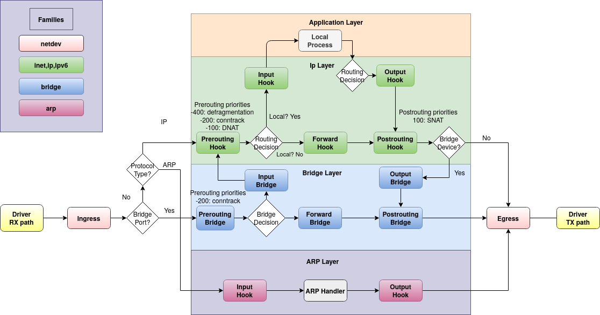

# Linux Bridge

A Linux bridge behaves like a network switch. It forwards packets based on a MAC address table, so it is a **layer 2** device.

A Linux bridge is a kernel module that behaves like a network switch, forwarding packets between the interfaces connected to it. It's typically used on routers, on gateways, or between VMs and network namespaces on a host. Linux bridging also supports **STP** and **VLANs** (see [VLAN](vlan.md)), and many software routers and switches are built on Linux.

A host can have many interfaces, each with its own IP — all belonging to the same host:

```text
Host has multiple interfaces:
- eth0      → 10.0.0.5        (real network)
- docker0   → 172.17.0.1      (container network)
- lo        → 127.0.0.1
```

For the kernel internals, see [Linux bridge internals](bridging.md).

The bridge is part of the kernel.



When a packet arrives from a network card (NIC) or a virtual machine, **the kernel receives it first**. It then looks at the configuration and says: "This interface is enslaved to a bridge, so I will process this packet using the bridge logic (layer 2) instead of the routing logic (layer 3)."

## Bridges are switches

- A network switch is basically a many-port bridge; a bridge is often a 2-port switch. Linux supports multiple interfaces in a bridge, making it a true switch — its switch ports are Linux network interfaces.
- A bridge passes packets **unaltered** from one interface to another, looking only at hardware addresses to decide where they go. So you can bridge traffic Linux doesn't understand, as long as it has a hardware address.
- If the destination MAC is the bridge device's own, the bridge passes the packet to the upper layer (see [MAC address lookup](#mac-address-lookup-l2-decision)).
- History: as of Linux 2.4.20, bridging and iptables didn't "see" each other without help — bridged packets from `eth0` to `eth1` didn't pass iptables, so no filtering, NAT or mangling. Fixed in 2.5.45+ (see `bridge-nf-call-iptables` below).
- Alternative to bridging two segments: turn on **proxy-ARP** on both interfaces — `echo 1 > /proc/sys/net/ipv4/conf/ethL/proxy_arp` and `echo 1 > /proc/sys/net/ipv4/conf/ethR/proxy_arp` (L and R = your left and right interfaces). See the [iproute2 docs](http://www.policyrouting.org/iproute2.doc.html).

## Bridge internals

From [Linux bridge, part 2 (hechao.li)](https://hechao.li/2018/01/31/linux-bridge-part2/):

- `port_list` is the list of ports a bridge has; each bridge can have at most `BR_MAX_PORTS` (1024). `dev` points to the `net_device` struct representing the bridge device.
- **Adding ports ("enslaving"):** `brctl addif br0 tap0` binds `tap0` to `br0`, making `tap0` a slave of `br0`. *Understanding Linux Network Internals* says a bridge must be bound to a "real device"; that's only partially true — it must be bound to a network interface, but not necessarily a physical NIC. Even a tap interface works.
- **Forwarding database (FDB):** stores MAC address → port mappings. It's a hash table (an array) of size `BR_HASH_SIZE` (256); each entry holds the head of a singly linked list (bucket) of entries whose MAC hashes there.
- **Lookup:** when the bridge needs the port for a MAC, it hashes the MAC with `br_mac_hash`, takes that bucket's list, and walks it comparing MAC addresses until it finds a match.

## Hands-on challenges

### Challenge 1: create a basic layer 2 bridge (switch)

```console
sudo -s
ip link add test-int-1 type dummy
ip link add test-int-2 type dummy
brctl addbr test-bridge
brctl addif test-bridge test-int-1 test-int-2
brctl show test-bridge
brctl showmacs test-bridge

ip link show

ip link set dev test-bridge up
ip link set dev test-int-1 up
ip link set dev test-int-2 up
```

### Challenge 2: layer 3 interface on the bridge (SVI)

Gives the bridge an IP so it can act as the default gateway (and NAT point) for containers:

```console
ip addr add 192.168.25.1/24 dev test-bridge
```

### Challenge 3: add veth interfaces to the bridge

> **Note:** this is in the default namespace — the same as using host networking with Docker (`docker run --name container --network=host`).

```console
ip link add veth-int1 type veth peer name veth-int1-br
ip link add veth-int2 type veth peer name veth-int2-br

ip link set veth-int1-br master test-bridge
ip link set veth-int2-br master test-bridge

ip link set up veth-int1
ip link set up veth-int2
ip link set up veth-int1-br
ip link set up veth-int2-br

ip addr add 192.168.25.10/24 dev veth-int1
ip addr add 192.168.25.11/24 dev veth-int2
```

Validation:

```console
root@linux-host-1:/home/nehali# brctl show test-bridge
bridge name     bridge id               STP enabled     interfaces
test-bridge             8000.1601e3095901       no              test-int-1
                                                        test-int-2
                                                        veth-int1-br
                                                        veth-int2-br
```

## Kernel hook architecture

When a packet enters a bridge port, the kernel's networking stack intercepts it. This is managed by the **netfilter** framework, which uses specific hooks to decide the packet's fate:

- **`NF_BR_PRE_ROUTING`:** the first stop for any incoming packet. The bridge checks the destination MAC address.
- **Forwarding:** if the destination MAC belongs to another device (like a VM), the packet stays in the bridge layer and is sent out the correct port via the Forwarding Database (FDB).
- **Local delivery:** if the destination MAC matches the bridge's own MAC, the packet is passed to the `NF_BR_LOCAL_IN` hook.

Once the bridge identifies a packet as "for me" (at the MAC level), it strips the Ethernet header and hands the remaining data (the IP packet) up to the IP stack — from the bridge's `NF_BR_LOCAL_IN` hook to the IP stack's `NF_INET_PRE_ROUTING` hook.

The IP stack then examines the destination IP (**local socket vs. routing**):

- If the IP matches the bridge's assigned IP, the packet is delivered to a local process (e.g. an SSH daemon or a web server).
- If the IP is for a different network, the host acts as a router, consulting its routing table to send the packet out a different interface (e.g. the physical NIC to the internet).

The `sk_buff` (socket buffer) is the "envelope" the kernel uses to carry data as it moves from bridge hooks to IP hooks.

### `net.bridge.bridge-nf-call-iptables = 1`

When enabled, even if a packet is just going from VM A to VM B (layer 2), the kernel pauses it and runs it through your iptables rules (layer 3).

## MAC address lookup (L2 decision)

The bridge checks its Forwarding Database (FDB):

```sh
bridge fdb show
```

**Destination MAC belongs to another bridge port:**

- The frame is forwarded to that port.
- The host IP stack is not involved.

**Destination MAC = the bridge's own MAC:**

- The frame is for the bridge itself.
- The bridge passes the packet up the host networking stack.

```sh
$ ip link show docker0
docker0: <BROADCAST,MULTICAST,UP,LOWER_UP>
    link/ether 02:42:ac:11:00:01
```

## What happens to an arriving frame

Destination MAC lookup:

1. **MAC not in the table (unknown unicast)** — the bridge **floods** the frame to all ports except the one it came in on. This is how initial ARP requests and unknown destinations behave.
2. **MAC known, associated with a port** — the bridge forwards the frame to that port (**bridges** the frame).
3. **MAC matches the bridge's own MAC** — the frame is **not** bridged; it's passed up to the host's IP stack, letting the host respond to ARP, ICMP (ping), TCP (SSH), etc.

> To **bridge** a frame means: it arrives on one interface (port), and the bridge forwards it out another port based on the destination MAC.

When `dst_mac` matches the bridge's (e.g. `br0`'s) MAC, the bridge recognizes the frame is addressed to the host itself, doesn't forward it to other ports, and delivers it to the host's network stack (an IP packet, ARP request, etc.).

A packet destined for the local computer according to the bridge (Ethernet layer) isn't necessarily destined for it according to the IP layer — that's how routing works: the MAC destination is the router, the IP destination is the box you actually want to reach.

### `eth0` as a bridge port

- The bridge's MAC is usually inherited from the first interface added (like `eth0`) — so `br0` and `eth0` share a MAC — but you can set it manually:

  ```sh
  ip link set dev br0 address 02:42:c0:a8:01:01
  ```

- When the NIC receives a frame on an enslaved `eth0`, the kernel redirects it into the bridge logic, which processes it at layer 2.
- An enslaved `eth0` loses its standalone interface status and acts like a physical port on a switch. `br0` becomes the interface the host uses at layer 3.

## Layer 2 filtering: ebtables → nftables

Without `ebtables` (or its modern successor `nftables`), a Linux bridge essentially reverts to being a standard, unmanaged layer 2 switch.

### ebtables tables

- `filter` — frame filtering.
- `nat` — MAC address rewriting.
- `broute` — deciding whether a frame should be routed or bridged.

The Linux bridging code defines six hooks; the `BROUTING` hook was added for ebtables. See [ebtables/iptables interaction](https://chunchaichang.blogspot.com/2011/01/ebtablesiptables-interaction-on-linux.html).

How frames flow in a bridged network — say `br0` has ports `eth0` and `veth0`:

1. A frame enters on `eth0`.
2. ebtables rules (e.g. `PREROUTING`) can inspect and filter it by source/destination MAC, EtherType, input port, etc.
3. If the bridge forwards it to another port (e.g. `veth0`), `FORWARD` chain rules apply.
4. The frame is sent out through `veth0`.

### Brouting

**Brouting** (bridge-routing) lets ebtables intercept frames **before** they're bridged and decide whether a frame should be bridged or passed up to the IP layer for routing.

Normally a frame received on a bridge port is either bridged to another port (known destination MAC) or flooded to all ports (unknown destination). Brouting rules divert selected frames away from bridging into routing, so the kernel processes them as IP packets.

```sh
# Route (don't bridge) IPv4 packets from a specific MAC address
# (in the broute table, DROP = "brout it")
ebtables -t broute -A BROUTING -p IPv4 -s 00:11:22:33:44:55 -j DROP

# Bridge all other frames
ebtables -t broute -A BROUTING -j RETURN
```

- Matching frames are not bridged, but routed; all others are bridged as usual.
- The `broute` table is consulted only **before** the frame enters the bridge forwarding logic, and only for **ingress** frames on bridge ports (not egress).
- A frame taken by the brouting chain is treated as if it came from a regular, non-bridged interface (routed by IP rules, processed by iptables, etc.).
- Brouting is **not** enabled by default: the bridge bridges all frames by MAC lookup and never sends bridged frames up to IP routing unless you explicitly tell it to with the `broute` table.

> In the `broute` table the targets are inverted: `DROP` **broutes** the frame (sends it up to the higher layers for routing), while `ACCEPT` lets it be bridged. (The original notes used `-j ACCEPT` to route, which would bridge it.)

#### Example: making a brouter

`br0` with ports `eth0` and `eth1`:

```sh
ifconfig br0 0.0.0.0
ifconfig eth0 172.16.1.1 netmask 255.255.255.0
ifconfig eth1 172.16.2.1 netmask 255.255.255.0
ebtables -t broute -A BROUTING -p ipv4 -i eth0 --ip-dst 172.16.1.1 -j DROP
ebtables -t broute -A BROUTING -p ipv4 -i eth1 --ip-dst 172.16.2.1 -j DROP
ebtables -t broute -A BROUTING -p arp -i eth0 -d $MAC_OF_ETH0 -j DROP
ebtables -t broute -A BROUTING -p arp -i eth1 -d $MAC_OF_ETH1 -j DROP
ebtables -t broute -A BROUTING -p arp -i eth0 --arp-ip-dst 172.16.1.1 -j DROP
ebtables -t broute -A BROUTING -p arp -i eth1 --arp-ip-dst 172.16.2.1 -j DROP
```

As the man page says, `DROP` in `BROUTING` broutes the frame: the bridge code won't touch it and it's sent up to the higher network layers, entering the box as if it arrived on the device itself rather than a bridge port.

#### Example: an OpenWrt brouter — bridge IPv6, route IPv4

```text
#	(Inside LAN)----->eth0.1 (br-lan) eth1----->(Outside LAN)
#						 (   brouter    )
```

On a router with `eth0.1` and `eth1`:

- **IPv6:** inside and outside LAN are one multicast domain — **bridged**.
- **IPv4:** inside and outside LAN are two broadcast domains — **routed** (via NAT).

```text
brctl: bridge br-lan: Device or resource busy
bridge name     bridge id               STP enabled     interfaces
br-lan          7fff.0024a5d73088       no              eth0.1
                                                        wlan0
                                                        eth1
Bridge table: filter

Bridge chain: INPUT, entries: 0, policy: ACCEPT

Bridge chain: FORWARD, entries: 0, policy: ACCEPT

Bridge chain: OUTPUT, entries: 0, policy: ACCEPT
--- Disable IPv6 RA on LAN
--- assigning IPv6 management address 2001:470:ebbd:0::11 to br-lan
--- configuring brouter to route everything but IPv6
Bridge table: broute

Bridge chain: BROUTING, entries: 1, policy: ACCEPT
-p ! IPv6 -i eth1 -j DROP 
--- pau
```

Adding an ip6tables firewall for the bridged IPv6 traffic (marking IPv6 frames from `eth1` and filtering them):

```text
bridge name     bridge id               STP enabled     interfaces
br-lan          7fff.0024a5d73088       no              eth0.1
                                                        wlan0
                                                        eth1
Bridge table: filter

Bridge chain: INPUT, entries: 0, policy: ACCEPT

Bridge chain: FORWARD, entries: 1, policy: ACCEPT
-p IPv6 -i eth1 -j mark --mark-set 0x10 --mark-target CONTINUE

Bridge chain: OUTPUT, entries: 0, policy: ACCEPT
--- Disable IPv6 RA on LAN
--- assigning IPv6 management address 2001:470:ebbd:0::11 to br-lan
--- configuring brouter to route everything but IPv6
Bridge table: broute

Bridge chain: BROUTING, entries: 1, policy: ACCEPT
-p ! IPv6 -i eth1 -j DROP 
--- ALLOW_SSH from eth1 via ip6tables, block all others
Chain forwarding_rule (1 references)
target     prot opt source               destination         
ACCEPT     tcp      anywhere             anywhere             mark match 0x10 tcp dpt:ssh
ACCEPT     ipv6-icmp    anywhere             anywhere             mark match 0x10
DROP       all      anywhere             anywhere             mark match 0x10
--- enable ip6tables firewall for v6Bridge
net.bridge.bridge-nf-call-ip6tables = 1
--- pau
```

### What you lose without it

The gateway still works perfectly, but you lose layer 2 control:

- You cannot block VM A from talking to VM B if they are on the same bridge.
- You cannot prevent **MAC spoofing** (a VM pretending to have a different hardware address).
- You cannot filter non-IP traffic (like PPPoE or specialized industrial protocols).

### Blocking a MAC address with nftables

Instead of the old ebtables syntax:

```sh
nft add table bridge my_bridge_filter
nft add chain bridge my_bridge_filter input { type filter hook input priority 0; }
nft add rule bridge my_bridge_filter input ether saddr 52:54:00:12:34:56 drop
```

Legacy ebtables had a major flaw: it was completely separate from the IP firewall. To block a user you had to write one rule in ebtables (to block their MAC) and another in iptables (to block their IP). nftables lets you write one rule that checks both at the same time, which is significantly faster for the CPU.
