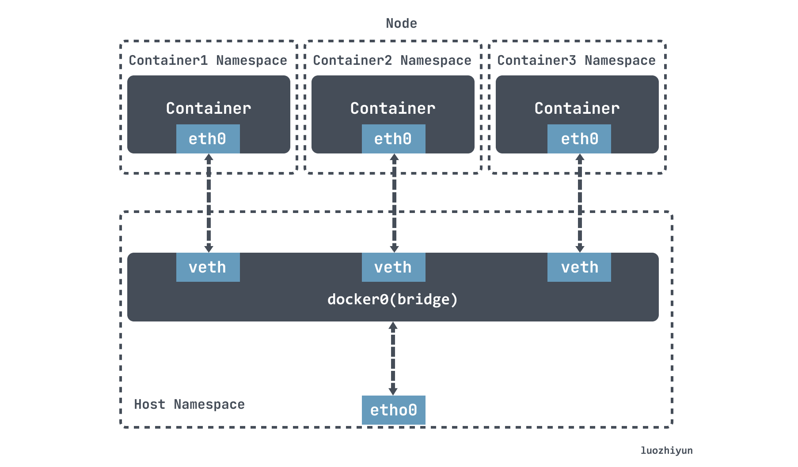

# Linux Network Namespaces

A Linux network namespace is logically another copy of the network stack, with its own routes, ARP table and firewall rules.

It is similar to **VRFs** in traditional networking. Creating namespaces (or VRFs) is foundational to container networking.

In the [Linux bridge](linux-bridge.md) notes there was only one namespace — the default namespace. Here we create namespaces other than the default one.

## Challenge 1: create network namespaces

```console
sudo -s
ip netns add red
ip netns add green
ip netns add blue

# Validation
ip netns ls

# View host networking
ip link
arp

# View namespace networking
ip netns exec red ip link
ip netns exec red arp
ip -n red link
```

Output — the host sees its real interfaces:

```console
root@linux-host-1:/home/nehali# ip link
1: lo: <LOOPBACK,UP,LOWER_UP> mtu 65536 qdisc noqueue state UNKNOWN mode DEFAULT group default qlen 1000
    link/loopback 00:00:00:00:00:00 brd 00:00:00:00:00:00
2: eth0: <BROADCAST,MULTICAST,UP,LOWER_UP> mtu 1500 qdisc mq state UP mode DEFAULT group default qlen 1000
    link/ether 00:0d:3a:1f:31:53 brd ff:ff:ff:ff:ff:ff
3: enP30916s1: <BROADCAST,MULTICAST,SLAVE,UP,LOWER_UP> mtu 1500 qdisc mq master eth0 state UP mode DEFAULT group default qlen 1000
    link/ether 00:0d:3a:1f:31:53 brd ff:ff:ff:ff:ff:ff
    altname enP30916p0s2
root@linux-host-1:/home/nehali# arp
Address HWtype HWaddress Flags Mask Iface
_gateway ether 12:34:56:78:9a:bc C
```

…while a fresh namespace has only a loopback (down) and an empty ARP table:

```console
root@linux-host-1:/home/nehali# ip netns exec red ip link
1: lo: <LOOPBACK> mtu 65536 qdisc noop state DOWN mode DEFAULT group default qlen 1000
    link/loopback 00:00:00:00:00:00 brd 00:00:00:00:00:00
root@linux-host-1:/home/nehali# ip netns exec red arp
```

## Challenge 2: create a bridge (switch) and connect veth pairs (cables)

veth interfaces are virtual Ethernet devices and are always created in pairs.

```console
# Create the Linux bridge (network switch)
ip link add linux-bridge type bridge
ip link set dev linux-bridge up

# Connect each namespace to the bridge with a veth pair (cable)
ip link add veth-red type veth peer name veth-red-br
ip link add veth-green type veth peer name veth-green-br

# Move one end into the corresponding namespace
ip link set veth-red netns red
ip link set veth-green netns green

# Attach the other end to the bridge
ip link set veth-red-br master linux-bridge
ip link set veth-green-br master linux-bridge

ip link set veth-red-br up
ip link set veth-green-br up

# Bridge validation
brctl show
```

Output after creating the bridge:

```console
root@linux-host-1:/home/nehali# ip link add linux-bridge type bridge
root@linux-host-1:/home/nehali# ip link
1: lo: <LOOPBACK,UP,LOWER_UP> mtu 65536 qdisc noqueue state UNKNOWN mode DEFAULT group default qlen 1000
    link/loopback 00:00:00:00:00:00 brd 00:00:00:00:00:00
2: eth0: <BROADCAST,MULTICAST,UP,LOWER_UP> mtu 1500 qdisc mq state UP mode DEFAULT group default qlen 1000
    link/ether 00:0d:3a:1f:31:53 brd ff:ff:ff:ff:ff:ff
3: enP30916s1: <BROADCAST,MULTICAST,SLAVE,UP,LOWER_UP> mtu 1500 qdisc mq master eth0 state UP mode DEFAULT group default qlen 1000
    link/ether 00:0d:3a:1f:31:53 brd ff:ff:ff:ff:ff:ff
    altname enP30916p0s2
4: linux-bridge: <BROADCAST,MULTICAST> mtu 1500 qdisc noop state DOWN mode DEFAULT group default qlen 1000
    link/ether c2:b7:68:b1:a1:f9 brd ff:ff:ff:ff:ff:ff
```

Output after wiring the veth pairs:

```console
root@linux-host-1:/home/nehali# brctl showmacs linux-bridge
port no mac addr                is local?       ageing timer
  1     4e:36:05:c3:04:62       no                96.58
  1     52:48:30:10:51:28       yes                0.00
  1     52:48:30:10:51:28       yes                0.00
  2     56:a8:2f:22:e6:b5       no               126.02
  2     8e:34:2d:f7:74:34       yes                0.00
  2     8e:34:2d:f7:74:34       yes                0.00
root@linux-host-1:/home/nehali# ip netns exec red ip link
1: lo: <LOOPBACK> mtu 65536 qdisc noop state DOWN mode DEFAULT group default qlen 1000
    link/loopback 00:00:00:00:00:00 brd 00:00:00:00:00:00
8: veth-red@if7: <BROADCAST,MULTICAST,UP,LOWER_UP> mtu 1500 qdisc noqueue state UP mode DEFAULT group default qlen 1000
    link/ether 56:a8:2f:22:e6:b5 brd ff:ff:ff:ff:ff:ff link-netnsid 0
root@linux-host-1:/home/nehali# ip netns exec green ip link
1: lo: <LOOPBACK> mtu 65536 qdisc noop state DOWN mode DEFAULT group default qlen 1000
    link/loopback 00:00:00:00:00:00 brd 00:00:00:00:00:00
10: veth-green@if9: <BROADCAST,MULTICAST,UP,LOWER_UP> mtu 1500 qdisc noqueue state UP mode DEFAULT group default qlen 1000
    link/ether 4e:36:05:c3:04:62 brd ff:ff:ff:ff:ff:ff link-netnsid 0
```

## Challenge 3: layer 3 connectivity

Assign IP addresses to the interfaces:

```console
ip -n red addr add 192.168.24.10/24 dev veth-red
ip -n green addr add 192.168.24.11/24 dev veth-green
ip -n red link set veth-red up
ip -n green link set veth-green up
ip netns exec red ip addr
ip netns exec green ip addr

ip netns exec red ping 192.168.24.11
```

Output:

```console
root@linux-host-1:/home/nehali# ip netns exec red ping 192.168.24.11
PING 192.168.24.11 (192.168.24.11) 56(84) bytes of data.
64 bytes from 192.168.24.11: icmp_seq=1 ttl=64 time=0.048 ms
64 bytes from 192.168.24.11: icmp_seq=2 ttl=64 time=0.051 ms
^C
--- 192.168.24.11 ping statistics ---
2 packets transmitted, 2 received, 0% packet loss, time 1032ms
rtt min/avg/max/mdev = 0.048/0.049/0.051/0.001 ms
root@linux-host-1:/home/nehali# ip netns exec red arp
Address                  HWtype  HWaddress           Flags Mask            Iface
192.168.24.11            ether   4e:36:05:c3:04:62   C                     veth-red
```

## Challenge 4: default gateway (outbound connectivity)

```console
# Give the bridge an IP: it becomes the namespaces' gateway
ip addr add 192.168.24.1/24 dev linux-bridge

# Default route inside the namespace
ip netns exec red ip route add 0.0.0.0/0 via 192.168.24.1
ip netns exec red ip route show

# NAT the namespace subnet out of the host, and enable forwarding
iptables -t nat -A POSTROUTING -s 192.168.24.0/24 -j MASQUERADE
echo 1 > /proc/sys/net/ipv4/ip_forward
```

Output:

```console
root@linux-host-1:/home/nehali# ip add add 192.168.24.1/24 dev linux-bridge
root@linux-host-1:/home/nehali# ping 192.168.24.10
PING 192.168.24.10 (192.168.24.10) 56(84) bytes of data.
64 bytes from 192.168.24.10: icmp_seq=1 ttl=64 time=0.077 ms
64 bytes from 192.168.24.10: icmp_seq=2 ttl=64 time=0.051 ms

root@linux-host-1:/home/nehali# echo 1 > /proc/sys/net/ipv4/ip_forward
root@linux-host-1:/home/nehali# ip netns exec red ping 8.8.8.8
PING 8.8.8.8 (8.8.8.8) 56(84) bytes of data.
64 bytes from 8.8.8.8: icmp_seq=1 ttl=55 time=1.57 ms
64 bytes from 8.8.8.8: icmp_seq=2 ttl=55 time=1.54 ms
64 bytes from 8.8.8.8: icmp_seq=3 ttl=55 time=1.54 ms
```

## Challenge 5: inbound connectivity (port forwarding)

```console
iptables -t nat -A PREROUTING -p tcp --dport 8080 -j DNAT --to-destination 192.168.24.10:80

# From outside
curl <public_ip>:8080
```

## Lab 2: two namespaces on a bridge (`172.18.0.0/16`)

### veth pairs

A **veth** pair is two virtual Ethernet devices directly connected to each other — a point-to-point link between two virtual interfaces. Network namespaces give a host multiple isolated network stacks; veth pairs connect those stacks so they can communicate.



In Docker, after one end of the veth is moved into the container's network namespace, it is renamed to `eth…`.

```sh
sudo ip link add <veth-name> type veth peer name <veth-peer-name>
```

### The bridge

A bridge is a layer 2 virtual device that "connects" several interfaces and forwards frames between them based on MAC address. It is **self-learning**: it learns source MACs, so it only forwards to the specific interface needed, avoiding unnecessary traffic. For a MAC it has never learned, it can't know the right interface, so it floods the frame to all interfaces except the one it came from.

After bridging, containers on the **same** host can communicate; containers on **different** hosts can't yet (that needs routing or an overlay — see [VXLAN](vxlan.md)).

The **FDB** (Forwarding Database) is the bridge's table mapping MAC addresses to ports:

```text
c6:9c:e9:44:e9:a4 dev veth1a master br0
```

`c6:9c:e9:44:e9:a4` is the MAC of the device (container); any packet destined for that MAC is forwarded to `veth1a`.

```text
+------------------------+    +------------------------+
|      Container 1       |    |      Container 2       |
|  veth1c (192.168.1.2)  |    |  veth2c (192.168.1.3)  |
+------------------------+    +------------------------+
             |                             |
             |                             |
+------------------------+    +------------------------+
|         veth1          |    |         veth2          |
+------------------------+    +------------------------+
               \                         /
                  \                   /
                     \             /
                        \       /
                         +-----+
                         | br0 |  (Linux Bridge)
                         +-----+
```

### Setup

```sh
# Create two network namespaces
ip netns add netns0
ip netns add netns1

# Create veth pairs
ip link add veth0 type veth peer name ceth0
ip link add veth1 type veth peer name ceth1

# Assign veth ends to network namespaces
ip link set ceth0 netns netns0
ip link set ceth1 netns netns1

# Set veth ends up in the root namespace
ip link set veth0 up
ip link set veth1 up

# Create and bring up the bridge
ip link add br0 type bridge
ip link set br0 up

# Attach veth ends to the bridge
ip link set veth0 master br0
ip link set veth1 master br0

# ip a
# 12: veth0@if11: <NO-CARRIER,BROADCAST,MULTICAST,UP> mtu 1500 qdisc noqueue master br0 state LOWERLAYERDOWN group default qlen 1000
#     link/ether 22:6f:fc:57:41:a9 brd ff:ff:ff:ff:ff:ff link-netns netns0
# 14: veth1@if13: <NO-CARRIER,BROADCAST,MULTICAST,UP> mtu 1500 qdisc noqueue master br0 state LOWERLAYERDOWN group default qlen 1000
#     link/ether f6:15:11:b6:94:ac brd ff:ff:ff:ff:ff:ff link-netns netns1
# 15: br0: <NO-CARRIER,BROADCAST,MULTICAST,UP> mtu 1500 qdisc noqueue state DOWN group default qlen 1000
#     link/ether 22:6f:fc:57:41:a9 brd ff:ff:ff:ff:ff:ff
#     inet6 fe80::4483:20ff:fefe:c182/64 scope link proto kernel_ll 
#        valid_lft forever preferred_lft forever

# Assign IP addresses to interfaces in netns0
ip netns exec netns0 ip addr add 172.18.0.10/16 dev ceth0
ip netns exec netns0 ip link set ceth0 up
ip netns exec netns0 ip link set lo up

# Assign IP addresses to interfaces in netns1
ip netns exec netns1 ip addr add 172.18.0.20/16 dev ceth1
ip netns exec netns1 ip link set ceth1 up
ip netns exec netns1 ip link set lo up

# Assign IP address to the bridge in root namespace
#To establish the connectivity between the root and container namespaces, we need to assign the IP address to the bridge network interface:
ip addr add 172.18.0.1/16 dev br0

# Ping from netns0 to netns1
ip netns exec netns0 ping -c 3 172.18.0.20

# / # ip netns exec netns0 ping -c 3 172.18.0.20
# PING 172.18.0.20 (172.18.0.20): 56 data bytes
# 64 bytes from 172.18.0.20: seq=0 ttl=64 time=2.992 ms
# 64 bytes from 172.18.0.20: seq=1 ttl=64 time=0.248 ms
# 64 bytes from 172.18.0.20: seq=2 ttl=64 time=0.175 ms

# --- 172.18.0.20 ping statistics ---
# 3 packets transmitted, 3 packets received, 0% packet loss
# round-trip min/avg/max = 0.175/1.138/2.992 ms

# Ping from netns1 to netns0
ip netns exec netns1 ping -c 3 172.18.0.10

```

### Inspecting the bridge

```console
brctl show br0
bridge name	bridge id		STP enabled	interfaces
br0		8000.566bed43389a	    no		        veth1
							                    veth0
```

```console
brctl showmacs br0
port no	mac addr		is local?	ageing timer
  2	52:ff:6f:94:39:77	no		 209.55 # learned=no
  1	56:6b:ed:43:38:9a	yes		   0.00
  1	56:6b:ed:43:38:9a	yes		   0.00 # veth0
  2	a2:41:16:29:98:40	yes		   0.00 # veth1
  2	a2:41:16:29:98:40	yes		   0.00
  1	e6:89:fa:cb:2b:a2	no		 176.79 # learned
```

In `showmacs`, `is local? = yes` entries are the bridge's own ports (`veth0`, `veth1`); `no` entries were learned from traffic.

```console
ip netns exec netns1 ip a
13: ceth1@if14: <BROADCAST,MULTICAST,UP,LOWER_UP> mtu 1500 qdisc noqueue state UP group default qlen 1000
    link/ether 6e:c8:4c:b3:aa:ed brd ff:ff:ff:ff:ff:ff link-netnsid 0
    inet 172.18.0.20/16 scope global ceth1
       valid_lft forever preferred_lft forever
    inet6 fe80::6cc8:4cff:feb3:aaed/64 scope link proto kernel_ll 
       valid_lft forever preferred_lft forever

ip netns exec netns0 ip a
11: ceth0@if12: <BROADCAST,MULTICAST,UP,LOWER_UP> mtu 1500 qdisc noqueue state UP group default qlen 1000
    link/ether ea:40:53:7a:8f:98 brd ff:ff:ff:ff:ff:ff link-netnsid 0
    inet 172.18.0.10/16 scope global ceth0
       valid_lft forever preferred_lft forever
    inet6 fe80::e840:53ff:fe7a:8f98/64 scope link proto kernel_ll 
       valid_lft forever preferred_lft forever
```

### Routing inside the namespace

From [Cloud-native virtual networking (sobyte)](https://www.sobyte.net/post/2022-07/cloud-native-virtual-networking/).

```console
ip netns exec netns0 route -n
Kernel IP routing table
Destination     Gateway         Genmask         Flags Metric Ref    Use Iface
0.0.0.0         172.18.0.1      0.0.0.0         UG    0      0        0 ceth0
172.18.0.0      0.0.0.0         255.255.0.0     U     0      0        0 ceth0
```

- For destinations **outside** this network, the namespace uses `172.18.0.1` (the bridge): it first ARPs for the bridge's MAC, then sends the frame to that MAC.
- For destinations **within** the network, it sends unicast if it already knows the destination's MAC (otherwise it ARPs first, by broadcast).

The same with `iproute2` (`ip route`):

```text
default via 172.18.0.1 dev ceth0
172.18.0.0/16 dev ceth0 proto kernel scope link src 172.18.0.2
```

## Cleanup

`veth-red` and `veth-green` live inside their namespaces, so delete them from there (deleting either end of a veth pair removes both):

```console
ip -n red link delete veth-red
ip -n green link delete veth-green
```
