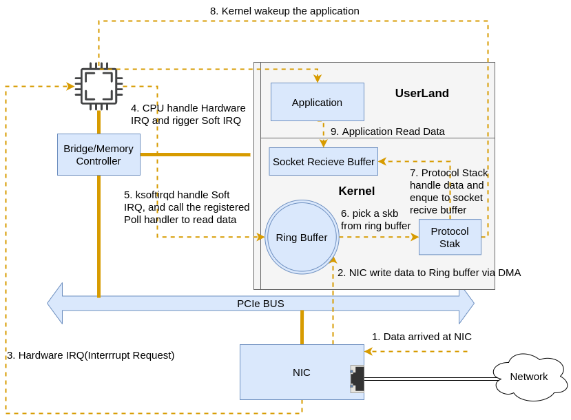
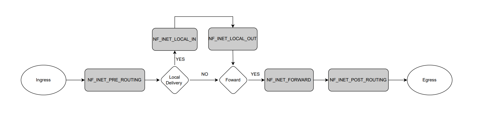
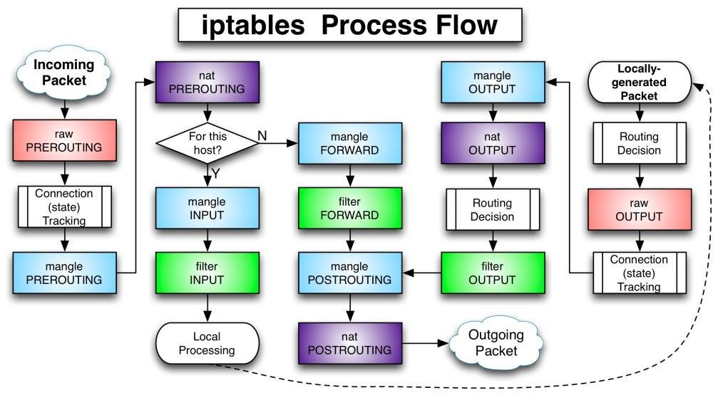
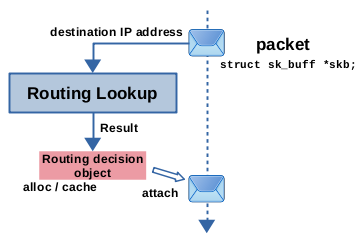

# Routing and the IPv4 Packet Path

How a packet moves through the Linux kernel's IPv4 stack and netfilter, from the wire to a local process, through forwarding, and back out.

See also: [iptables](iptables.md), [conntrack](conntrack.md), [Linux bridge internals](bridging.md), [IP addressing](ip-addressing.md).

## From the wire to the socket



The high-level path a packet takes from arrival to the socket receive buffer:

1. The driver is loaded and initialized.
2. A packet arrives at the NIC from the network.
3. The packet is copied (via DMA) to a **ring buffer** in kernel memory.
4. A hardware interrupt tells the system a packet is in memory.
5. The driver calls into **NAPI** to start a poll loop if one isn't running already (`napi_schedule` or other NAPI APIs).
6. `ksoftirqd` processes (one per CPU, registered at boot) pull packets off the ring buffer by calling the NAPI poll function the driver registered during initialization.
7. Ring buffer memory regions that had network data written to them are unmapped.
8. The DMA'd data is passed up the networking layer as an `skb` for more processing.
9. Frames are distributed across CPUs if Receive Packet Steering (RPS) is enabled or the NIC has multiple receive queues.
10. Frames are handed to the protocol layers from the queues.
11. Protocol layers process the data.
12. Data is added to the receive buffers of the sockets.

## Netfilter hook points

There are five predefined netfilter hook points (from [Linux kernel IP stack (Aalto)](https://wiki.aalto.fi/download/attachments/70789059/linux-kernel-ip.pdf)):

- `NF_IP_PRE_ROUTING` — triggered by any incoming traffic very soon after it enters the network stack, **before** any routing decision (is this packet for another interface, or a local process?). The routing code may drop unroutable packets.
- `NF_IP_LOCAL_IN` — after an incoming packet has been routed and is destined for the **local** system.
- `NF_IP_FORWARD` — after an incoming packet has been routed and is to be **forwarded** to another host.
- `NF_IP_LOCAL_OUT` — any **locally created** outbound traffic, as soon as it hits the network stack.
- `NF_IP_POST_ROUTING` — any outgoing or forwarded traffic **after** routing, just before it's put on the wire.



The kernel's hook enums (IPv4/inet, netdev, and bridge families):

```c
enum nf_inet_hooks {
    NF_INET_PRE_ROUTING,   // 0
    NF_INET_LOCAL_IN,      // 1
    NF_INET_FORWARD,       // 2
    NF_INET_LOCAL_OUT,     // 3
    NF_INET_POST_ROUTING,  // 4
    NF_INET_NUMHOOKS,      // 5 (count)
    NF_INET_INGRESS = NF_INET_NUMHOOKS, // 5: new hook
};

enum nf_dev_hooks {
	NF_NETDEV_INGRESS,
	NF_NETDEV_EGRESS,
	NF_NETDEV_NUMHOOKS
}

/* Bridge Hooks */
/* After promisc drops, checksum checks. */
#define NF_BR_PRE_ROUTING	0
/* If the packet is destined for this box. */
#define NF_BR_LOCAL_IN		1
/* If the packet is destined for another interface. */
#define NF_BR_FORWARD		2
/* Packets coming from a local process. */
#define NF_BR_LOCAL_OUT		3
/* Packets about to hit the wire. */
#define NF_BR_POST_ROUTING	4
/* Not really a hook, but used for the ebtables broute table */
#define NF_BR_BROUTING		5
#define NF_BR_NUMHOOKS		6

enum nf_br_hook_priorities {
	NF_BR_PRI_FIRST = INT_MIN,
	NF_BR_PRI_NAT_DST_BRIDGED = -300,
	NF_BR_PRI_FILTER_BRIDGED = -200,
	NF_BR_PRI_BRNF = 0,
	NF_BR_PRI_NAT_DST_OTHER = 100,
	NF_BR_PRI_FILTER_OTHER = 200,
	NF_BR_PRI_NAT_SRC = 300,
	NF_BR_PRI_LAST = INT_MAX,
};
```

For a packet destined for the **local** machine, only two netfilter hooks are on its path: `PREROUTING` and `INPUT` (`LOCAL_IN`).



### nftables' sixth hook: `ingress`

`nftables` adds a hook called `ingress` that is very important for modern performance. With `iptables`, the earliest you can touch a packet is `PREROUTING`; `ingress` runs even earlier — immediately after the network driver passes the packet to the kernel.

- It is much faster for **dropping** traffic (e.g. a DDoS): it happens before conntrack starts, so the CPU wastes no effort tracking a packet you're about to throw away.
- It is tied to a specific network interface (e.g. `eth0`).

## Packet paths through the iptables tables

### Incoming packet to a local process

1. The packet first hits the `PREROUTING` chain of the `mangle` table — typically used to change header values before the rest of the chains.
2. The `PREROUTING` chain of the `nat` table performs destination NAT (`DNAT`), converting the destination IP to a private IP for further routing.
3. The kernel makes a **routing decision**: forward to another host (the forward path), or deliver to a local process.
4. For local delivery, the packet goes to the `INPUT` chain of the `mangle` table (mangling for locally destined packets).
5. Then the `INPUT` chain of the `filter` table — where the drop/reject rules live. A packet that survives reaches the local process.

### Outgoing packet from a local process

*(No notes yet.)* Path per the hooks above: `OUTPUT` (raw → mangle → nat → filter) → routing decision → `POSTROUTING` (mangle → nat).

### Forwarded packets

1. Same first leg as incoming: `PREROUTING` of `mangle` and `nat`, then the routing decision.
2. Packets to be forwarded hit the `FORWARD` chain of the `mangle` table (mangling specifically for forwarded packets).
3. Then the `FORWARD` chain of the `filter` table, where unwanted packets on the forward path are dropped or rejected.
4. Survivors go through the `POSTROUTING` chain of `mangle` and then `nat`. `nat POSTROUTING` performs `SNAT`, converting a private source IP to a public one:
   - **SNAT** — for a static (permanent) IP on the outgoing interface:

     ```sh
     iptables -t nat -A POSTROUTING -o eth0 -j SNAT --to-source 1.2.3.4
     ```

   - **MASQUERADE** — a specialized SNAT for dynamic IPs (DHCP, dial-up modem):

     ```sh
     iptables -t nat -A POSTROUTING -o eth0 -j MASQUERADE
     ```

### Example: rules in every table

Assumes shell variables `LAN_NET`, `EXT_IF`, `BACKEND` and `LOCAL_PROXY_PORT` are set.

```sh
# -------------------------
# RAW table (PREROUTING / OUTPUT)
# -------------------------
# Example: skip conntrack for a specific subprotocol or flow if needed.
# Here we *do not* actually NOTRACK anything critical; just an example entry.
iptables -t raw -A PREROUTING -p icmp -j NOTRACK
iptables -t raw -A OUTPUT -p icmp -j NOTRACK

# -------------------------
# MANGLE table (PREROUTING / FORWARD / OUTPUT / POSTROUTING / INPUT)
# -------------------------
# Mark incoming packets from LAN for policy routing or QoS:
iptables -t mangle -A PREROUTING -s ${LAN_NET} -j MARK --set-mark 0x1

# Set TTL for forwarded packets (example):
iptables -t mangle -A FORWARD -p tcp -m state --state NEW -j TTL --ttl-set 64

# Mark locally generated HTTP connections for special handling:
iptables -t mangle -A OUTPUT -p tcp --dport 80 -m owner --uid-owner 1000 -j MARK --set-mark 0x2

# TOS tweak before leaving:
iptables -t mangle -A POSTROUTING -o ${EXT_IF} -p tcp --dport 80 -j TOS --set-tos 0x10

# -------------------------
# NAT table (PREROUTING / OUTPUT / POSTROUTING)
# -------------------------
# DNAT: Port-forward WAN:80 -> internal backend:80 (PREROUTING)
iptables -t nat -A PREROUTING -i ${EXT_IF} -p tcp --dport 80 -j DNAT --to-destination ${BACKEND}:80

# OUTPUT DNAT: locally generated traffic to example.com:80 -> redirect to local proxy:3128
# Note: matching by hostname is resolved at rule add time; better to match by IP or port
iptables -t nat -A OUTPUT -p tcp --dport 80 -m owner ! --uid-owner 0 -j REDIRECT --to-ports ${LOCAL_PROXY_PORT}

# SNAT / MASQUERADE for LAN -> Internet (POSTROUTING)
iptables -t nat -A POSTROUTING -o ${EXT_IF} -s ${LAN_NET} -j MASQUERADE

# -------------------------
# FILTER table (INPUT / FORWARD / OUTPUT)
# -------------------------
# Accept established/related everywhere (common first rules)
iptables -A INPUT -m state --state ESTABLISHED,RELATED -j ACCEPT
iptables -A FORWARD -m state --state ESTABLISHED,RELATED -j ACCEPT
iptables -A OUTPUT -m state --state ESTABLISHED,RELATED -j ACCEPT

# Allow local loopback fully
iptables -A INPUT -i lo -j ACCEPT
iptables -A OUTPUT -o lo -j ACCEPT

# Allow incoming SSH (already inserted for safety, but good to keep)
iptables -A INPUT -p tcp --dport 22 -m state --state NEW -j ACCEPT

# Allow traffic to locally hosted services (if DNAT to local host happens)
iptables -A INPUT -p tcp -d 127.0.0.1 --dport ${LOCAL_PROXY_PORT} -j ACCEPT

# Allow forwarding to the internal backend from the WAN (needed for DNAT)
iptables -A FORWARD -d ${BACKEND} -p tcp --dport 80 -m state --state NEW,ESTABLISHED -j ACCEPT
iptables -A FORWARD -s ${BACKEND} -m state --state ESTABLISHED -j ACCEPT

# Example OUTPUT filters: block local processes from connecting to a blacklist IP
BLACKLIST_IP="203.0.113.9"
iptables -A OUTPUT -d ${BLACKLIST_IP} -j REJECT
```

## The IPv4 receive path in the kernel

In the kernel, a packet is stored in a data structure called an **`sk_buff`** (socket buffer). While the packet is in the bridge code, the kernel only reads the Ethernet-header part of it. When the bridge decides a packet is for the host, it calls `ip_rcv` (see [bridging](bridging.md#passing-frames-up-to-the-host-stack)).

### `ip_rcv()` — entry point

```c
/*
 * IP receive entry point
 */
int ip_rcv(struct sk_buff *skb, struct net_device *dev, struct packet_type *pt,
	   struct net_device *orig_dev)
{
	struct net *net = dev_net(dev);

	skb = ip_rcv_core(skb, net);
	if (skb == NULL)
		return NET_RX_DROP;

	return NF_HOOK(NFPROTO_IPV4, NF_INET_PRE_ROUTING,
		       net, NULL, skb, dev, NULL,
		       ip_rcv_finish);// ip_rcv_finish
}
```

It immediately passes the packet through the `PRE_ROUTING` hook. This is where `iptables` or `nftables` (NAT/mangle) get to look at the packet before the kernel even decides where it's going.

### `ip_rcv_finish()` — the routing decision

```c

static int ip_rcv_finish(struct net *net, struct sock *sk, struct sk_buff *skb)
{
	struct net_device *dev = skb->dev;
	int ret;

	/* if ingress device is enslaved to an L3 master device pass the
	 * skb to its handler for processing
	 */
	skb = l3mdev_ip_rcv(skb);
	if (!skb)
		return NET_RX_SUCCESS;

	ret = ip_rcv_finish_core(net, skb, dev, NULL);
	if (ret != NET_RX_DROP)
		ret = dst_input(skb);
	return ret;
}
```

Inside `ip_rcv_finish_core`, `ip_route_input_noref` is the call to the routing table:

- If the destination IP (`daddr`) is the bridge's (host's) own IP, the packet is marked for **local delivery**.
- If `daddr` is an external address (like `8.8.8.8`), it's marked for **forwarding**.

The routing lookup runs for frames received from the network once they're identified as IP packets, reach the network layer, and pass the netfilter `PREROUTING` hook. It decides whether a packet is handed to the transport layer (received by a local socket) or forwarded and sent out again. It also runs for locally generated packets from the transport layer, to find a route out. For forwarded and locally generated packets, the lookup determines the **output interface** and the **next-hop gateway IP**, if any.

How is the decision applied? It is **attached to the packet**: the lookup allocates (or takes from cache) a routing-decision object containing the output interface and next-hop gateway, and attaches it to the socket buffer (`skb`) representing the packet:



Further reading: [Routing decisions in the Linux kernel, part 1: lookup and packet flow](https://thermalcircle.de/doku.php?id=blog:linux:routing_decisions_in_the_linux_kernel_1_lookup_packet_flow)

### `ip_local_deliver()` — to the local process

```c
/*
 * 	Deliver IP Packets to the higher protocol layers.
 */
int ip_local_deliver(struct sk_buff *skb)
{
	/*
	 *	Reassemble IP fragments.
	 */
	struct net *net = dev_net(skb->dev);

	if (ip_is_fragment(ip_hdr(skb))) {
		if (ip_defrag(net, skb, IP_DEFRAG_LOCAL_DELIVER))
			return 0;
	}

	return NF_HOOK(NFPROTO_IPV4, NF_INET_LOCAL_IN,
		       net, NULL, skb, skb->dev, NULL,
		       ip_local_deliver_finish);
}
```

## Forwarding: `ip_forward()`

Key steps in `ip_forward.c` (full source in the appendix):

**TTL decrement** — classic router behavior. Each time a packet hops through a gateway its Time-to-Live is decreased; at zero, the host kills the packet and sends an ICMP "Time Exceeded" back to the sender (e.g. a VM):

```c
if (ip_hdr(skb)->ttl <= 1)
    goto too_many_hops;
...
ip_decrease_ttl(iph);
```

**MTU check** — is the packet too big for the next link (e.g. your physical fiber line)? If so and it may not be fragmented, the gateway tells the sender to try again with smaller packets:

```c
if (ip_exceeds_mtu(skb, mtu)) {
    ...
    icmp_send(skb, ICMP_DEST_UNREACH, ICMP_FRAG_NEEDED, ...);
}
```

**The `FORWARD` hook:**

```c
NF_HOOK(NFPROTO_IPV4, NF_INET_FORWARD,
		       net, NULL, skb, skb->dev, rt->dst.dev,
		       ip_forward_finish);
```

This is where a rule like `iptables -A FORWARD -s 192.168.1.50 -j DROP` applies: `NF_HOOK` jumps to it, sees the `DROP` verdict, and `ip_forward_finish` is never called.

## Output: `ip_output()`

```c
int ip_output(struct net *net, struct sock *sk, struct sk_buff *skb)
{
	struct net_device *dev, *indev = skb->dev;
	int ret_val;

	rcu_read_lock();
	dev = skb_dst_dev_rcu(skb);
	skb->dev = dev;
	skb->protocol = htons(ETH_P_IP);

	ret_val = NF_HOOK_COND(NFPROTO_IPV4, NF_INET_POST_ROUTING,
				net, sk, skb, indev, dev,
				ip_finish_output,
				!(IPCB(skb)->flags & IPSKB_REROUTED));
	rcu_read_unlock();
	return ret_val;
}
```

## Layer 3 master device (L3MDEV)

Its primary purpose is to support **Virtual Routing and Forwarding (VRF)**. In `ip_rcv_finish()` above, if the ingress device is enslaved to an L3 master device, the skb is passed to that device's handler (`l3mdev_ip_rcv`).

## Routes, next hops and ARP

### Directly connected routes

```text
192.168.1.0/24 dev br0 proto kernel scope link src 192.168.1.1
```

- `192.168.1.1` belongs to this device. Under normal circumstances (`proto kernel`), the kernel only creates this route when you assign an IP address to an interface.
- Any IP in this range is directly connected to `br0`. To send to `192.168.1.5`, the kernel:
  1. sees `192.168.1.5` matches `192.168.1.0/24`;
  2. reads `src` and puts `192.168.1.1` in the packet's source IP field, so the receiver knows where to reply;
  3. sends the packet out of `br0`.
- A **direct connection** ("directly connected route", link scope) means a device can reach another using only its MAC address, without a gateway.
- For a `scope link` route (e.g. `10.0.0.2 dev tun0 proto kernel scope link src 10.0.0.1`), the kernel calls the neighbor subsystem (ARP for IPv4) — see `ip neigh show`:

  ```text
  192.168.1.10 dev br0 lladdr 52:54:00:12:34:56 REACHABLE
  ```

- An ARP **request** is usually sent to `ff:ff:ff:ff:ff:ff` (broadcast); the ARP **reply** is almost always unicast.
- `192.168.1.0/24 dev eth0.10` — the kernel adds VLAN tag 10 to the Ethernet header and sends it out the physical `eth0` (see [VLAN](vlan.md)).

### Reading a routing table

```text
Destination         Gateway         Interface
0.0.0.0/0           192.168.1.1     eth0         ← default route (used if nothing else matches)
10.0.0.0/24         0.0.0.0         eth1         ← direct delivery on eth1
192.168.1.0/24      0.0.0.0         eth0         ← direct delivery on eth0
```

On a Windows laptop with a VPN:

```text
Network Destination       Netmask          Gateway         Interface
0.0.0.0                   0.0.0.0          192.168.8.1     192.168.8.144
192.168.8.144             255.255.255.255   on-link        192.168.8.144
192.168.8.255             255.255.255.255   on-link        192.168.8.144
192.168.8.1               255.255.255.255   on-link        192.168.8.144
192.168.8.0               255.255.255.0     some-ip        some-other-ip
```

- Any packet for a network not listed goes to the gateway `192.168.8.1` via the interface `192.168.8.144`.
- A netmask of `255.255.255.255` targets a single IP address.
- **on-link** means the destination is directly reachable without a gateway; the packet is sent directly out the `192.168.8.144` interface.

### Default route and `via`

```text
default via 203.0.113.1 dev eth1
```

Anything else (like `8.8.8.8`) goes out the physical internet interface `eth1`.

```text
10.0.0.2 via 192.168.1.254 dev eth0
```

1. The kernel looks up the MAC of the gateway (`192.168.1.254`) using ARP on `eth0`.
2. It puts the gateway's MAC as the destination on the Ethernet frame.
3. It keeps `10.0.0.2` as the destination IP.

The packet leaves `eth0`, hits the router, which looks at the IP and decides where to send it next. When a router forwards data to a new network it builds a brand-new frame: the source MAC becomes the MAC of the router's outgoing port.

To use `via`, the device at that IP must be layer 3 aware (a router, firewall, or another computer) with IP forwarding enabled.

### Proxy ARP

A device (usually a router or host) answers an ARP request for an IP it doesn't actually own. Normally a device only replies if the target IP is its own; with proxy ARP enabled:

1. **The request:** VM1 asks "Who has `1.1.1.1`?" (a destination outside its network).
2. **The check:** the host looks at its routing table and sees it has a route to `1.1.1.1` via another interface (e.g. the physical internet link).
3. **The deception:** the host replies "`1.1.1.1` is at [my MAC]".
4. **The result:** VM1 sends the data packet to the host's MAC; the host receives it, sees destination `1.1.1.1`, and routes it onward.

## Further reading

- [Routing decisions in the Linux kernel, part 1 (thermalcircle)](https://thermalcircle.de/doku.php?id=blog:linux:routing_decisions_in_the_linux_kernel_1_lookup_packet_flow)
- [Linux kernel IP stack (Aalto, PDF)](https://wiki.aalto.fi/download/attachments/70789059/linux-kernel-ip.pdf)

## Appendix: kernel source

<details>
<summary><code>net/ipv4/ip_input.c</code></summary>

```c
//ip_input.c
/*
 * INET		An implementation of the TCP/IP protocol suite for the LINUX
 *		operating system.  INET is implemented using the  BSD Socket
 *		interface as the means of communication with the user level.
 *
 *		The Internet Protocol (IP) module.
 */

#define pr_fmt(fmt) "IPv4: " fmt

#include <linux/module.h>
#include <linux/types.h>
#include <linux/kernel.h>
#include <linux/string.h>
#include <linux/errno.h>
#include <linux/slab.h>

#include <linux/net.h>
#include <linux/socket.h>
#include <linux/sockios.h>
#include <linux/in.h>
#include <linux/inet.h>
#include <linux/inetdevice.h>
#include <linux/netdevice.h>
#include <linux/etherdevice.h>
#include <linux/indirect_call_wrapper.h>

#include <net/snmp.h>
#include <net/ip.h>
#include <net/protocol.h>
#include <net/route.h>
#include <linux/skbuff.h>
#include <net/sock.h>
#include <net/arp.h>
#include <net/icmp.h>
#include <net/raw.h>
#include <net/checksum.h>
#include <net/inet_ecn.h>
#include <linux/netfilter_ipv4.h>
#include <net/xfrm.h>
#include <linux/mroute.h>
#include <linux/netlink.h>
#include <net/dst_metadata.h>
#include <net/udp.h>
#include <net/tcp.h>

/*
 *	Process Router Attention IP option (RFC 2113)
 */
bool ip_call_ra_chain(struct sk_buff *skb)
{
	struct ip_ra_chain *ra;
	u8 protocol = ip_hdr(skb)->protocol;
	struct sock *last = NULL;
	struct net_device *dev = skb->dev;
	struct net *net = dev_net(dev);

	for (ra = rcu_dereference(net->ipv4.ra_chain); ra; ra = rcu_dereference(ra->next)) {
		struct sock *sk = ra->sk;

		/* If socket is bound to an interface, only report
		 * the packet if it came  from that interface.
		 */
		if (sk && inet_sk(sk)->inet_num == protocol &&
		    (!sk->sk_bound_dev_if ||
		     sk->sk_bound_dev_if == dev->ifindex)) {
			if (ip_is_fragment(ip_hdr(skb))) {
				if (ip_defrag(net, skb, IP_DEFRAG_CALL_RA_CHAIN))
					return true;
			}
			if (last) {
				struct sk_buff *skb2 = skb_clone(skb, GFP_ATOMIC);
				if (skb2)
					raw_rcv(last, skb2);
			}
			last = sk;
		}
	}

	if (last) {
		raw_rcv(last, skb);
		return true;
	}
	return false;
}

INDIRECT_CALLABLE_DECLARE(int udp_rcv(struct sk_buff *));
INDIRECT_CALLABLE_DECLARE(int tcp_v4_rcv(struct sk_buff *));
void ip_protocol_deliver_rcu(struct net *net, struct sk_buff *skb, int protocol)
{
	const struct net_protocol *ipprot;
	int raw, ret;

resubmit:
	raw = raw_local_deliver(skb, protocol);

	ipprot = rcu_dereference(inet_protos[protocol]);
	if (ipprot) {
		if (!ipprot->no_policy) {
			if (!xfrm4_policy_check(NULL, XFRM_POLICY_IN, skb)) {
				kfree_skb_reason(skb,
						 SKB_DROP_REASON_XFRM_POLICY);
				return;
			}
			nf_reset_ct(skb);
		}
		ret = INDIRECT_CALL_2(ipprot->handler, tcp_v4_rcv, udp_rcv,
				      skb);
		if (ret < 0) {
			protocol = -ret;
			goto resubmit;
		}
		__IP_INC_STATS(net, IPSTATS_MIB_INDELIVERS);
	} else {
		if (!raw) {
			if (xfrm4_policy_check(NULL, XFRM_POLICY_IN, skb)) {
				__IP_INC_STATS(net, IPSTATS_MIB_INUNKNOWNPROTOS);
				icmp_send(skb, ICMP_DEST_UNREACH,
					  ICMP_PROT_UNREACH, 0);
			}
			kfree_skb_reason(skb, SKB_DROP_REASON_IP_NOPROTO);
		} else {
			__IP_INC_STATS(net, IPSTATS_MIB_INDELIVERS);
			consume_skb(skb);
		}
	}
}

static int ip_local_deliver_finish(struct net *net, struct sock *sk, struct sk_buff *skb)
{
	if (unlikely(skb_orphan_frags_rx(skb, GFP_ATOMIC))) {
		__IP_INC_STATS(net, IPSTATS_MIB_INDISCARDS);
		kfree_skb_reason(skb, SKB_DROP_REASON_NOMEM);
		return 0;
	}

	skb_clear_delivery_time(skb);
	__skb_pull(skb, skb_network_header_len(skb));

	rcu_read_lock();
	ip_protocol_deliver_rcu(net, skb, ip_hdr(skb)->protocol);
	rcu_read_unlock();

	return 0;
}

/*
 * 	Deliver IP Packets to the higher protocol layers.
 */
int ip_local_deliver(struct sk_buff *skb)
{
	/*
	 *	Reassemble IP fragments.
	 */
	struct net *net = dev_net(skb->dev);

	if (ip_is_fragment(ip_hdr(skb))) {
		if (ip_defrag(net, skb, IP_DEFRAG_LOCAL_DELIVER))
			return 0;
	}

	return NF_HOOK(NFPROTO_IPV4, NF_INET_LOCAL_IN,
		       net, NULL, skb, skb->dev, NULL,
		       ip_local_deliver_finish);
}
EXPORT_SYMBOL(ip_local_deliver);

static inline enum skb_drop_reason
ip_rcv_options(struct sk_buff *skb, struct net_device *dev)
{
	const struct iphdr *iph;
	struct ip_options *opt;

	/* It looks as overkill, because not all
	   IP options require packet mangling.
	   But it is the easiest for now, especially taking
	   into account that combination of IP options
	   and running sniffer is extremely rare condition.
					      --ANK (980813)
	*/
	if (skb_cow(skb, skb_headroom(skb))) {
		__IP_INC_STATS(dev_net(dev), IPSTATS_MIB_INDISCARDS);
		return SKB_DROP_REASON_NOMEM;
	}

	iph = ip_hdr(skb);
	opt = &(IPCB(skb)->opt);
	opt->optlen = iph->ihl*4 - sizeof(struct iphdr);

	if (ip_options_compile(dev_net(dev), opt, skb)) {
		__IP_INC_STATS(dev_net(dev), IPSTATS_MIB_INHDRERRORS);
		return SKB_DROP_REASON_IP_INHDR;
	}

	if (unlikely(opt->srr)) {
		struct in_device *in_dev = __in_dev_get_rcu(dev);

		if (in_dev) {
			if (!IN_DEV_SOURCE_ROUTE(in_dev)) {
				if (IN_DEV_LOG_MARTIANS(in_dev))
					net_info_ratelimited("source route option %pI4 -> %pI4\n",
							     &iph->saddr,
							     &iph->daddr);
				return SKB_DROP_REASON_NOT_SPECIFIED;
			}
		}

		if (ip_options_rcv_srr(skb, dev))
			return SKB_DROP_REASON_NOT_SPECIFIED;
	}

	return SKB_NOT_DROPPED_YET;
}

static bool ip_can_use_hint(const struct sk_buff *skb, const struct iphdr *iph,
			    const struct sk_buff *hint)
{
	return hint && !skb_dst(skb) && ip_hdr(hint)->daddr == iph->daddr &&
	       ip_hdr(hint)->tos == iph->tos;
}

static int ip_rcv_finish_core(struct net *net,
			      struct sk_buff *skb, struct net_device *dev,
			      const struct sk_buff *hint)
{
	const struct iphdr *iph = ip_hdr(skb);
	struct rtable *rt;
	int drop_reason;

	if (ip_can_use_hint(skb, iph, hint)) {
		drop_reason = ip_route_use_hint(skb, iph->daddr, iph->saddr,
						ip4h_dscp(iph), dev, hint);
		if (unlikely(drop_reason))
			goto drop_error;
	}

	if (READ_ONCE(net->ipv4.sysctl_ip_early_demux) &&
	    !skb_dst(skb) &&
	    !skb->sk &&
	    !ip_is_fragment(iph)) {
		switch (iph->protocol) {
		case IPPROTO_TCP:
			if (READ_ONCE(net->ipv4.sysctl_tcp_early_demux)) {
				tcp_v4_early_demux(skb);

				/* must reload iph, skb->head might have changed */
				iph = ip_hdr(skb);
			}
			break;
		case IPPROTO_UDP:
			if (READ_ONCE(net->ipv4.sysctl_udp_early_demux)) {
				drop_reason = udp_v4_early_demux(skb);
				if (unlikely(drop_reason))
					goto drop_error;

				/* must reload iph, skb->head might have changed */
				iph = ip_hdr(skb);
			}
			break;
		}
	}

	/*
	 *	Initialise the virtual path cache for the packet. It describes
	 *	how the packet travels inside Linux networking.
	 */
	if (!skb_valid_dst(skb)) {
		drop_reason = ip_route_input_noref(skb, iph->daddr, iph->saddr,
						   ip4h_dscp(iph), dev);
		if (unlikely(drop_reason))
			goto drop_error;
	} else {
		struct in_device *in_dev = __in_dev_get_rcu(dev);

		if (in_dev && IN_DEV_ORCONF(in_dev, NOPOLICY))
			IPCB(skb)->flags |= IPSKB_NOPOLICY;
	}

#ifdef CONFIG_IP_ROUTE_CLASSID
	if (unlikely(skb_dst(skb)->tclassid)) {
		struct ip_rt_acct *st = this_cpu_ptr(ip_rt_acct);
		u32 idx = skb_dst(skb)->tclassid;
		st[idx&0xFF].o_packets++;
		st[idx&0xFF].o_bytes += skb->len;
		st[(idx>>16)&0xFF].i_packets++;
		st[(idx>>16)&0xFF].i_bytes += skb->len;
	}
#endif

	if (iph->ihl > 5) {
		drop_reason = ip_rcv_options(skb, dev);
		if (drop_reason)
			goto drop;
	}

	rt = skb_rtable(skb);
	if (rt->rt_type == RTN_MULTICAST) {
		__IP_UPD_PO_STATS(net, IPSTATS_MIB_INMCAST, skb->len);
	} else if (rt->rt_type == RTN_BROADCAST) {
		__IP_UPD_PO_STATS(net, IPSTATS_MIB_INBCAST, skb->len);
	} else if (skb->pkt_type == PACKET_BROADCAST ||
		   skb->pkt_type == PACKET_MULTICAST) {
		struct in_device *in_dev = __in_dev_get_rcu(dev);

		/* RFC 1122 3.3.6:
		 *
		 *   When a host sends a datagram to a link-layer broadcast
		 *   address, the IP destination address MUST be a legal IP
		 *   broadcast or IP multicast address.
		 *
		 *   A host SHOULD silently discard a datagram that is received
		 *   via a link-layer broadcast (see Section 2.4) but does not
		 *   specify an IP multicast or broadcast destination address.
		 *
		 * This doesn't explicitly say L2 *broadcast*, but broadcast is
		 * in a way a form of multicast and the most common use case for
		 * this is 802.11 protecting against cross-station spoofing (the
		 * so-called "hole-196" attack) so do it for both.
		 */
		if (in_dev &&
		    IN_DEV_ORCONF(in_dev, DROP_UNICAST_IN_L2_MULTICAST)) {
			drop_reason = SKB_DROP_REASON_UNICAST_IN_L2_MULTICAST;
			goto drop;
		}
	}

	return NET_RX_SUCCESS;

drop:
	kfree_skb_reason(skb, drop_reason);
	return NET_RX_DROP;

drop_error:
	if (drop_reason == SKB_DROP_REASON_IP_RPFILTER)
		__NET_INC_STATS(net, LINUX_MIB_IPRPFILTER);
	goto drop;
}

static int ip_rcv_finish(struct net *net, struct sock *sk, struct sk_buff *skb)
{
	struct net_device *dev = skb->dev;
	int ret;

	/* if ingress device is enslaved to an L3 master device pass the
	 * skb to its handler for processing
	 */
	skb = l3mdev_ip_rcv(skb);
	if (!skb)
		return NET_RX_SUCCESS;

	ret = ip_rcv_finish_core(net, skb, dev, NULL);
	if (ret != NET_RX_DROP)
		ret = dst_input(skb);
	return ret;
}

/*
 * 	Main IP Receive routine.
 */
static struct sk_buff *ip_rcv_core(struct sk_buff *skb, struct net *net)
{
	const struct iphdr *iph;
	int drop_reason;
	u32 len;

	/* When the interface is in promisc. mode, drop all the crap
	 * that it receives, do not try to analyse it.
	 */
	if (skb->pkt_type == PACKET_OTHERHOST) {
		dev_core_stats_rx_otherhost_dropped_inc(skb->dev);
		drop_reason = SKB_DROP_REASON_OTHERHOST;
		goto drop;
	}

	__IP_UPD_PO_STATS(net, IPSTATS_MIB_IN, skb->len);

	skb = skb_share_check(skb, GFP_ATOMIC);
	if (!skb) {
		__IP_INC_STATS(net, IPSTATS_MIB_INDISCARDS);
		goto out;
	}

	drop_reason = SKB_DROP_REASON_NOT_SPECIFIED;
	if (!pskb_may_pull(skb, sizeof(struct iphdr)))
		goto inhdr_error;

	iph = ip_hdr(skb);

	/*
	 *	RFC1122: 3.2.1.2 MUST silently discard any IP frame that fails the checksum.
	 *
	 *	Is the datagram acceptable?
	 *
	 *	1.	Length at least the size of an ip header
	 *	2.	Version of 4
	 *	3.	Checksums correctly. [Speed optimisation for later, skip loopback checksums]
	 *	4.	Doesn't have a bogus length
	 */

	if (iph->ihl < 5 || iph->version != 4)
		goto inhdr_error;

	BUILD_BUG_ON(IPSTATS_MIB_ECT1PKTS != IPSTATS_MIB_NOECTPKTS + INET_ECN_ECT_1);
	BUILD_BUG_ON(IPSTATS_MIB_ECT0PKTS != IPSTATS_MIB_NOECTPKTS + INET_ECN_ECT_0);
	BUILD_BUG_ON(IPSTATS_MIB_CEPKTS != IPSTATS_MIB_NOECTPKTS + INET_ECN_CE);
	__IP_ADD_STATS(net,
		       IPSTATS_MIB_NOECTPKTS + (iph->tos & INET_ECN_MASK),
		       max_t(unsigned short, 1, skb_shinfo(skb)->gso_segs));

	if (!pskb_may_pull(skb, iph->ihl*4))
		goto inhdr_error;

	iph = ip_hdr(skb);

	if (unlikely(ip_fast_csum((u8 *)iph, iph->ihl)))
		goto csum_error;

	len = iph_totlen(skb, iph);
	if (skb->len < len) {
		drop_reason = SKB_DROP_REASON_PKT_TOO_SMALL;
		__IP_INC_STATS(net, IPSTATS_MIB_INTRUNCATEDPKTS);
		goto drop;
	} else if (len < (iph->ihl*4))
		goto inhdr_error;

	/* Our transport medium may have padded the buffer out. Now we know it
	 * is IP we can trim to the true length of the frame.
	 * Note this now means skb->len holds ntohs(iph->tot_len).
	 */
	if (pskb_trim_rcsum(skb, len)) {
		__IP_INC_STATS(net, IPSTATS_MIB_INDISCARDS);
		goto drop;
	}

	iph = ip_hdr(skb);
	skb->transport_header = skb->network_header + iph->ihl*4;

	/* Remove any debris in the socket control block */
	memset(IPCB(skb), 0, sizeof(struct inet_skb_parm));
	IPCB(skb)->iif = skb->skb_iif;

	/* Must drop socket now because of tproxy. */
	if (!skb_sk_is_prefetched(skb))
		skb_orphan(skb);

	return skb;

csum_error:
	drop_reason = SKB_DROP_REASON_IP_CSUM;
	__IP_INC_STATS(net, IPSTATS_MIB_CSUMERRORS);
inhdr_error:
	if (drop_reason == SKB_DROP_REASON_NOT_SPECIFIED)
		drop_reason = SKB_DROP_REASON_IP_INHDR;
	__IP_INC_STATS(net, IPSTATS_MIB_INHDRERRORS);
drop:
	kfree_skb_reason(skb, drop_reason);
out:
	return NULL;
}

/*
 * IP receive entry point
 */
int ip_rcv(struct sk_buff *skb, struct net_device *dev, struct packet_type *pt,
	   struct net_device *orig_dev)
{
	struct net *net = dev_net(dev);

	skb = ip_rcv_core(skb, net);
	if (skb == NULL)
		return NET_RX_DROP;

	return NF_HOOK(NFPROTO_IPV4, NF_INET_PRE_ROUTING,
		       net, NULL, skb, dev, NULL,
		       ip_rcv_finish);
}

static void ip_sublist_rcv_finish(struct list_head *head)
{
	struct sk_buff *skb, *next;

	list_for_each_entry_safe(skb, next, head, list) {
		skb_list_del_init(skb);
		dst_input(skb);
	}
}

static struct sk_buff *ip_extract_route_hint(const struct net *net,
					     struct sk_buff *skb)
{
	const struct iphdr *iph = ip_hdr(skb);

	if (fib4_has_custom_rules(net) ||
	    ipv4_is_lbcast(iph->daddr) ||
	    ipv4_is_zeronet(iph->daddr) ||
	    IPCB(skb)->flags & IPSKB_MULTIPATH)
		return NULL;

	return skb;
}

static void ip_list_rcv_finish(struct net *net, struct list_head *head)
{
	struct sk_buff *skb, *next, *hint = NULL;
	struct dst_entry *curr_dst = NULL;
	LIST_HEAD(sublist);

	list_for_each_entry_safe(skb, next, head, list) {
		struct net_device *dev = skb->dev;
		struct dst_entry *dst;

		skb_list_del_init(skb);
		/* if ingress device is enslaved to an L3 master device pass the
		 * skb to its handler for processing
		 */
		skb = l3mdev_ip_rcv(skb);
		if (!skb)
			continue;
		if (ip_rcv_finish_core(net, skb, dev, hint) == NET_RX_DROP)
			continue;

		dst = skb_dst(skb);
		if (curr_dst != dst) {
			hint = ip_extract_route_hint(net, skb);

			/* dispatch old sublist */
			if (!list_empty(&sublist))
				ip_sublist_rcv_finish(&sublist);
			/* start new sublist */
			INIT_LIST_HEAD(&sublist);
			curr_dst = dst;
		}
		list_add_tail(&skb->list, &sublist);
	}
	/* dispatch final sublist */
	ip_sublist_rcv_finish(&sublist);
}

static void ip_sublist_rcv(struct list_head *head, struct net_device *dev,
			   struct net *net)
{
	NF_HOOK_LIST(NFPROTO_IPV4, NF_INET_PRE_ROUTING, net, NULL,
		     head, dev, NULL, ip_rcv_finish);
	ip_list_rcv_finish(net, head);
}

/* Receive a list of IP packets */
void ip_list_rcv(struct list_head *head, struct packet_type *pt,
		 struct net_device *orig_dev)
{
	struct net_device *curr_dev = NULL;
	struct net *curr_net = NULL;
	struct sk_buff *skb, *next;
	LIST_HEAD(sublist);

	list_for_each_entry_safe(skb, next, head, list) {
		struct net_device *dev = skb->dev;
		struct net *net = dev_net(dev);

		skb_list_del_init(skb);
		skb = ip_rcv_core(skb, net);
		if (skb == NULL)
			continue;

		if (curr_dev != dev || curr_net != net) {
			/* dispatch old sublist */
			if (!list_empty(&sublist))
				ip_sublist_rcv(&sublist, curr_dev, curr_net);
			/* start new sublist */
			INIT_LIST_HEAD(&sublist);
			curr_dev = dev;
			curr_net = net;
		}
		list_add_tail(&skb->list, &sublist);
	}
	/* dispatch final sublist */
	if (!list_empty(&sublist))
		ip_sublist_rcv(&sublist, curr_dev, curr_net);
}
```

</details>

<details>
<summary><code>net/ipv4/ip_forward.c</code></summary>

```c
//ip_forward.c
/*
 * INET		An implementation of the TCP/IP protocol suite for the LINUX
 *		operating system.  INET is implemented using the  BSD Socket
 *		interface as the means of communication with the user level.
 *
 *		The IP forwarding functionality.
 *
 * Authors:	see ip.c
 *
 */

#include <linux/types.h>
#include <linux/mm.h>
#include <linux/skbuff.h>
#include <linux/ip.h>
#include <linux/icmp.h>
#include <linux/netdevice.h>
#include <linux/slab.h>
#include <net/sock.h>
#include <net/ip.h>
#include <net/tcp.h>
#include <net/udp.h>
#include <net/icmp.h>
#include <linux/tcp.h>
#include <linux/udp.h>
#include <linux/netfilter_ipv4.h>
#include <net/checksum.h>
#include <linux/route.h>
#include <net/route.h>
#include <net/xfrm.h>

static bool ip_exceeds_mtu(const struct sk_buff *skb, unsigned int mtu)
{
	if (skb->len <= mtu)
		return false;

	if (unlikely((ip_hdr(skb)->frag_off & htons(IP_DF)) == 0))
		return false;

	/* original fragment exceeds mtu and DF is set */
	if (unlikely(IPCB(skb)->frag_max_size > mtu))
		return true;

	if (skb->ignore_df)
		return false;

	if (skb_is_gso(skb) && skb_gso_validate_network_len(skb, mtu))
		return false;

	return true;
}

static int ip_forward_finish(struct net *net, struct sock *sk, struct sk_buff *skb)
{
	struct ip_options *opt	= &(IPCB(skb)->opt);

#ifdef CONFIG_NET_SWITCHDEV
	if (skb->offload_l3_fwd_mark) {
		consume_skb(skb);
		return 0;
	}
#endif

	if (unlikely(opt->optlen))
		ip_forward_options(skb);

	skb_clear_tstamp(skb);
	return dst_output(net, sk, skb);
}

int ip_forward(struct sk_buff *skb)
{
	u32 mtu;
	struct iphdr *iph;	/* Our header */
	struct rtable *rt;	/* Route we use */
	struct ip_options *opt	= &(IPCB(skb)->opt);
	struct net *net;
	SKB_DR(reason);

	/* that should never happen */
	if (skb->pkt_type != PACKET_HOST)
		goto drop;

	if (unlikely(skb->sk))
		goto drop;

	if (skb_warn_if_lro(skb))
		goto drop;

	if (!xfrm4_policy_check(NULL, XFRM_POLICY_FWD, skb)) {
		SKB_DR_SET(reason, XFRM_POLICY);
		goto drop;
	}

	if (IPCB(skb)->opt.router_alert && ip_call_ra_chain(skb))
		return NET_RX_SUCCESS;

	skb_forward_csum(skb);
	net = dev_net(skb->dev);

	/*
	 *	According to the RFC, we must first decrease the TTL field. If
	 *	that reaches zero, we must reply an ICMP control message telling
	 *	that the packet's lifetime expired.
	 */
	if (ip_hdr(skb)->ttl <= 1)
		goto too_many_hops;

	if (!xfrm4_route_forward(skb)) {
		SKB_DR_SET(reason, XFRM_POLICY);
		goto drop;
	}

	rt = skb_rtable(skb);

	if (opt->is_strictroute && rt->rt_uses_gateway)
		goto sr_failed;

	__IP_INC_STATS(net, IPSTATS_MIB_OUTFORWDATAGRAMS);

	IPCB(skb)->flags |= IPSKB_FORWARDED;
	mtu = ip_dst_mtu_maybe_forward(&rt->dst, true);
	if (ip_exceeds_mtu(skb, mtu)) {
		IP_INC_STATS(net, IPSTATS_MIB_FRAGFAILS);
		icmp_send(skb, ICMP_DEST_UNREACH, ICMP_FRAG_NEEDED,
			  htonl(mtu));
		SKB_DR_SET(reason, PKT_TOO_BIG);
		goto drop;
	}

	/* We are about to mangle packet. Copy it! */
	if (skb_cow(skb, LL_RESERVED_SPACE(rt->dst.dev)+rt->dst.header_len))
		goto drop;
	iph = ip_hdr(skb);

	/* Decrease ttl after skb cow done */
	ip_decrease_ttl(iph);

	/*
	 *	We now generate an ICMP HOST REDIRECT giving the route
	 *	we calculated.
	 */
	if (IPCB(skb)->flags & IPSKB_DOREDIRECT && !opt->srr &&
	    !skb_sec_path(skb))
		ip_rt_send_redirect(skb);

	if (READ_ONCE(net->ipv4.sysctl_ip_fwd_update_priority))
		skb->priority = rt_tos2priority(iph->tos);

	return NF_HOOK(NFPROTO_IPV4, NF_INET_FORWARD,
		       net, NULL, skb, skb->dev, rt->dst.dev,
		       ip_forward_finish);

sr_failed:
	/*
	 *	Strict routing permits no gatewaying
	 */
	 icmp_send(skb, ICMP_DEST_UNREACH, ICMP_SR_FAILED, 0);
	 goto drop;

too_many_hops:
	/* Tell the sender its packet died... */
	__IP_INC_STATS(net, IPSTATS_MIB_INHDRERRORS);
	icmp_send(skb, ICMP_TIME_EXCEEDED, ICMP_EXC_TTL, 0);
	SKB_DR_SET(reason, IP_INHDR);
drop:
	kfree_skb_reason(skb, reason);
	return NET_RX_DROP;
}
```

</details>

<details>
<summary><code>net/ipv4/ip_output.c</code></summary>

```c
//ip_output.c
/*
 * INET		An implementation of the TCP/IP protocol suite for the LINUX
 *		operating system.  INET is implemented using the  BSD Socket
 *		interface as the means of communication with the user level.
 *
 *		The Internet Protocol (IP) output module.
 */

#include <linux/uaccess.h>
#include <linux/module.h>
#include <linux/types.h>
#include <linux/kernel.h>
#include <linux/mm.h>
#include <linux/string.h>
#include <linux/errno.h>
#include <linux/highmem.h>
#include <linux/slab.h>

#include <linux/socket.h>
#include <linux/sockios.h>
#include <linux/in.h>
#include <linux/inet.h>
#include <linux/netdevice.h>
#include <linux/etherdevice.h>
#include <linux/proc_fs.h>
#include <linux/stat.h>
#include <linux/init.h>

#include <net/flow.h>
#include <net/snmp.h>
#include <net/ip.h>
#include <net/protocol.h>
#include <net/route.h>
#include <net/xfrm.h>
#include <linux/skbuff.h>
#include <net/sock.h>
#include <net/arp.h>
#include <net/icmp.h>
#include <net/checksum.h>
#include <net/gso.h>
#include <net/inetpeer.h>
#include <net/lwtunnel.h>
#include <net/inet_dscp.h>
#include <linux/bpf-cgroup.h>
#include <linux/igmp.h>
#include <linux/netfilter_ipv4.h>
#include <linux/netfilter_bridge.h>
#include <linux/netlink.h>
#include <linux/tcp.h>
#include <net/psp.h>

static int
ip_fragment(struct net *net, struct sock *sk, struct sk_buff *skb,
	    unsigned int mtu,
	    int (*output)(struct net *, struct sock *, struct sk_buff *));

/* Generate a checksum for an outgoing IP datagram. */
void ip_send_check(struct iphdr *iph)
{
	iph->check = 0;
	iph->check = ip_fast_csum((unsigned char *)iph, iph->ihl);
}
EXPORT_SYMBOL(ip_send_check);

int __ip_local_out(struct net *net, struct sock *sk, struct sk_buff *skb)
{
	struct iphdr *iph = ip_hdr(skb);

	IP_INC_STATS(net, IPSTATS_MIB_OUTREQUESTS);

	iph_set_totlen(iph, skb->len);
	ip_send_check(iph);

	/* if egress device is enslaved to an L3 master device pass the
	 * skb to its handler for processing
	 */
	skb = l3mdev_ip_out(sk, skb);
	if (unlikely(!skb))
		return 0;

	skb->protocol = htons(ETH_P_IP);

	return nf_hook(NFPROTO_IPV4, NF_INET_LOCAL_OUT,
		       net, sk, skb, NULL, skb_dst_dev(skb),
		       dst_output);
}

int ip_local_out(struct net *net, struct sock *sk, struct sk_buff *skb)
{
	int err;

	err = __ip_local_out(net, sk, skb);
	if (likely(err == 1))
		err = dst_output(net, sk, skb);

	return err;
}
EXPORT_SYMBOL_GPL(ip_local_out);

static inline int ip_select_ttl(const struct inet_sock *inet,
				const struct dst_entry *dst)
{
	int ttl = READ_ONCE(inet->uc_ttl);

	if (ttl < 0)
		ttl = ip4_dst_hoplimit(dst);
	return ttl;
}

/*
 *		Add an ip header to a skbuff and send it out.
 *
 */
int ip_build_and_send_pkt(struct sk_buff *skb, const struct sock *sk,
			  __be32 saddr, __be32 daddr, struct ip_options_rcu *opt,
			  u8 tos)
{
	const struct inet_sock *inet = inet_sk(sk);
	struct rtable *rt = skb_rtable(skb);
	struct net *net = sock_net(sk);
	struct iphdr *iph;

	/* Build the IP header. */
	skb_push(skb, sizeof(struct iphdr) + (opt ? opt->opt.optlen : 0));
	skb_reset_network_header(skb);
	iph = ip_hdr(skb);
	iph->version  = 4;
	iph->ihl      = 5;
	iph->tos      = tos;
	iph->ttl      = ip_select_ttl(inet, &rt->dst);
	iph->daddr    = (opt && opt->opt.srr ? opt->opt.faddr : daddr);
	iph->saddr    = saddr;
	iph->protocol = sk->sk_protocol;
	/* Do not bother generating IPID for small packets (eg SYNACK) */
	if (skb->len <= IPV4_MIN_MTU || ip_dont_fragment(sk, &rt->dst)) {
		iph->frag_off = htons(IP_DF);
		iph->id = 0;
	} else {
		iph->frag_off = 0;
		/* TCP packets here are SYNACK with fat IPv4/TCP options.
		 * Avoid using the hashed IP ident generator.
		 */
		if (sk->sk_protocol == IPPROTO_TCP)
			iph->id = (__force __be16)get_random_u16();
		else
			__ip_select_ident(net, iph, 1);
	}

	if (opt && opt->opt.optlen) {
		iph->ihl += opt->opt.optlen>>2;
		ip_options_build(skb, &opt->opt, daddr, rt);
	}

	skb->priority = READ_ONCE(sk->sk_priority);
	if (!skb->mark)
		skb->mark = READ_ONCE(sk->sk_mark);

	/* Send it out. */
	return ip_local_out(net, skb->sk, skb);
}
EXPORT_SYMBOL_GPL(ip_build_and_send_pkt);

static int ip_finish_output2(struct net *net, struct sock *sk, struct sk_buff *skb)
{
	struct dst_entry *dst = skb_dst(skb);
	struct rtable *rt = dst_rtable(dst);
	struct net_device *dev = dst_dev(dst);
	unsigned int hh_len = LL_RESERVED_SPACE(dev);
	struct neighbour *neigh;
	bool is_v6gw = false;

	if (rt->rt_type == RTN_MULTICAST) {
		IP_UPD_PO_STATS(net, IPSTATS_MIB_OUTMCAST, skb->len);
	} else if (rt->rt_type == RTN_BROADCAST)
		IP_UPD_PO_STATS(net, IPSTATS_MIB_OUTBCAST, skb->len);

	/* OUTOCTETS should be counted after fragment */
	IP_UPD_PO_STATS(net, IPSTATS_MIB_OUT, skb->len);

	if (unlikely(skb_headroom(skb) < hh_len && dev->header_ops)) {
		skb = skb_expand_head(skb, hh_len);
		if (!skb)
			return -ENOMEM;
	}

	if (lwtunnel_xmit_redirect(dst->lwtstate)) {
		int res = lwtunnel_xmit(skb);

		if (res != LWTUNNEL_XMIT_CONTINUE)
			return res;
	}

	rcu_read_lock();
	neigh = ip_neigh_for_gw(rt, skb, &is_v6gw);
	if (!IS_ERR(neigh)) {
		int res;

		sock_confirm_neigh(skb, neigh);
		/* if crossing protocols, can not use the cached header */
		res = neigh_output(neigh, skb, is_v6gw);
		rcu_read_unlock();
		return res;
	}
	rcu_read_unlock();

	net_dbg_ratelimited("%s: No header cache and no neighbour!\n",
			    __func__);
	kfree_skb_reason(skb, SKB_DROP_REASON_NEIGH_CREATEFAIL);
	return PTR_ERR(neigh);
}

static int ip_finish_output_gso(struct net *net, struct sock *sk,
				struct sk_buff *skb, unsigned int mtu)
{
	struct sk_buff *segs, *nskb;
	netdev_features_t features;
	int ret = 0;

	/* common case: seglen is <= mtu
	 */
	if (skb_gso_validate_network_len(skb, mtu))
		return ip_finish_output2(net, sk, skb);

	/* Slowpath -  GSO segment length exceeds the egress MTU.
	 *
	 * This can happen in several cases:
	 *  - Forwarding of a TCP GRO skb, when DF flag is not set.
	 *  - Forwarding of an skb that arrived on a virtualization interface
	 *    (virtio-net/vhost/tap) with TSO/GSO size set by other network
	 *    stack.
	 *  - Local GSO skb transmitted on an NETIF_F_TSO tunnel stacked over an
	 *    interface with a smaller MTU.
	 *  - Arriving GRO skb (or GSO skb in a virtualized environment) that is
	 *    bridged to a NETIF_F_TSO tunnel stacked over an interface with an
	 *    insufficient MTU.
	 */
	features = netif_skb_features(skb);
	BUILD_BUG_ON(sizeof(*IPCB(skb)) > SKB_GSO_CB_OFFSET);
	segs = skb_gso_segment(skb, features & ~NETIF_F_GSO_MASK);
	if (IS_ERR_OR_NULL(segs)) {
		kfree_skb(skb);
		return -ENOMEM;
	}

	consume_skb(skb);

	skb_list_walk_safe(segs, segs, nskb) {
		int err;

		skb_mark_not_on_list(segs);
		err = ip_fragment(net, sk, segs, mtu, ip_finish_output2);

		if (err && ret == 0)
			ret = err;
	}

	return ret;
}

static int __ip_finish_output(struct net *net, struct sock *sk, struct sk_buff *skb)
{
	unsigned int mtu;

#if defined(CONFIG_NETFILTER) && defined(CONFIG_XFRM)
	/* Policy lookup after SNAT yielded a new policy */
	if (skb_dst(skb)->xfrm) {
		IPCB(skb)->flags |= IPSKB_REROUTED;
		return dst_output(net, sk, skb);
	}
#endif
	mtu = ip_skb_dst_mtu(sk, skb);
	if (skb_is_gso(skb))
		return ip_finish_output_gso(net, sk, skb, mtu);

	if (skb->len > mtu || IPCB(skb)->frag_max_size)
		return ip_fragment(net, sk, skb, mtu, ip_finish_output2);

	return ip_finish_output2(net, sk, skb);
}

static int ip_finish_output(struct net *net, struct sock *sk, struct sk_buff *skb)
{
	int ret;

	ret = BPF_CGROUP_RUN_PROG_INET_EGRESS(sk, skb);
	switch (ret) {
	case NET_XMIT_SUCCESS:
		return __ip_finish_output(net, sk, skb);
	case NET_XMIT_CN:
		return __ip_finish_output(net, sk, skb) ? : ret;
	default:
		kfree_skb_reason(skb, SKB_DROP_REASON_BPF_CGROUP_EGRESS);
		return ret;
	}
}

static int ip_mc_finish_output(struct net *net, struct sock *sk,
			       struct sk_buff *skb)
{
	struct rtable *new_rt;
	bool do_cn = false;
	int ret, err;

	ret = BPF_CGROUP_RUN_PROG_INET_EGRESS(sk, skb);
	switch (ret) {
	case NET_XMIT_CN:
		do_cn = true;
		fallthrough;
	case NET_XMIT_SUCCESS:
		break;
	default:
		kfree_skb_reason(skb, SKB_DROP_REASON_BPF_CGROUP_EGRESS);
		return ret;
	}

	/* Reset rt_iif so that inet_iif() will return skb->skb_iif. Setting
	 * this to non-zero causes ipi_ifindex in in_pktinfo to be overwritten,
	 * see ipv4_pktinfo_prepare().
	 */
	new_rt = rt_dst_clone(net->loopback_dev, skb_rtable(skb));
	if (new_rt) {
		new_rt->rt_iif = 0;
		skb_dst_drop(skb);
		skb_dst_set(skb, &new_rt->dst);
	}

	err = dev_loopback_xmit(net, sk, skb);
	return (do_cn && err) ? ret : err;
}

int ip_mc_output(struct net *net, struct sock *sk, struct sk_buff *skb)
{
	struct rtable *rt = skb_rtable(skb);
	struct net_device *dev = rt->dst.dev;

	/*
	 *	If the indicated interface is up and running, send the packet.
	 */
	skb->dev = dev;
	skb->protocol = htons(ETH_P_IP);

	/*
	 *	Multicasts are looped back for other local users
	 */

	if (rt->rt_flags&RTCF_MULTICAST) {
		if (sk_mc_loop(sk)
#ifdef CONFIG_IP_MROUTE
		/* Small optimization: do not loopback not local frames,
		   which returned after forwarding; they will be  dropped
		   by ip_mr_input in any case.
		   Note, that local frames are looped back to be delivered
		   to local recipients.

		   This check is duplicated in ip_mr_input at the moment.
		 */
		    &&
		    ((rt->rt_flags & RTCF_LOCAL) ||
		     !(IPCB(skb)->flags & IPSKB_FORWARDED))
#endif
		   ) {
			struct sk_buff *newskb = skb_clone(skb, GFP_ATOMIC);
			if (newskb)
				NF_HOOK(NFPROTO_IPV4, NF_INET_POST_ROUTING,
					net, sk, newskb, NULL, newskb->dev,
					ip_mc_finish_output);
		}

		/* Multicasts with ttl 0 must not go beyond the host */

		if (ip_hdr(skb)->ttl == 0) {
			kfree_skb(skb);
			return 0;
		}
	}

	if (rt->rt_flags&RTCF_BROADCAST) {
		struct sk_buff *newskb = skb_clone(skb, GFP_ATOMIC);
		if (newskb)
			NF_HOOK(NFPROTO_IPV4, NF_INET_POST_ROUTING,
				net, sk, newskb, NULL, newskb->dev,
				ip_mc_finish_output);
	}

	return NF_HOOK_COND(NFPROTO_IPV4, NF_INET_POST_ROUTING,
			    net, sk, skb, NULL, skb->dev,
			    ip_finish_output,
			    !(IPCB(skb)->flags & IPSKB_REROUTED));
}

int ip_output(struct net *net, struct sock *sk, struct sk_buff *skb)
{
	struct net_device *dev, *indev = skb->dev;
	int ret_val;

	rcu_read_lock();
	dev = skb_dst_dev_rcu(skb);
	skb->dev = dev;
	skb->protocol = htons(ETH_P_IP);

	ret_val = NF_HOOK_COND(NFPROTO_IPV4, NF_INET_POST_ROUTING,
				net, sk, skb, indev, dev,
				ip_finish_output,
				!(IPCB(skb)->flags & IPSKB_REROUTED));
	rcu_read_unlock();
	return ret_val;
}
EXPORT_SYMBOL(ip_output);

/*
 * copy saddr and daddr, possibly using 64bit load/stores
 * Equivalent to :
 *   iph->saddr = fl4->saddr;
 *   iph->daddr = fl4->daddr;
 */
static void ip_copy_addrs(struct iphdr *iph, const struct flowi4 *fl4)
{
	BUILD_BUG_ON(offsetof(typeof(*fl4), daddr) !=
		     offsetof(typeof(*fl4), saddr) + sizeof(fl4->saddr));

	iph->saddr = fl4->saddr;
	iph->daddr = fl4->daddr;
}

/* Note: skb->sk can be different from sk, in case of tunnels */
int __ip_queue_xmit(struct sock *sk, struct sk_buff *skb, struct flowi *fl,
		    __u8 tos)
{
	struct inet_sock *inet = inet_sk(sk);
	struct net *net = sock_net(sk);
	struct ip_options_rcu *inet_opt;
	struct flowi4 *fl4;
	struct rtable *rt;
	struct iphdr *iph;
	int res;

	/* Skip all of this if the packet is already routed,
	 * f.e. by something like SCTP.
	 */
	rcu_read_lock();
	inet_opt = rcu_dereference(inet->inet_opt);
	fl4 = &fl->u.ip4;
	rt = skb_rtable(skb);
	if (rt)
		goto packet_routed;

	/* Make sure we can route this packet. */
	rt = dst_rtable(__sk_dst_check(sk, 0));
	if (!rt) {
		inet_sk_init_flowi4(inet, fl4);

		/* sctp_v4_xmit() uses its own DSCP value */
		fl4->flowi4_dscp = inet_dsfield_to_dscp(tos);

		/* If this fails, retransmit mechanism of transport layer will
		 * keep trying until route appears or the connection times
		 * itself out.
		 */
		rt = ip_route_output_flow(net, fl4, sk);
		if (IS_ERR(rt))
			goto no_route;
		sk_setup_caps(sk, &rt->dst);
	}
	skb_dst_set_noref(skb, &rt->dst);

packet_routed:
	if (inet_opt && inet_opt->opt.is_strictroute && rt->rt_uses_gateway)
		goto no_route;

	/* OK, we know where to send it, allocate and build IP header. */
	skb_push(skb, sizeof(struct iphdr) + (inet_opt ? inet_opt->opt.optlen : 0));
	skb_reset_network_header(skb);
	iph = ip_hdr(skb);
	*((__be16 *)iph) = htons((4 << 12) | (5 << 8) | (tos & 0xff));
	if (ip_dont_fragment(sk, &rt->dst) && !skb->ignore_df)
		iph->frag_off = htons(IP_DF);
	else
		iph->frag_off = 0;
	iph->ttl      = ip_select_ttl(inet, &rt->dst);
	iph->protocol = sk->sk_protocol;
	ip_copy_addrs(iph, fl4);

	/* Transport layer set skb->h.foo itself. */

	if (inet_opt && inet_opt->opt.optlen) {
		iph->ihl += inet_opt->opt.optlen >> 2;
		ip_options_build(skb, &inet_opt->opt, inet->inet_daddr, rt);
	}

	ip_select_ident_segs(net, skb, sk,
			     skb_shinfo(skb)->gso_segs ?: 1);

	/* TODO : should we use skb->sk here instead of sk ? */
	skb->priority = READ_ONCE(sk->sk_priority);
	skb->mark = READ_ONCE(sk->sk_mark);

	res = ip_local_out(net, sk, skb);
	rcu_read_unlock();
	return res;

no_route:
	rcu_read_unlock();
	IP_INC_STATS(net, IPSTATS_MIB_OUTNOROUTES);
	kfree_skb_reason(skb, SKB_DROP_REASON_IP_OUTNOROUTES);
	return -EHOSTUNREACH;
}
EXPORT_SYMBOL(__ip_queue_xmit);

int ip_queue_xmit(struct sock *sk, struct sk_buff *skb, struct flowi *fl)
{
	return __ip_queue_xmit(sk, skb, fl, READ_ONCE(inet_sk(sk)->tos));
}
EXPORT_SYMBOL(ip_queue_xmit);

static void ip_copy_metadata(struct sk_buff *to, struct sk_buff *from)
{
	to->pkt_type = from->pkt_type;
	to->priority = from->priority;
	to->protocol = from->protocol;
	to->skb_iif = from->skb_iif;
	skb_dst_drop(to);
	skb_dst_copy(to, from);
	to->dev = from->dev;
	to->mark = from->mark;

	skb_copy_hash(to, from);

#ifdef CONFIG_NET_SCHED
	to->tc_index = from->tc_index;
#endif
	nf_copy(to, from);
	skb_ext_copy(to, from);
#if IS_ENABLED(CONFIG_IP_VS)
	to->ipvs_property = from->ipvs_property;
#endif
	skb_copy_secmark(to, from);
}

static int ip_fragment(struct net *net, struct sock *sk, struct sk_buff *skb,
		       unsigned int mtu,
		       int (*output)(struct net *, struct sock *, struct sk_buff *))
{
	struct iphdr *iph = ip_hdr(skb);

	if ((iph->frag_off & htons(IP_DF)) == 0)
		return ip_do_fragment(net, sk, skb, output);

	if (unlikely(!skb->ignore_df ||
		     (IPCB(skb)->frag_max_size &&
		      IPCB(skb)->frag_max_size > mtu))) {
		IP_INC_STATS(net, IPSTATS_MIB_FRAGFAILS);
		icmp_send(skb, ICMP_DEST_UNREACH, ICMP_FRAG_NEEDED,
			  htonl(mtu));
		kfree_skb(skb);
		return -EMSGSIZE;
	}

	return ip_do_fragment(net, sk, skb, output);
}

void ip_fraglist_init(struct sk_buff *skb, struct iphdr *iph,
		      unsigned int hlen, struct ip_fraglist_iter *iter)
{
	unsigned int first_len = skb_pagelen(skb);

	iter->frag = skb_shinfo(skb)->frag_list;
	skb_frag_list_init(skb);

	iter->offset = 0;
	iter->iph = iph;
	iter->hlen = hlen;

	skb->data_len = first_len - skb_headlen(skb);
	skb->len = first_len;
	iph->tot_len = htons(first_len);
	iph->frag_off = htons(IP_MF);
	ip_send_check(iph);
}
EXPORT_SYMBOL(ip_fraglist_init);

void ip_fraglist_prepare(struct sk_buff *skb, struct ip_fraglist_iter *iter)
{
	unsigned int hlen = iter->hlen;
	struct iphdr *iph = iter->iph;
	struct sk_buff *frag;

	frag = iter->frag;
	frag->ip_summed = CHECKSUM_NONE;
	skb_reset_transport_header(frag);
	__skb_push(frag, hlen);
	skb_reset_network_header(frag);
	memcpy(skb_network_header(frag), iph, hlen);
	iter->iph = ip_hdr(frag);
	iph = iter->iph;
	iph->tot_len = htons(frag->len);
	ip_copy_metadata(frag, skb);
	iter->offset += skb->len - hlen;
	iph->frag_off = htons(iter->offset >> 3);
	if (frag->next)
		iph->frag_off |= htons(IP_MF);
	/* Ready, complete checksum */
	ip_send_check(iph);
}
EXPORT_SYMBOL(ip_fraglist_prepare);

void ip_frag_init(struct sk_buff *skb, unsigned int hlen,
		  unsigned int ll_rs, unsigned int mtu, bool DF,
		  struct ip_frag_state *state)
{
	struct iphdr *iph = ip_hdr(skb);

	state->DF = DF;
	state->hlen = hlen;
	state->ll_rs = ll_rs;
	state->mtu = mtu;

	state->left = skb->len - hlen;	/* Space per frame */
	state->ptr = hlen;		/* Where to start from */

	state->offset = (ntohs(iph->frag_off) & IP_OFFSET) << 3;
	state->not_last_frag = iph->frag_off & htons(IP_MF);
}
EXPORT_SYMBOL(ip_frag_init);

static void ip_frag_ipcb(struct sk_buff *from, struct sk_buff *to,
			 bool first_frag)
{
	/* Copy the flags to each fragment. */
	IPCB(to)->flags = IPCB(from)->flags;

	/* ANK: dirty, but effective trick. Upgrade options only if
	 * the segment to be fragmented was THE FIRST (otherwise,
	 * options are already fixed) and make it ONCE
	 * on the initial skb, so that all the following fragments
	 * will inherit fixed options.
	 */
	if (first_frag)
		ip_options_fragment(from);
}

struct sk_buff *ip_frag_next(struct sk_buff *skb, struct ip_frag_state *state)
{
	unsigned int len = state->left;
	struct sk_buff *skb2;
	struct iphdr *iph;

	/* IF: it doesn't fit, use 'mtu' - the data space left */
	if (len > state->mtu)
		len = state->mtu;
	/* IF: we are not sending up to and including the packet end
	   then align the next start on an eight byte boundary */
	if (len < state->left)	{
		len &= ~7;
	}

	/* Allocate buffer */
	skb2 = alloc_skb(len + state->hlen + state->ll_rs, GFP_ATOMIC);
	if (!skb2)
		return ERR_PTR(-ENOMEM);

	/*
	 *	Set up data on packet
	 */

	ip_copy_metadata(skb2, skb);
	skb_reserve(skb2, state->ll_rs);
	skb_put(skb2, len + state->hlen);
	skb_reset_network_header(skb2);
	skb2->transport_header = skb2->network_header + state->hlen;

	/*
	 *	Charge the memory for the fragment to any owner
	 *	it might possess
	 */

	if (skb->sk)
		skb_set_owner_w(skb2, skb->sk);

	/*
	 *	Copy the packet header into the new buffer.
	 */

	skb_copy_from_linear_data(skb, skb_network_header(skb2), state->hlen);

	/*
	 *	Copy a block of the IP datagram.
	 */
	if (skb_copy_bits(skb, state->ptr, skb_transport_header(skb2), len))
		BUG();
	state->left -= len;

	/*
	 *	Fill in the new header fields.
	 */
	iph = ip_hdr(skb2);
	iph->frag_off = htons((state->offset >> 3));
	if (state->DF)
		iph->frag_off |= htons(IP_DF);

	/*
	 *	Added AC : If we are fragmenting a fragment that's not the
	 *		   last fragment then keep MF on each bit
	 */
	if (state->left > 0 || state->not_last_frag)
		iph->frag_off |= htons(IP_MF);
	state->ptr += len;
	state->offset += len;

	iph->tot_len = htons(len + state->hlen);

	ip_send_check(iph);

	return skb2;
}
EXPORT_SYMBOL(ip_frag_next);

/*
 *	This IP datagram is too large to be sent in one piece.  Break it up into
 *	smaller pieces (each of size equal to IP header plus
 *	a block of the data of the original IP data part) that will yet fit in a
 *	single device frame, and queue such a frame for sending.
 */

int ip_do_fragment(struct net *net, struct sock *sk, struct sk_buff *skb,
		   int (*output)(struct net *, struct sock *, struct sk_buff *))
{
	struct iphdr *iph;
	struct sk_buff *skb2;
	u8 tstamp_type = skb->tstamp_type;
	struct rtable *rt = skb_rtable(skb);
	unsigned int mtu, hlen, ll_rs;
	struct ip_fraglist_iter iter;
	ktime_t tstamp = skb->tstamp;
	struct ip_frag_state state;
	int err = 0;

	/* for offloaded checksums cleanup checksum before fragmentation */
	if (skb->ip_summed == CHECKSUM_PARTIAL &&
	    (err = skb_checksum_help(skb)))
		goto fail;

	/*
	 *	Point into the IP datagram header.
	 */

	iph = ip_hdr(skb);

	mtu = ip_skb_dst_mtu(sk, skb);
	if (IPCB(skb)->frag_max_size && IPCB(skb)->frag_max_size < mtu)
		mtu = IPCB(skb)->frag_max_size;

	/*
	 *	Setup starting values.
	 */

	hlen = iph->ihl * 4;
	mtu = mtu - hlen;	/* Size of data space */
	IPCB(skb)->flags |= IPSKB_FRAG_COMPLETE;
	ll_rs = LL_RESERVED_SPACE(rt->dst.dev);

	/* When frag_list is given, use it. First, check its validity:
	 * some transformers could create wrong frag_list or break existing
	 * one, it is not prohibited. In this case fall back to copying.
	 *
	 * LATER: this step can be merged to real generation of fragments,
	 * we can switch to copy when see the first bad fragment.
	 */
	if (skb_has_frag_list(skb)) {
		struct sk_buff *frag, *frag2;
		unsigned int first_len = skb_pagelen(skb);

		if (first_len - hlen > mtu ||
		    ((first_len - hlen) & 7) ||
		    ip_is_fragment(iph) ||
		    skb_cloned(skb) ||
		    skb_headroom(skb) < ll_rs)
			goto slow_path;

		skb_walk_frags(skb, frag) {
			/* Correct geometry. */
			if (frag->len > mtu ||
			    ((frag->len & 7) && frag->next) ||
			    skb_headroom(frag) < hlen + ll_rs)
				goto slow_path_clean;

			/* Partially cloned skb? */
			if (skb_shared(frag))
				goto slow_path_clean;

			BUG_ON(frag->sk);
			if (skb->sk) {
				frag->sk = skb->sk;
				frag->destructor = sock_wfree;
			}
			skb->truesize -= frag->truesize;
		}

		/* Everything is OK. Generate! */
		ip_fraglist_init(skb, iph, hlen, &iter);

		for (;;) {
			/* Prepare header of the next frame,
			 * before previous one went down. */
			if (iter.frag) {
				bool first_frag = (iter.offset == 0);

				IPCB(iter.frag)->flags = IPCB(skb)->flags;
				ip_fraglist_prepare(skb, &iter);
				if (first_frag && IPCB(skb)->opt.optlen) {
					/* ipcb->opt is not populated for frags
					 * coming from __ip_make_skb(),
					 * ip_options_fragment() needs optlen
					 */
					IPCB(iter.frag)->opt.optlen =
						IPCB(skb)->opt.optlen;
					ip_options_fragment(iter.frag);
					ip_send_check(iter.iph);
				}
			}

			skb_set_delivery_time(skb, tstamp, tstamp_type);
			err = output(net, sk, skb);

			if (!err)
				IP_INC_STATS(net, IPSTATS_MIB_FRAGCREATES);
			if (err || !iter.frag)
				break;

			skb = ip_fraglist_next(&iter);
		}

		if (err == 0) {
			IP_INC_STATS(net, IPSTATS_MIB_FRAGOKS);
			return 0;
		}

		kfree_skb_list(iter.frag);

		IP_INC_STATS(net, IPSTATS_MIB_FRAGFAILS);
		return err;

slow_path_clean:
		skb_walk_frags(skb, frag2) {
			if (frag2 == frag)
				break;
			frag2->sk = NULL;
			frag2->destructor = NULL;
			skb->truesize += frag2->truesize;
		}
	}

slow_path:
	/*
	 *	Fragment the datagram.
	 */

	ip_frag_init(skb, hlen, ll_rs, mtu, IPCB(skb)->flags & IPSKB_FRAG_PMTU,
		     &state);

	/*
	 *	Keep copying data until we run out.
	 */

	while (state.left > 0) {
		bool first_frag = (state.offset == 0);

		skb2 = ip_frag_next(skb, &state);
		if (IS_ERR(skb2)) {
			err = PTR_ERR(skb2);
			goto fail;
		}
		ip_frag_ipcb(skb, skb2, first_frag);

		/*
		 *	Put this fragment into the sending queue.
		 */
		skb_set_delivery_time(skb2, tstamp, tstamp_type);
		err = output(net, sk, skb2);
		if (err)
			goto fail;

		IP_INC_STATS(net, IPSTATS_MIB_FRAGCREATES);
	}
	consume_skb(skb);
	IP_INC_STATS(net, IPSTATS_MIB_FRAGOKS);
	return err;

fail:
	kfree_skb(skb);
	IP_INC_STATS(net, IPSTATS_MIB_FRAGFAILS);
	return err;
}
EXPORT_SYMBOL(ip_do_fragment);

int
ip_generic_getfrag(void *from, char *to, int offset, int len, int odd, struct sk_buff *skb)
{
	struct msghdr *msg = from;

	if (skb->ip_summed == CHECKSUM_PARTIAL) {
		if (!copy_from_iter_full(to, len, &msg->msg_iter))
			return -EFAULT;
	} else {
		__wsum csum = 0;
		if (!csum_and_copy_from_iter_full(to, len, &csum, &msg->msg_iter))
			return -EFAULT;
		skb->csum = csum_block_add(skb->csum, csum, odd);
	}
	return 0;
}
EXPORT_SYMBOL(ip_generic_getfrag);

static int __ip_append_data(struct sock *sk,
			    struct flowi4 *fl4,
			    struct sk_buff_head *queue,
			    struct inet_cork *cork,
			    struct page_frag *pfrag,
			    int getfrag(void *from, char *to, int offset,
					int len, int odd, struct sk_buff *skb),
			    void *from, int length, int transhdrlen,
			    unsigned int flags)
{
	struct inet_sock *inet = inet_sk(sk);
	struct ubuf_info *uarg = NULL;
	struct sk_buff *skb;
	struct ip_options *opt = cork->opt;
	int hh_len;
	int exthdrlen;
	int mtu;
	int copy;
	int err;
	int offset = 0;
	bool zc = false;
	unsigned int maxfraglen, fragheaderlen, maxnonfragsize;
	int csummode = CHECKSUM_NONE;
	struct rtable *rt = dst_rtable(cork->dst);
	bool paged, hold_tskey = false, extra_uref = false;
	unsigned int wmem_alloc_delta = 0;
	u32 tskey = 0;

	skb = skb_peek_tail(queue);

	exthdrlen = !skb ? rt->dst.header_len : 0;
	mtu = cork->gso_size ? IP_MAX_MTU : cork->fragsize;
	paged = !!cork->gso_size;

	hh_len = LL_RESERVED_SPACE(rt->dst.dev);

	fragheaderlen = sizeof(struct iphdr) + (opt ? opt->optlen : 0);
	maxfraglen = ((mtu - fragheaderlen) & ~7) + fragheaderlen;
	maxnonfragsize = ip_sk_ignore_df(sk) ? IP_MAX_MTU : mtu;

	if (cork->length + length > maxnonfragsize - fragheaderlen) {
		ip_local_error(sk, EMSGSIZE, fl4->daddr, inet->inet_dport,
			       mtu - (opt ? opt->optlen : 0));
		return -EMSGSIZE;
	}

	/*
	 * transhdrlen > 0 means that this is the first fragment and we wish
	 * it won't be fragmented in the future.
	 */
	if (transhdrlen &&
	    length + fragheaderlen <= mtu &&
	    rt->dst.dev->features & (NETIF_F_HW_CSUM | NETIF_F_IP_CSUM) &&
	    (!(flags & MSG_MORE) || cork->gso_size) &&
	    (!exthdrlen || (rt->dst.dev->features & NETIF_F_HW_ESP_TX_CSUM)))
		csummode = CHECKSUM_PARTIAL;

	if ((flags & MSG_ZEROCOPY) && length) {
		struct msghdr *msg = from;

		if (getfrag == ip_generic_getfrag && msg->msg_ubuf) {
			if (skb_zcopy(skb) && msg->msg_ubuf != skb_zcopy(skb))
				return -EINVAL;

			/* Leave uarg NULL if can't zerocopy, callers should
			 * be able to handle it.
			 */
			if ((rt->dst.dev->features & NETIF_F_SG) &&
			    csummode == CHECKSUM_PARTIAL) {
				paged = true;
				zc = true;
				uarg = msg->msg_ubuf;
			}
		} else if (sock_flag(sk, SOCK_ZEROCOPY)) {
			uarg = msg_zerocopy_realloc(sk, length, skb_zcopy(skb),
						    false);
			if (!uarg)
				return -ENOBUFS;
			extra_uref = !skb_zcopy(skb);	/* only ref on new uarg */
			if (rt->dst.dev->features & NETIF_F_SG &&
			    csummode == CHECKSUM_PARTIAL) {
				paged = true;
				zc = true;
			} else {
				uarg_to_msgzc(uarg)->zerocopy = 0;
				skb_zcopy_set(skb, uarg, &extra_uref);
			}
		}
	} else if ((flags & MSG_SPLICE_PAGES) && length) {
		if (inet_test_bit(HDRINCL, sk))
			return -EPERM;
		if (rt->dst.dev->features & NETIF_F_SG &&
		    getfrag == ip_generic_getfrag)
			/* We need an empty buffer to attach stuff to */
			paged = true;
		else
			flags &= ~MSG_SPLICE_PAGES;
	}

	cork->length += length;

	if (cork->tx_flags & SKBTX_ANY_TSTAMP &&
	    READ_ONCE(sk->sk_tsflags) & SOF_TIMESTAMPING_OPT_ID) {
		if (cork->flags & IPCORK_TS_OPT_ID) {
			tskey = cork->ts_opt_id;
		} else {
			tskey = atomic_inc_return(&sk->sk_tskey) - 1;
			hold_tskey = true;
		}
	}

	/* So, what's going on in the loop below?
	 *
	 * We use calculated fragment length to generate chained skb,
	 * each of segments is IP fragment ready for sending to network after
	 * adding appropriate IP header.
	 */

	if (!skb)
		goto alloc_new_skb;

	while (length > 0) {
		/* Check if the remaining data fits into current packet. */
		copy = mtu - skb->len;
		if (copy < length)
			copy = maxfraglen - skb->len;
		if (copy <= 0) {
			char *data;
			unsigned int datalen;
			unsigned int fraglen;
			unsigned int fraggap;
			unsigned int alloclen, alloc_extra;
			unsigned int pagedlen;
			struct sk_buff *skb_prev;
alloc_new_skb:
			skb_prev = skb;
			if (skb_prev)
				fraggap = skb_prev->len - maxfraglen;
			else
				fraggap = 0;

			/*
			 * If remaining data exceeds the mtu,
			 * we know we need more fragment(s).
			 */
			datalen = length + fraggap;
			if (datalen > mtu - fragheaderlen)
				datalen = maxfraglen - fragheaderlen;
			fraglen = datalen + fragheaderlen;
			pagedlen = 0;

			alloc_extra = hh_len + 15;
			alloc_extra += exthdrlen;

			/* The last fragment gets additional space at tail.
			 * Note, with MSG_MORE we overallocate on fragments,
			 * because we have no idea what fragment will be
			 * the last.
			 */
			if (datalen == length + fraggap)
				alloc_extra += rt->dst.trailer_len;

			if ((flags & MSG_MORE) &&
			    !(rt->dst.dev->features&NETIF_F_SG))
				alloclen = mtu;
			else if (!paged &&
				 (fraglen + alloc_extra < SKB_MAX_ALLOC ||
				  !(rt->dst.dev->features & NETIF_F_SG)))
				alloclen = fraglen;
			else {
				alloclen = fragheaderlen + transhdrlen;
				pagedlen = datalen - transhdrlen;
			}

			alloclen += alloc_extra;

			if (transhdrlen) {
				skb = sock_alloc_send_skb(sk, alloclen,
						(flags & MSG_DONTWAIT), &err);
			} else {
				skb = NULL;
				if (refcount_read(&sk->sk_wmem_alloc) + wmem_alloc_delta <=
				    2 * sk->sk_sndbuf)
					skb = alloc_skb(alloclen,
							sk->sk_allocation);
				if (unlikely(!skb))
					err = -ENOBUFS;
			}
			if (!skb)
				goto error;

			/*
			 *	Fill in the control structures
			 */
			skb->ip_summed = csummode;
			skb->csum = 0;
			skb_reserve(skb, hh_len);

			/*
			 *	Find where to start putting bytes.
			 */
			data = skb_put(skb, fraglen + exthdrlen - pagedlen);
			skb_set_network_header(skb, exthdrlen);
			skb->transport_header = (skb->network_header +
						 fragheaderlen);
			data += fragheaderlen + exthdrlen;

			if (fraggap) {
				skb->csum = skb_copy_and_csum_bits(
					skb_prev, maxfraglen,
					data + transhdrlen, fraggap);
				skb_prev->csum = csum_sub(skb_prev->csum,
							  skb->csum);
				data += fraggap;
				pskb_trim_unique(skb_prev, maxfraglen);
			}

			copy = datalen - transhdrlen - fraggap - pagedlen;
			/* [!] NOTE: copy will be negative if pagedlen>0
			 * because then the equation reduces to -fraggap.
			 */
			if (copy > 0 &&
			    INDIRECT_CALL_1(getfrag, ip_generic_getfrag,
					    from, data + transhdrlen, offset,
					    copy, fraggap, skb) < 0) {
				err = -EFAULT;
				kfree_skb(skb);
				goto error;
			} else if (flags & MSG_SPLICE_PAGES) {
				copy = 0;
			}

			offset += copy;
			length -= copy + transhdrlen;
			transhdrlen = 0;
			exthdrlen = 0;
			csummode = CHECKSUM_NONE;

			/* only the initial fragment is time stamped */
			skb_shinfo(skb)->tx_flags = cork->tx_flags;
			cork->tx_flags = 0;
			skb_shinfo(skb)->tskey = tskey;
			tskey = 0;
			skb_zcopy_set(skb, uarg, &extra_uref);

			if ((flags & MSG_CONFIRM) && !skb_prev)
				skb_set_dst_pending_confirm(skb, 1);

			/*
			 * Put the packet on the pending queue.
			 */
			if (!skb->destructor) {
				skb->destructor = sock_wfree;
				skb->sk = sk;
				wmem_alloc_delta += skb->truesize;
			}
			__skb_queue_tail(queue, skb);
			continue;
		}

		if (copy > length)
			copy = length;

		if (!(rt->dst.dev->features&NETIF_F_SG) &&
		    skb_tailroom(skb) >= copy) {
			unsigned int off;

			off = skb->len;
			if (INDIRECT_CALL_1(getfrag, ip_generic_getfrag,
					    from, skb_put(skb, copy),
					    offset, copy, off, skb) < 0) {
				__skb_trim(skb, off);
				err = -EFAULT;
				goto error;
			}
		} else if (flags & MSG_SPLICE_PAGES) {
			struct msghdr *msg = from;

			err = -EIO;
			if (WARN_ON_ONCE(copy > msg->msg_iter.count))
				goto error;

			err = skb_splice_from_iter(skb, &msg->msg_iter, copy);
			if (err < 0)
				goto error;
			copy = err;
			wmem_alloc_delta += copy;
		} else if (!zc) {
			int i = skb_shinfo(skb)->nr_frags;

			err = -ENOMEM;
			if (!sk_page_frag_refill(sk, pfrag))
				goto error;

			skb_zcopy_downgrade_managed(skb);
			if (!skb_can_coalesce(skb, i, pfrag->page,
					      pfrag->offset)) {
				err = -EMSGSIZE;
				if (i == MAX_SKB_FRAGS)
					goto error;

				__skb_fill_page_desc(skb, i, pfrag->page,
						     pfrag->offset, 0);
				skb_shinfo(skb)->nr_frags = ++i;
				get_page(pfrag->page);
			}
			copy = min_t(int, copy, pfrag->size - pfrag->offset);
			if (INDIRECT_CALL_1(getfrag, ip_generic_getfrag,
				    from,
				    page_address(pfrag->page) + pfrag->offset,
				    offset, copy, skb->len, skb) < 0)
				goto error_efault;

			pfrag->offset += copy;
			skb_frag_size_add(&skb_shinfo(skb)->frags[i - 1], copy);
			skb_len_add(skb, copy);
			wmem_alloc_delta += copy;
		} else {
			err = skb_zerocopy_iter_dgram(skb, from, copy);
			if (err < 0)
				goto error;
		}
		offset += copy;
		length -= copy;
	}

	if (wmem_alloc_delta)
		refcount_add(wmem_alloc_delta, &sk->sk_wmem_alloc);
	return 0;

error_efault:
	err = -EFAULT;
error:
	net_zcopy_put_abort(uarg, extra_uref);
	cork->length -= length;
	IP_INC_STATS(sock_net(sk), IPSTATS_MIB_OUTDISCARDS);
	refcount_add(wmem_alloc_delta, &sk->sk_wmem_alloc);
	if (hold_tskey)
		atomic_dec(&sk->sk_tskey);
	return err;
}

static int ip_setup_cork(struct sock *sk, struct inet_cork *cork,
			 struct ipcm_cookie *ipc, struct rtable **rtp)
{
	struct ip_options_rcu *opt;
	struct rtable *rt;

	rt = *rtp;
	if (unlikely(!rt))
		return -EFAULT;

	cork->fragsize = ip_sk_use_pmtu(sk) ?
			 dst_mtu(&rt->dst) : READ_ONCE(rt->dst.dev->mtu);

	if (!inetdev_valid_mtu(cork->fragsize))
		return -ENETUNREACH;

	/*
	 * setup for corking.
	 */
	opt = ipc->opt;
	if (opt) {
		if (!cork->opt) {
			cork->opt = kmalloc(sizeof(struct ip_options) + 40,
					    sk->sk_allocation);
			if (unlikely(!cork->opt))
				return -ENOBUFS;
		}
		memcpy(cork->opt, &opt->opt, sizeof(struct ip_options) + opt->opt.optlen);
		cork->flags |= IPCORK_OPT;
		cork->addr = ipc->addr;
	}

	cork->gso_size = ipc->gso_size;

	cork->dst = &rt->dst;
	/* We stole this route, caller should not release it. */
	*rtp = NULL;

	cork->length = 0;
	cork->ttl = ipc->ttl;
	cork->tos = ipc->tos;
	cork->mark = ipc->sockc.mark;
	cork->priority = ipc->sockc.priority;
	cork->transmit_time = ipc->sockc.transmit_time;
	cork->tx_flags = 0;
	sock_tx_timestamp(sk, &ipc->sockc, &cork->tx_flags);
	if (ipc->sockc.tsflags & SOCKCM_FLAG_TS_OPT_ID) {
		cork->flags |= IPCORK_TS_OPT_ID;
		cork->ts_opt_id = ipc->sockc.ts_opt_id;
	}

	return 0;
}

/*
 *	ip_append_data() can make one large IP datagram from many pieces of
 *	data.  Each piece will be held on the socket until
 *	ip_push_pending_frames() is called. Each piece can be a page or
 *	non-page data.
 *
 *	Not only UDP, other transport protocols - e.g. raw sockets - can use
 *	this interface potentially.
 *
 *	LATER: length must be adjusted by pad at tail, when it is required.
 */
int ip_append_data(struct sock *sk, struct flowi4 *fl4,
		   int getfrag(void *from, char *to, int offset, int len,
			       int odd, struct sk_buff *skb),
		   void *from, int length, int transhdrlen,
		   struct ipcm_cookie *ipc, struct rtable **rtp,
		   unsigned int flags)
{
	struct inet_sock *inet = inet_sk(sk);
	int err;

	if (flags&MSG_PROBE)
		return 0;

	if (skb_queue_empty(&sk->sk_write_queue)) {
		err = ip_setup_cork(sk, &inet->cork.base, ipc, rtp);
		if (err)
			return err;
	} else {
		transhdrlen = 0;
	}

	return __ip_append_data(sk, fl4, &sk->sk_write_queue, &inet->cork.base,
				sk_page_frag(sk), getfrag,
				from, length, transhdrlen, flags);
}

static void ip_cork_release(struct inet_cork *cork)
{
	cork->flags &= ~IPCORK_OPT;
	kfree(cork->opt);
	cork->opt = NULL;
	dst_release(cork->dst);
	cork->dst = NULL;
}

/*
 *	Combined all pending IP fragments on the socket as one IP datagram
 *	and push them out.
 */
struct sk_buff *__ip_make_skb(struct sock *sk,
			      struct flowi4 *fl4,
			      struct sk_buff_head *queue,
			      struct inet_cork *cork)
{
	struct sk_buff *skb, *tmp_skb;
	struct sk_buff **tail_skb;
	struct inet_sock *inet = inet_sk(sk);
	struct net *net = sock_net(sk);
	struct ip_options *opt = NULL;
	struct rtable *rt = dst_rtable(cork->dst);
	struct iphdr *iph;
	u8 pmtudisc, ttl;
	__be16 df = 0;

	skb = __skb_dequeue(queue);
	if (!skb)
		goto out;
	tail_skb = &(skb_shinfo(skb)->frag_list);

	/* move skb->data to ip header from ext header */
	if (skb->data < skb_network_header(skb))
		__skb_pull(skb, skb_network_offset(skb));
	while ((tmp_skb = __skb_dequeue(queue)) != NULL) {
		__skb_pull(tmp_skb, skb_network_header_len(skb));
		*tail_skb = tmp_skb;
		tail_skb = &(tmp_skb->next);
		skb->len += tmp_skb->len;
		skb->data_len += tmp_skb->len;
		skb->truesize += tmp_skb->truesize;
		tmp_skb->destructor = NULL;
		tmp_skb->sk = NULL;
	}

	/* Unless user demanded real pmtu discovery (IP_PMTUDISC_DO), we allow
	 * to fragment the frame generated here. No matter, what transforms
	 * how transforms change size of the packet, it will come out.
	 */
	skb->ignore_df = ip_sk_ignore_df(sk);

	/* DF bit is set when we want to see DF on outgoing frames.
	 * If ignore_df is set too, we still allow to fragment this frame
	 * locally. */
	pmtudisc = READ_ONCE(inet->pmtudisc);
	if (pmtudisc == IP_PMTUDISC_DO ||
	    pmtudisc == IP_PMTUDISC_PROBE ||
	    (skb->len <= dst_mtu(&rt->dst) &&
	     ip_dont_fragment(sk, &rt->dst)))
		df = htons(IP_DF);

	if (cork->flags & IPCORK_OPT)
		opt = cork->opt;

	if (cork->ttl != 0)
		ttl = cork->ttl;
	else if (rt->rt_type == RTN_MULTICAST)
		ttl = READ_ONCE(inet->mc_ttl);
	else
		ttl = ip_select_ttl(inet, &rt->dst);

	iph = ip_hdr(skb);
	iph->version = 4;
	iph->ihl = 5;
	iph->tos = (cork->tos != -1) ? cork->tos : READ_ONCE(inet->tos);
	iph->frag_off = df;
	iph->ttl = ttl;
	iph->protocol = sk->sk_protocol;
	ip_copy_addrs(iph, fl4);
	ip_select_ident(net, skb, sk);

	if (opt) {
		iph->ihl += opt->optlen >> 2;
		ip_options_build(skb, opt, cork->addr, rt);
	}

	skb->priority = cork->priority;
	skb->mark = cork->mark;
	if (sk_is_tcp(sk))
		skb_set_delivery_time(skb, cork->transmit_time, SKB_CLOCK_MONOTONIC);
	else
		skb_set_delivery_type_by_clockid(skb, cork->transmit_time, sk->sk_clockid);
	/*
	 * Steal rt from cork.dst to avoid a pair of atomic_inc/atomic_dec
	 * on dst refcount
	 */
	cork->dst = NULL;
	skb_dst_set(skb, &rt->dst);

	if (iph->protocol == IPPROTO_ICMP) {
		u8 icmp_type;

		/* For such sockets, transhdrlen is zero when do ip_append_data(),
		 * so icmphdr does not in skb linear region and can not get icmp_type
		 * by icmp_hdr(skb)->type.
		 */
		if (sk->sk_type == SOCK_RAW &&
		    !(fl4->flowi4_flags & FLOWI_FLAG_KNOWN_NH))
			icmp_type = fl4->fl4_icmp_type;
		else
			icmp_type = icmp_hdr(skb)->type;
		icmp_out_count(net, icmp_type);
	}

	ip_cork_release(cork);
out:
	return skb;
}

int ip_send_skb(struct net *net, struct sk_buff *skb)
{
	int err;

	err = ip_local_out(net, skb->sk, skb);
	if (err) {
		if (err > 0)
			err = net_xmit_errno(err);
		if (err)
			IP_INC_STATS(net, IPSTATS_MIB_OUTDISCARDS);
	}

	return err;
}

int ip_push_pending_frames(struct sock *sk, struct flowi4 *fl4)
{
	struct sk_buff *skb;

	skb = ip_finish_skb(sk, fl4);
	if (!skb)
		return 0;

	/* Netfilter gets whole the not fragmented skb. */
	return ip_send_skb(sock_net(sk), skb);
}

/*
 *	Throw away all pending data on the socket.
 */
static void __ip_flush_pending_frames(struct sock *sk,
				      struct sk_buff_head *queue,
				      struct inet_cork *cork)
{
	struct sk_buff *skb;

	while ((skb = __skb_dequeue_tail(queue)) != NULL)
		kfree_skb(skb);

	ip_cork_release(cork);
}

void ip_flush_pending_frames(struct sock *sk)
{
	__ip_flush_pending_frames(sk, &sk->sk_write_queue, &inet_sk(sk)->cork.base);
}

struct sk_buff *ip_make_skb(struct sock *sk,
			    struct flowi4 *fl4,
			    int getfrag(void *from, char *to, int offset,
					int len, int odd, struct sk_buff *skb),
			    void *from, int length, int transhdrlen,
			    struct ipcm_cookie *ipc, struct rtable **rtp,
			    struct inet_cork *cork, unsigned int flags)
{
	struct sk_buff_head queue;
	int err;

	if (flags & MSG_PROBE)
		return NULL;

	__skb_queue_head_init(&queue);

	cork->flags = 0;
	cork->addr = 0;
	cork->opt = NULL;
	err = ip_setup_cork(sk, cork, ipc, rtp);
	if (err)
		return ERR_PTR(err);

	err = __ip_append_data(sk, fl4, &queue, cork,
			       &current->task_frag, getfrag,
			       from, length, transhdrlen, flags);
	if (err) {
		__ip_flush_pending_frames(sk, &queue, cork);
		return ERR_PTR(err);
	}

	return __ip_make_skb(sk, fl4, &queue, cork);
}

/*
 *	Fetch data from kernel space and fill in checksum if needed.
 */
static int ip_reply_glue_bits(void *dptr, char *to, int offset,
			      int len, int odd, struct sk_buff *skb)
{
	__wsum csum;

	csum = csum_partial_copy_nocheck(dptr+offset, to, len);
	skb->csum = csum_block_add(skb->csum, csum, odd);
	return 0;
}

/*
 *	Generic function to send a packet as reply to another packet.
 *	Used to send some TCP resets/acks so far.
 */
void ip_send_unicast_reply(struct sock *sk, const struct sock *orig_sk,
			   struct sk_buff *skb,
			   const struct ip_options *sopt,
			   __be32 daddr, __be32 saddr,
			   const struct ip_reply_arg *arg,
			   unsigned int len, u64 transmit_time, u32 txhash)
{
	struct ip_options_data replyopts;
	struct ipcm_cookie ipc;
	struct flowi4 fl4;
	struct rtable *rt = skb_rtable(skb);
	struct net *net = sock_net(sk);
	struct sk_buff *nskb;
	int err;
	int oif;

	if (__ip_options_echo(net, &replyopts.opt.opt, skb, sopt))
		return;

	ipcm_init(&ipc);
	ipc.addr = daddr;
	ipc.sockc.transmit_time = transmit_time;

	if (replyopts.opt.opt.optlen) {
		ipc.opt = &replyopts.opt;

		if (replyopts.opt.opt.srr)
			daddr = replyopts.opt.opt.faddr;
	}

	oif = arg->bound_dev_if;
	if (!oif && netif_index_is_l3_master(net, skb->skb_iif))
		oif = skb->skb_iif;

	flowi4_init_output(&fl4, oif,
			   IP4_REPLY_MARK(net, skb->mark) ?: sk->sk_mark,
			   arg->tos & INET_DSCP_MASK,
			   RT_SCOPE_UNIVERSE, ip_hdr(skb)->protocol,
			   ip_reply_arg_flowi_flags(arg),
			   daddr, saddr,
			   tcp_hdr(skb)->source, tcp_hdr(skb)->dest,
			   arg->uid);
	security_skb_classify_flow(skb, flowi4_to_flowi_common(&fl4));
	rt = ip_route_output_flow(net, &fl4, sk);
	if (IS_ERR(rt))
		return;

	inet_sk(sk)->tos = arg->tos;

	sk->sk_protocol = ip_hdr(skb)->protocol;
	sk->sk_bound_dev_if = arg->bound_dev_if;
	sk->sk_sndbuf = READ_ONCE(sysctl_wmem_default);
	ipc.sockc.mark = fl4.flowi4_mark;
	err = ip_append_data(sk, &fl4, ip_reply_glue_bits, arg->iov->iov_base,
			     len, 0, &ipc, &rt, MSG_DONTWAIT);
	if (unlikely(err)) {
		ip_flush_pending_frames(sk);
		goto out;
	}

	nskb = skb_peek(&sk->sk_write_queue);
	if (nskb) {
		if (arg->csumoffset >= 0)
			*((__sum16 *)skb_transport_header(nskb) +
			  arg->csumoffset) = csum_fold(csum_add(nskb->csum,
								arg->csum));
		nskb->ip_summed = CHECKSUM_NONE;
		if (orig_sk) {
			skb_set_owner_edemux(nskb, (struct sock *)orig_sk);
			psp_reply_set_decrypted(orig_sk, nskb);
		}
		if (transmit_time)
			nskb->tstamp_type = SKB_CLOCK_MONOTONIC;
		if (txhash)
			skb_set_hash(nskb, txhash, PKT_HASH_TYPE_L4);
		ip_push_pending_frames(sk, &fl4);
	}
out:
	ip_rt_put(rt);
}

void __init ip_init(void)
{
	ip_rt_init();
	inet_initpeers();

#if defined(CONFIG_IP_MULTICAST)
	igmp_mc_init();
#endif
}
```

</details>

<details>
<summary><code>include/uapi/linux/netfilter.h</code></summary>

```c
//netfilter.h
#ifndef _UAPI__LINUX_NETFILTER_H
#define _UAPI__LINUX_NETFILTER_H

#include <linux/types.h>
#include <linux/compiler.h>
#include <linux/in.h>
#include <linux/in6.h>

/* Responses from hook functions. */
#define NF_DROP 0
#define NF_ACCEPT 1
#define NF_STOLEN 2
#define NF_QUEUE 3
#define NF_REPEAT 4
#define NF_STOP 5	/* Deprecated, for userspace nf_queue compatibility. */
#define NF_MAX_VERDICT NF_STOP

/* we overload the higher bits for encoding auxiliary data such as the queue
 * number or errno values. Not nice, but better than additional function
 * arguments. */
#define NF_VERDICT_MASK 0x000000ff

/* extra verdict flags have mask 0x0000ff00 */
#define NF_VERDICT_FLAG_QUEUE_BYPASS	0x00008000

/* queue number (NF_QUEUE) or errno (NF_DROP) */
#define NF_VERDICT_QMASK 0xffff0000
#define NF_VERDICT_QBITS 16

#define NF_QUEUE_NR(x) ((((x) << 16) & NF_VERDICT_QMASK) | NF_QUEUE)

#define NF_DROP_ERR(x) (((-x) << 16) | NF_DROP)

/* only for userspace compatibility */
#ifndef __KERNEL__

/* NF_VERDICT_BITS should be 8 now, but userspace might break if this changes */
#define NF_VERDICT_BITS 16
#endif

enum nf_inet_hooks {
	NF_INET_PRE_ROUTING,
	NF_INET_LOCAL_IN,
	NF_INET_FORWARD,
	NF_INET_LOCAL_OUT,
	NF_INET_POST_ROUTING,
	NF_INET_NUMHOOKS,
	NF_INET_INGRESS = NF_INET_NUMHOOKS,
};

enum nf_dev_hooks {
	NF_NETDEV_INGRESS,
	NF_NETDEV_EGRESS,
	NF_NETDEV_NUMHOOKS
};

enum {
	NFPROTO_UNSPEC =  0,
	NFPROTO_INET   =  1,
	NFPROTO_IPV4   =  2,
	NFPROTO_ARP    =  3,
	NFPROTO_NETDEV =  5,
	NFPROTO_BRIDGE =  7,
	NFPROTO_IPV6   = 10,
#ifndef __KERNEL__ /* no longer supported by kernel */
	NFPROTO_DECNET = 12,
#endif
	NFPROTO_NUMPROTO,
};

union nf_inet_addr {
	__u32		all[4];
	__be32		ip;
	__be32		ip6[4];
	struct in_addr	in;
	struct in6_addr	in6;
};

#endif /* _UAPI__LINUX_NETFILTER_H */
```

</details>
