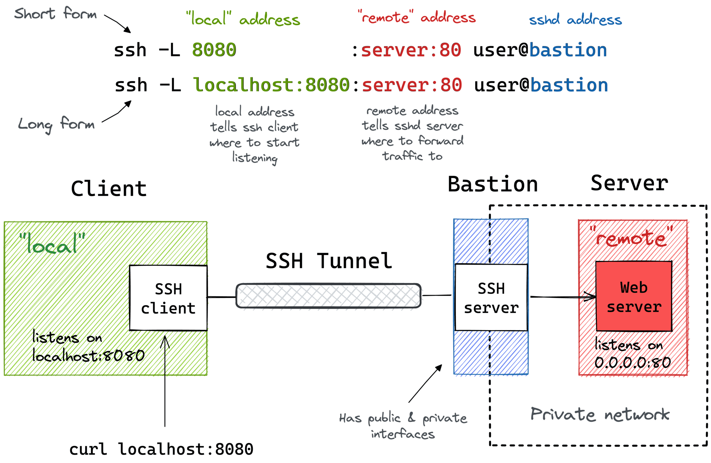
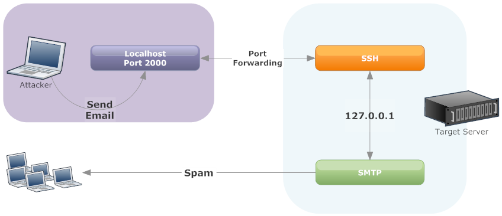
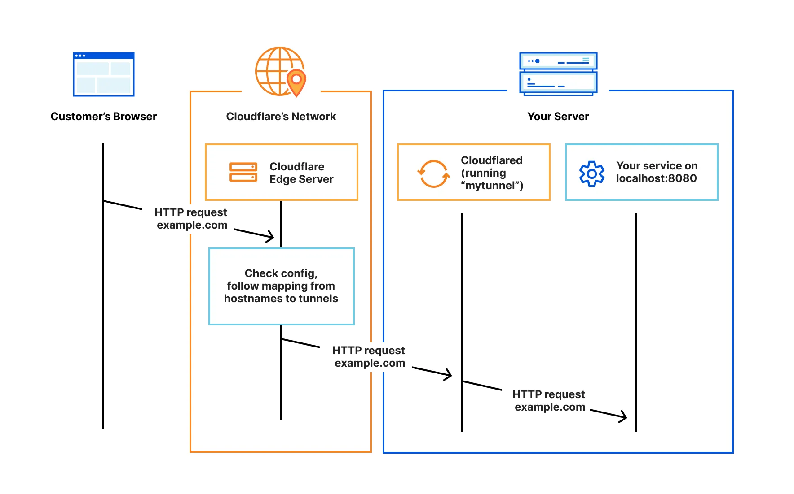

# SSH

## How an SSH connection works

An SSH session has four main phases:

1. **TCP connection**
   - SSH runs over TCP, default port 22.
   - The client (`ssh user@server`) opens a TCP connection.
2. **Handshake and key exchange**
   - Client and server negotiate which encryption algorithms to use (AES, ChaCha20, etc.) and which key exchange method (Diffie–Hellman, ECDH, etc.).
   - A shared secret is generated and **never sent over the network** (important for security).
   - The server proves its identity with a host key (stored in `~/.ssh/known_hosts`). This is why, the first time you connect to a new server, SSH asks: *"Are you sure you want to continue connecting?"*
3. **Authentication** — the client must prove its identity:
   - **Password authentication** → simplest but less secure.
   - **Public key authentication** → the preferred method:
     - generate a key pair (`ssh-keygen`);
     - place your public key on the server (`~/.ssh/authorized_keys`);
     - when connecting, the server challenges the client;
     - the client proves it has the private key by signing data.
   - Other methods exist too (Kerberos, certificates, hardware tokens).
4. **Secure channel established**
   - All data is **encrypted** (negotiated cipher) and **integrity-protected** (MACs ensure no tampering).
   - Multiple channels can run inside one SSH connection: a shell (bash, zsh), file transfers (scp, sftp), port forwarding/tunnels.

### Encryption layers in SSH

| Layer                 | Algorithms          | Used for                             |
| --------------------- | ------------------- | ------------------------------------ |
| Symmetric encryption  | AES, ChaCha20, …    | Bulk traffic (fast)                  |
| Asymmetric encryption | RSA, ECDSA, Ed25519 | Only during handshake/authentication |
| MACs                  | HMAC-SHA2, Poly1305 | Detecting tampering                  |

## Best practices

- Use SSH keys instead of passwords.
- Use `~/.ssh/config` for cleaner configs:

  ```text
  Host myserver
      HostName remote-server.com
      User myuser
      LocalForward 8080 localhost:80

  Host mytunnel
      HostName ssh.example.com
      User user
      LocalForward 5432 db.internal:5432       # local forward
      DynamicForward 1080                      # socks proxy
      ServerAliveInterval 60
  ```

## SSH tunnels (port forwarding)

Port forwarding lets you use SSH as a tunnel that carries arbitrary TCP traffic — not just a terminal. An SSH tunnel securely forwards network traffic from one computer to another through an encrypted SSH connection. It lets you access services (databases, websites, applications) running on a remote system — or even inside a private network — as if they were running on your local machine.

SSH tunnels (a.k.a. SSH port forwarding) create a secure channel between your local computer and a remote server, used to relay traffic — bypassing firewalls or reaching services that are not directly accessible. The data is encrypted as it travels through the tunnel, an additional layer of security that is particularly useful on unsecured networks or when you need to bypass network restrictions.

SSH tunneling transports **additional data streams within an existing SSH session**. To understand it, you need to know how ports work:

- Processes bind to ports (listening for connections).
- SSH can redirect ports: instead of connecting directly, the data goes into the SSH channel.
- On the other end, SSH re-establishes the TCP connection to the target port.

In short: **tunneling = port redirection over an encrypted channel.**

- In local forwarding (`-L`), the port opens on the **client** side.
- In remote forwarding (`-R`), the port opens on the **server** side.

With SSH tunnels you can:

- Access internal VPC endpoints through a public-facing EC2 instance.
- Open a port from the localhost of a development VM in the host's browser.
- Expose any local server from a home/private network to the outside world.

SSH is not only tunneling, but tunneling is one of its key features. The three types:

| Type    | Description                                                      | Example use case                              |
| ------- | ---------------------------------------------------------------- | --------------------------------------------- |
| Local   | Forwards a local port to a remote destination via the SSH tunnel | Access a remote database or internal service  |
| Remote  | Exposes a local service to a remote server via the SSH tunnel    | Make your local dev server reachable remotely |
| Dynamic | Acts like a SOCKS proxy, routing traffic dynamically             | Securely browse the internet over SSH         |

```sh
ssh -L 8080:localhost:80 user@remote
# forwards localhost:8080 on your machine to localhost:80 on the remote server
```

### Local port forwarding (`-L`) — most common

```sh
ssh -L [local_addr:]local_port:remote_addr:remote_port [user@]sshd_addr
```

You say: *"Bind `localhost:8080` → forward to `remotehost:80` via SSH."*

- On your machine, the SSH client listens on `local_port` (likely on `localhost`, but it depends — check the `GatewayPorts` setting).
- Any traffic to this port is forwarded to `remote_addr:remote_port` as seen from the machine you SSH-ed to.
- Local port forwarding **always binds a port on the client side**: with `ssh -L 8080:remotehost:80 user@ssh-server`, the SSH client process is what listens on `localhost:8080`. If you point your browser at `http://localhost:8080`, it connects to the SSH client, not a real web server.

Examples:

```sh
# Remote PostgreSQL behind a firewall: local localhost:5432 → server's PostgreSQL port
ssh -L 5432:localhost:5432 user@remote-server

# Remote MySQL
ssh -L 3306:127.0.0.1:3306 user@remote-server
mysql -h 127.0.0.1 -P 3306 -u dbuser -p

# A database reachable only from the SSH server
ssh -L 3306:db.mycompany.com:3306 user@foo.mycompany.com
mysql -h 127.0.0.1 -P 3306 -u dbuser -p
```

Backgrounded tunnel to a service on the SSH server itself (from [tecnico-sec/SSH-Tunnels](https://github.com/tecnico-sec/SSH-Tunnels?tab=readme-ov-file)):

```sh
# localhost because the destination resource is the SSH server itself
ssh -f -N -L 12345:localhost:23 user@192.168.64.4
```

- `ssh user@192.168.64.4` — connect to the SSH server at `192.168.64.4` as `user`.
- `-L 12345:localhost:23` — on your machine, open TCP port 12345 on `127.0.0.1`. Any connection to it is forwarded through the tunnel to `localhost:23` **as seen from the SSH server** (the server itself, port 23 — typically telnet). Effectively: `your_pc:12345 →(SSH)→ server:localhost:23`.
- `-N` — don't run a remote command; just keep the tunnel open.
- `-f` — go to the background after authentication (daemonize the tunnel).

#### Local forwarding through a bastion host

It might not be obvious at first, but `ssh -L` can forward a local port to a port on **any** machine, not only the SSH server itself — `remote_addr` and `sshd_addr` may or may not be the same:



This is handy for calling endpoints reachable from the bastion host but not from your laptop (e.g. using an EC2 instance with private and public interfaces to reach an OpenSearch cluster deployed fully within a VPC).

### Remote port forwarding (`-R`)

```sh
ssh -R [remote_addr:]remote_port:local_addr:local_port [user@]gateway_addr
```

You say: *"Bind `remotehost:9000` → forward to `localhost:3000`."* Someone connecting to `remotehost:9000` actually hits your local app on port 3000.

Examples:

```sh
# Expose your local web app (port 3000) as remote-server:8080
ssh -R 8080:localhost:3000 user@remote-server

# foo.mycompany.com opens port 8080; connections to foo.mycompany.com:8080
# are tunneled back to your home machine's localhost:3000
ssh -R 8080:localhost:3000 user@foo.mycompany.com
```

How it works on the server — `ssh -R 8080:localhost:80 user@remotehost`:

- `sshd` listens on TCP port 8080 of the remote machine.
- The kernel's TCP/IP stack delivers packets destined for `<remotehost-ip>:8080` to whichever process bound that port — here, `sshd` — via the normal socket API.
- If a firewall (iptables/nftables) blocks port 8080, the packets never reach `sshd`.

**`GatewayPorts`:** by default, a remote forward only uses the gateway's **localhost** as the remote address — your local port is reachable only from inside the gateway server itself, which is rarely what you want. To use the gateway's public address (e.g. to expose local services to the internet), the SSH server needs `GatewayPorts yes`.

#### Why reverse tunnels are NAT-friendly

How connections work by default:

- On the public internet, servers usually have public IP addresses (reachable from anywhere).
- Most client machines (laptops, desktops) are behind NAT (home routers, corporate firewalls, ISP carrier-grade NAT).
- NAT/firewalls block unsolicited inbound connections, so remote machines usually cannot open a connection directly to your laptop.

So in practice you can SSH **out** to a server, but the server can't usually SSH **in** to your laptop. With reverse SSH tunneling, your laptop initiates the outbound SSH connection (NAT-friendly), and the server reaches you back through it.

### Dynamic port forwarding (`-D`) — SOCKS proxy

```sh
ssh -D 1080 user@remote-server
```

You say: *"Create a SOCKS proxy on `localhost:1080`."*

- The SSH client binds `localhost:1080` and speaks the SOCKS protocol (usually SOCKS5).
- Applications (like browsers) are configured to use that SOCKS proxy.
- Instead of forwarding one fixed host/port (like `-L` or `-R`), it forwards traffic to **any destination you request, decided at runtime**.

When you visit `http://example.com`:

1. The browser sends the request to the SOCKS proxy.
2. The SSH client tells `sshd` to connect to `example.com:80`.
3. Data flows through the tunnel.
4. To `example.com`, the request appears to come from the remote server's IP.

**Scenario:** you're on public Wi-Fi and want to secure all browser traffic by routing it through an SSH tunnel — configure the browser to use `localhost:1080` as a SOCKS proxy, and all browsing goes via the server.

### Forwarding multiple ports in one connection

Specify multiple `-L` or `-R` options:

```sh
ssh -L 8080:localhost:80 -L 5433:localhost:5432 user@server
```

You can forward any combination of local and remote ports through a single encrypted connection, reducing the overhead of maintaining multiple SSH connections.

### Server-side control: `AllowTcpForwarding`

The SSH server must allow port forwarding (see `AllowTcpForwarding` in `/etc/ssh/sshd_config`):

```text
AllowTcpForwarding yes|no|local|remote
```

- `yes` → forwarding is allowed (default in many setups).
- `no` → completely disable `-L`, `-R`, and `-D`.
- `local` → only allow `-L`.
- `remote` → only allow `-R`.

### SSH with TUN/TAP (`-w`)

```sh
ssh -w <local_tun>:<remote_tun> user@server
```

Sets up a **point-to-point** tunnel between a TUN/TAP interface on the client and one on the server (see [TUN/TAP](tuntap.md)).

- `-w 0:0` → create `tun0` locally and `tun0` remotely, and connect them.
- Requires root or `CAP_NET_ADMIN` on both sides (you're creating network devices).
- Requires `PermitTunnel yes` in the server's `sshd_config`.

Simple IP-over-SSH tunnel — on the client:

```sh
sudo ssh -w 0:0 user@server

# then configure the interface
sudo ip addr add 10.0.0.1/30 dev tun0
sudo ip link set tun0 up
```

On the server:

```sh
sudo ip addr add 10.0.0.2/30 dev tun0
sudo ip link set tun0 up
```

Now you have a `/30` point-to-point link (client `10.0.0.1`, server `10.0.0.2`). Ping `10.0.0.2` from the client and packets flow encrypted over SSH.

How it works — the client has the route:

```text
10.0.0.0/30 dev tun0 proto kernel scope link src 10.0.0.1
```

1. An app sends traffic (e.g. `ping 10.0.0.2`); the kernel's routing table matches `10.0.0.0/30` → `dev tun0`, so the kernel injects the packet into `tun0`.
2. `tun0` doesn't send to a wire: it hands the packet to a file descriptor on `/dev/net/tun`, which the `ssh` process holds open.
3. SSH reads the raw IP packet, wraps it into the encrypted TCP session, and ships it to the remote host.
4. On the remote side SSH writes the packet into its own `/dev/net/tun` (`tun0`), and the server's kernel sees it as if it came from a real NIC.

### FAQ

**What is SSH port forwarding used for?** Creating encrypted tunnels to bypass restrictive firewalls, securely access remote databases, facilitate remote debugging, and protect sensitive data in transit — for developers, sysadmins and security professionals who need to reach remote services or link network segments while keeping data confidential and intact.

**Local vs remote forwarding?** Local (`-L`) tunnels from your machine to a remote server so you can use remote services as if they were local — ideal for remote databases or web apps. Remote (`-R`) works in the opposite direction, letting external connections reach services on your machine through the SSH server — useful for exposing local development servers or giving remote access to local resources.

**How do I use dynamic forwarding?** `ssh -D 1080 user@server` creates a SOCKS proxy that can handle multiple simultaneous connections through one tunnel. Point SOCKS-capable applications (browsers, dev tools) at it — a VPN-like experience for chosen applications only.

**Is it secure?** All forwarded traffic is end-to-end encrypted with SSH's standard algorithms (e.g. AES). Staying secure still requires proper configuration: strong authentication, regular updates, careful access permissions, and monitoring.

### Security: tunnels can be abused

From [Spam via SSH tunnel](https://www.rackaid.com/blog/spam-ssh-tunnel/) (see also [SSH, The Definitive Guide: port forwarding](https://docstore.mik.ua/orelly/networking_2ndEd/ssh/ch09_02.htm)):



1. **Attacker's machine** — opens `localhost:2000` and configures SSH local forwarding so traffic sent there is carried over SSH.
2. **SSH tunnel** — the attacker SSHes to the target with `-L`, e.g. `ssh -L 2000:127.0.0.1:23 user@target`, or in this case targeting SMTP (port 25). Connections to the attacker's `localhost:2000` are tunneled to `127.0.0.1:25` on the target.
3. **Target server** — runs an SMTP service bound to `127.0.0.1:25` (local connections only); normally unreachable externally.
4. **Abuse** — the attacker sends email via `localhost:2000`; traffic goes through SSH to the target's localhost SMTP port; the target sends the email. The spam now comes "from" the target server (a trusted IP), not the attacker.

SSH tunneling is powerful but dangerous if misconfigured. If users on a system can forward ports, they can expose internal-only services (DBs, SMTP, Redis, etc.) to themselves and abuse them (spam, data exfiltration, lateral movement). That's why admins sometimes set `AllowTcpForwarding no` in `/etc/ssh/sshd_config`.

## Other ways to expose a local service

### ngrok

ngrok is a tunneling service that exposes a local service (e.g. a web server on `localhost:3000`) to the public internet via a temporary HTTPS (or TCP) URL:

```sh
ngrok http 3000
```

You get a public URL like `https://abcd1234.ngrok.io` that forwards traffic securely to your local server. Internally:

1. You run `ngrok http 3000`.
2. The ngrok client opens a persistent **outbound** connection to ngrok's servers (usually over TLS).
3. The ngrok server assigns a public domain/port.
4. Incoming requests hit ngrok.io; ngrok forwards them down the tunnel to `localhost:3000`.

This avoids NAT/firewall issues since the connection originates from your computer (outbound is almost always allowed).

### Cloudflare Tunnel

To enable clientless access to your applications, create a Cloudflare Tunnel that publishes applications to a domain on Cloudflare. A published application creates a public DNS record that routes traffic to a specific address, protocol and port of a private application. For example, a public hostname `mywebapp.example.com` can front a web server on `https://localhost:8080`. A user's request first goes to a Cloudflare data center, is inspected against your security policies, and validated requests are forwarded down the tunnel to the web server.



**Outbound-only connection:** when you run `cloudflared`, it initiates an outbound connection through your firewall from the origin to Cloudflare's network. Once established, traffic flows in both directions over the tunnel. Most firewalls allow outbound traffic by default, so you can allow only these outbound connections and block **all** inbound traffic — nothing but Cloudflare can reach your origin.

## Bastion hosts and ingress gateways

- A **bastion host** is for SSH (administrative access).
- An **ingress gateway** is for application traffic (HTTP, TCP, gRPC, etc.).

### Ingress gateway

A machine (or cluster) that:

- receives external client requests (HTTP, HTTPS, TCP, etc.);
- applies security/policies (TLS termination, authentication, rate limiting, WAF rules);
- routes traffic to the correct internal service (usually on private IPs, not directly exposed).

Think of it as the front door into your private network or Kubernetes cluster.

- **Classic networking:** an Nginx or HAProxy server listening on 443 and forwarding requests to your app servers.
- **Kubernetes:** the Ingress Controller concept, implemented by an ingress gateway — e.g. Istio's `istio-ingressgateway` pod or the Nginx Ingress Controller. It exposes a public IP/hostname and routes requests to the right Services inside the cluster.

### What a bastion adds beyond firewalls

1. **Centralized entry point** — without a bastion, every server needs firewall rules, SSH key management and user auditing individually. With one, only the bastion is exposed; internal servers lock SSH down to `AllowUsers bastion-user` or `iptables -s bastion-ip -p tcp --dport 22 -j ACCEPT`. Easier to maintain and review.
2. **Audit and logging** — firewalls only log connections, not commands. A bastion can record who logged in and session logs (keystrokes, commands, even session replay). Critical for compliance (PCI, SOC 2, HIPAA).
3. **User management** — iptables ties access to IP ranges, which is weak (IP spoofing, shared NATs). A bastion ties access to user identity (SSH keys, MFA, SSO) and makes it easy to revoke one person's access without touching every server.
4. **Additional security layers** — bastions are typically hardened: MFA, intrusion detection/IPS, session timeouts and monitoring. They can enforce things iptables can't (forcing `ssh-agent`, restricting file copy, disabling root login).
5. **Operational simplicity** — with 500 servers, managing iptables rules and SSH keys on each is painful. A bastion gives one public entry point and one set of access policies.

## Further reading

- [SSH tunnels (iximiuz)](https://iximiuz.com/en/posts/ssh-tunnels/)
- [SSH tunneling explained (Teleport)](https://goteleport.com/blog/ssh-tunneling-explained/)
- [tecnico-sec/SSH-Tunnels](https://github.com/tecnico-sec/SSH-Tunnels?tab=readme-ov-file)
- [Spam via SSH tunnel](https://www.rackaid.com/blog/spam-ssh-tunnel/)
- [SSH, The Definitive Guide: port forwarding](https://docstore.mik.ua/orelly/networking_2ndEd/ssh/ch09_02.htm)
