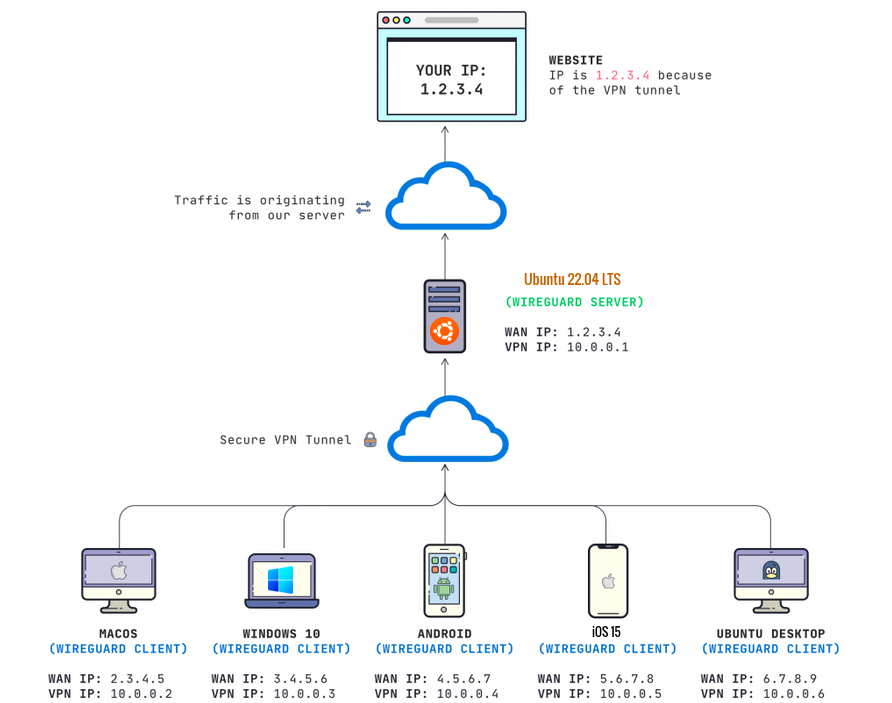

# Tunneling

## What is tunneling?

From *TCP/IP Illustrated*:

> Tunneling, generally speaking, is the idea of carrying lower-layer traffic in higher-layer (or equal-layer) packets. For example, IPv4 can be carried in an IPv4 or IPv6 packet; Ethernet can be carried in a UDP or IPv4 or IPv6 packet, and so on.

Put another way: tunneling is encapsulating a packet of one protocol inside another. This lets a protocol that normally works on one layer be transported over a different protocol — often through a medium it wasn't originally designed for. In Linux, it lets data be sent securely or pass through otherwise incompatible or restricted networks.

We use the term *tunneling* when the encapsulated payload is a packet (or signal) from a layer **equal to or lower than** the one carrying it. Examples:

- Physical layer — DS0s — over IP
- Link layer — Ethernet — over IP
- IP with private addresses — over IP with public addresses

The name comes from the fact that the encapsulated data travels inside another "layer", hidden from the outside view — just like a car traveling inside a physical tunnel. The outer packet provides the routing and addressing information that gets the encapsulated data from point A to point B, much like a tunnel lets traffic pass through otherwise inaccessible areas.

### Tunneling from the OS's point of view

A tunnel takes one kind of traffic (TCP streams, or even whole IP packets), encapsulates it inside another protocol, sends it across a transport channel, and unwraps it on the other end:

- **Outer layer** = the carrier (e.g. SSH, GRE, IPsec).
- **Inner layer** = the traffic being tunneled (HTTP, SMTP, entire subnets).

At the OS level, tunneling = creating a **virtual endpoint** (a socket or an interface). Data sent to it is captured by a process or kernel module, encapsulated, transmitted over the carrier (TCP, UDP, raw IP), decapsulated at the other end, and injected back into the OS networking stack as if it arrived locally.

Linux supports this at two levels:

- **Application level** (streams) — e.g. SSH `-L`, `-R`, `-D`. With `ssh -L 8080:bar.internal:80 user@server`:
  - client side (`ssh`) calls `bind()` and `listen()` on `127.0.0.1:8080`, accepts connections locally, and wraps arriving data into an SSH channel over the encrypted SSH TCP connection;
  - server side (`sshd`) receives the channel request, calls `connect(bar.internal:80)` like a normal socket, and relays the TCP stream.

  All encapsulation happens in userspace inside `ssh`/`sshd`; the kernel just sees "one SSH TCP session". See [SSH](ssh.md).
- **Kernel level** (packets) — virtual interfaces: TUN (L3, raw IP packets — used by VPNs like OpenVPN, WireGuard, or `ssh -w`), TAP (L2, Ethernet frames — can be bridged into LANs), and encapsulation modules: GRE/IPIP (IP in IP), IPsec (encrypts IP packets at L3), VXLAN/Geneve (L2 over UDP, used in Kubernetes and cloud networking). All of these create virtual interfaces and route traffic through them. See [TUN/TAP](tuntap.md).

### Tunnel endpoints

A tunnel endpoint is a network interface (physical or virtual) at each end of the tunnel, responsible for:

- **Addressing** — each endpoint needs a reachable underlay IP (often public, or behind NAT with port forwarding).
- **Key exchange / session setup** — endpoints exchange authentication material: public/private key pairs in WireGuard; certificates or pre-shared keys in IPsec.
- **Encapsulation** — endpoint A wraps the original packet (e.g. `10.0.0.5 → 10.1.0.10`) in an outer packet addressed to endpoint B (`203.0.113.1 → 198.51.100.2`).
- **Transport across the underlay** — the underlay (internet, MPLS, private backbone) just sees regular UDP/IP; routers forward on the outer header without knowing it's a tunnel.
- **Decapsulation** — endpoint B strips the outer headers and delivers the inner packet (`10.0.0.5 → 10.1.0.10`) to its private LAN.

### Split tunnel vs full tunnel

- **Split tunnel:** only specific private subnets go through the tunnel (e.g. `10.1.0.0/24`).
- **Full tunnel:** all traffic (default route `0.0.0.0/0`) goes into the tunnel — even internet browsing.

### Site-to-site routing symmetry

Site A LAN `10.0.0.0/24`, Site B LAN `10.1.0.0/24`, connected by a tunnel (e.g. WireGuard `wg0`):

```text
# At Site A
Destination      Interface
10.0.0.0/24      local LAN
10.1.0.0/24      wg0 (tunnel)
default          eth0 (Internet)
```

```text
# At Site B
Destination      Interface
10.1.0.0/24      local LAN
10.0.0.0/24      wg0 (tunnel)
default          eth0 (Internet)
```

- At Site A, traffic to `10.1.0.x` goes into `wg0`, is encapsulated, and is sent to Site B's endpoint; traffic to e.g. `8.8.8.8` goes out `eth0` (not through the tunnel, unless configured).
- At Site B, the mirror image.

Each site sees its own subnet as local (directly connected) and the other site's subnet as remote, reached through the tunnel — this is routing symmetry in a site-to-site tunnel. At its core, WireGuard is exactly this kind of point-to-point encrypted tunnel: two peers exchange keys and send traffic to each other. See the [WireGuard site-to-site example](wireguard.md#example-site-to-site).

## Underlay vs overlay



- **Underlay network:** the physical or IP network that carries the actual packets. Example: a data center's IP network with routers and switches running BGP.
- **Overlay network:** a virtual network built on top of the underlay. Components: virtual tunnels (e.g. VXLAN, GRE), virtual switches, virtual routers. Example: a VXLAN network that connects VMs across different hosts as if they were on the same Ethernet segment.

## Common tunneling protocols

| Protocol                            | What it encapsulates | Used in                                           |
| ----------------------------------- | -------------------- | ------------------------------------------------- |
| GRE (Generic Routing Encapsulation) | IP, Ethernet         | VPNs, MPLS, cloud networking                      |
| IP-in-IP                            | IP                   | Simple IP tunnels                                 |
| L2TP                                | PPP (layer 2)        | VPNs (often with IPsec)                           |
| VXLAN                               | Ethernet             | Data center, cloud/virtual networking             |
| OpenVPN                             | IP over TLS          | Secure VPN                                        |
| WireGuard                           | IP over UDP          | Modern secure VPN — see [WireGuard](wireguard.md) |

## Point-to-point links and `/31`

A point-to-point network is, as its name implies, a connection between two specific points. On a point-to-point link, a packet sent from one router always has precisely one recipient.

**PPP** (Point-to-Point Protocol) is the standard for carrying multi-protocol data over point-to-point links. It's a data link layer (L2) protocol, below IP and TCP, that encapsulates IP across a serial link between two devices.

A `/31` mask (`255.255.255.254`) allows only two IP addresses per network. Traditionally a subnet needs at least three (network address, broadcast, and one or more hosts), so this seems impractical — but `/31` is designed for exactly this case: point-to-point links, such as between two routers or between an ISP and a customer's firewall, where only two addresses are needed. See [RFC 3021](https://www.rfc-editor.org/rfc/rfc3021.html#:~:text=Retana%2C%20et%20al.,to%2Dpoint%20links%20are%20numbered.).

## Tunnel types in Linux

### 1. IP-in-IP (IPIP)

```sh
ip tunnel add tun0 mode ipip remote 192.0.2.1 local 192.0.2.2
ip link set tun0 up
ip addr add 10.0.0.1/24 dev tun0
```

### 2. GRE (Generic Routing Encapsulation)

```sh
ip tunnel add gre1 mode gre remote 192.0.2.1 local 192.0.2.2 ttl 255
ip link set gre1 up
ip addr add 10.0.0.1/24 dev gre1
```

**Example: GRE between two hosts.** Underlay addresses: Host A `192.168.1.10`, Host B `192.168.2.20`. Private tunnel IPs: Host A `10.0.0.1/30`, Host B `10.0.0.2/30`.

On Host A (`192.168.1.10`):

```sh
# Add GRE tunnel interface
ip tunnel add gre1 mode gre local 192.168.1.10 remote 192.168.2.20 ttl 255

# Bring it up and assign IP
ip link set gre1 up
ip addr add 10.0.0.1/30 dev gre1
```

On Host B (`192.168.2.20`):

```sh
ip tunnel add gre1 mode gre local 192.168.2.20 remote 192.168.1.10 ttl 255
ip link set gre1 up
ip addr add 10.0.0.2/30 dev gre1
```

Test and inspect:

```sh
# From Host A, over the tunnel
ping 10.0.0.2

ip tunnel show gre1
```

The same pattern between two public IPs, carrying a private `10.0.0.0/30` (Site A `192.0.2.1`, Site B `198.51.100.2`):

```sh
# Site A
ip tunnel add gre1 mode gre remote 198.51.100.2 local 192.0.2.1 ttl 255
ip addr add 10.0.0.1/30 dev gre1
ip link set gre1 up

# Site B
ip tunnel add gre1 mode gre remote 192.0.2.1 local 198.51.100.2 ttl 255
ip addr add 10.0.0.2/30 dev gre1
ip link set gre1 up
```

You now have a point-to-point interface `gre1` (`10.0.0.1 ↔ 10.0.0.2`).

What happens to the ping:

```text
User sends ping from Host A to 10.0.0.2
+----------------------+
| ICMP Echo Request    |
| Source: 10.0.0.1     |  <--- tunnel IPs
| Dest:   10.0.0.2     |
+----------------------+
           |
           V
Encapsulated in GRE by the kernel:
+------------------------------+
| Outer IP Header              |
| Source: 192.168.1.10         |  <--- transport IPs
| Dest:   192.168.2.20         |
| Protocol: GRE                |
+------------------------------+
| GRE Header                   |
+------------------------------+
| Inner IP Header              |
| Source: 10.0.0.1             |
| Dest:   10.0.0.2             |
+------------------------------+
| ICMP Echo Request            |
+------------------------------+
           |
           V
Sent over real network to Host B
           |
           V
Host B receives packet at 192.168.2.20
→ Kernel sees it's a GRE packet → decapsulates
→ Extracts inner packet: IP(10.0.0.1 → 10.0.0.2)
→ Sends it to local stack
→ Responds with ICMP Echo Reply (same process reversed)
```

### 3. VXLAN (Virtual Extensible LAN)

- Extends layer 2 networks over layer 3.
- Popular in cloud and container networking (e.g. Kubernetes, OpenStack).
- Requires kernel support (`vxlan` module).
- See [VXLAN](vxlan.md) and the [two-host VXLAN lab](linux-vxlan.md).

Multicast-based:

```sh
ip link add vxlan100 type vxlan id 100 group 239.1.1.1 dev eth0 dstport 4789
ip addr add 10.0.0.1/24 dev vxlan100
ip link set vxlan100 up
```

**Example: unicast point-to-point (multicast-free).** Host A `192.168.1.10`, Host B `192.168.2.20`, VXLAN ID `100`, overlay IPs `10.0.0.1` / `10.0.0.2`.

Host A:

```sh
# Load vxlan module
modprobe vxlan

# Create VXLAN interface
ip link add vxlan100 type vxlan id 100 dev eth0 remote 192.168.2.20 dstport 4789

# Assign an IP address (for testing)
ip addr add 10.0.0.1/24 dev vxlan100

# Bring up the interface
ip link set vxlan100 up
```

Host B:

```sh
modprobe vxlan

ip link add vxlan100 type vxlan id 100 dev eth0 remote 192.168.1.10 dstport 4789
ip addr add 10.0.0.2/24 dev vxlan100
ip link set vxlan100 up
```

Test:

```sh
# From Host A
ping 10.0.0.2

# From Host B
ping 10.0.0.1
```

Encapsulation:

```text
+-------------------------------+
| Inner Ethernet Frame          |
| Src MAC: A                    |
| Dst MAC: B                    |
| IP: 10.0.0.1 → 10.0.0.2       |
+-------------------------------+
        |
        V
+-------------------------------+
| Outer IP Header               |
| Src IP: 192.168.1.10          |
| Dst IP: 192.168.2.20          |
| Protocol: UDP (port 4789)     |
+-------------------------------+
| VXLAN Header (VNI=100)        |
+-------------------------------+
| Encapsulated Ethernet Frame   |
+-------------------------------+
```

Building a VXLAN packet by hand in C:

```c
struct vxlan_hdr {
    uint8_t  flags;       // Always 0x08: indicates valid VNI
    uint8_t  reserved1[3];
    uint8_t  vni[3];      // VXLAN Network Identifier (24 bits)
    uint8_t  reserved2;
} __attribute__((packed));

uint8_t udp_packet[MAX_LEN];

struct iphdr *ip   = (struct iphdr *)(udp_packet + ETH_HLEN);
struct udphdr *udp = (struct udphdr *)(ip + 1);
struct vxlan_hdr *vxh = (struct vxlan_hdr *)(udp + 1);
struct eth_hdr *inner_eth = (struct eth_hdr *)(vxh + 1);

// Fill IP header
ip->protocol = IPPROTO_UDP;
ip->saddr = local_ip;
ip->daddr = remote_ip;

// Fill UDP header
udp->source = htons(12345);
udp->dest   = htons(4789); // VXLAN default port

// Fill VXLAN header
vxh->flags = 0x08;           // Set "I" bit (valid VNI)
vxh->vni[0] = (vni >> 16) & 0xFF;
vxh->vni[1] = (vni >> 8) & 0xFF;
vxh->vni[2] = vni & 0xFF;

// Copy the original Ethernet frame into the tunnel
memcpy(inner_eth, original_ethernet_frame, frame_len);
```

> **EtherType:** the 2-byte EtherType field in an Ethernet frame indicates the protocol that comes after the Ethernet header — usually a layer 3 protocol (IPv4, IPv6), occasionally a "layer 2.5" protocol (VLAN tags, MPLS).

### 4. GRETAP (layer 2 GRE)

- GRE tunneling at layer 2 (Ethernet bridging).
- Use `gretap` to bridge virtual interfaces over IP.

```sh
ip link add gretap0 type gretap local 192.0.2.2 remote 192.0.2.1
ip link set gretap0 up
brctl addif br0 gretap0
```

### 5. TUN/TAP

- `TUN`: layer 3 virtual device (IP).
- `TAP`: layer 2 virtual device (Ethernet).
- Common in VPN software like OpenVPN. See [TUN/TAP](tuntap.md).

```sh
# Create a TUN device
ip tuntap add dev tun0 mode tun
ip addr add 10.0.0.1/24 dev tun0
ip link set tun0 up
```

## How the kernel routes the outer packet

Say a tunnel (GRE, IPIP, PPTP, …) is set up between:

- local tunnel endpoint: `192.168.1.10` (your machine)
- remote tunnel endpoint: `192.168.2.20` (the other side)

The tunnel interface (e.g. `tun0`, `gre0`) encapsulates the packet, then the kernel must decide: **"How do I get this encapsulated (outer) packet to `192.168.2.20`?"** It does a normal routing table lookup for `192.168.2.20`:

```text
default via 192.168.1.1 dev eth0
192.168.1.0/24 dev eth0 proto kernel scope link src 192.168.1.10
```

```sh
ip route get 192.168.2.20
# 192.168.2.20 via 192.168.1.1 dev eth0 src 192.168.1.10
```

With multiple uplinks, the lower metric wins:

```text
default via 192.168.1.1 dev eth0
default via 10.10.10.1 dev eth1 metric 100
192.168.1.0/24 dev eth0 proto kernel scope link src 192.168.1.10
10.10.10.0/24 dev eth1 proto kernel scope link src 10.10.10.10
```

Reading `192.168.1.0/24 dev eth0 proto kernel scope link src 192.168.1.10` — the subnet `192.168.1.0/24` is directly reachable via `eth0`, and your IP on that network is `192.168.1.10`:

| Field              | Meaning                                                           |
| ------------------ | ----------------------------------------------------------------- |
| `proto kernel`     | Route was added automatically by the kernel (not manually).       |
| `scope link`       | These IPs are reachable directly on the link (no gateway needed). |
| `src 192.168.1.10` | Source IP to use when sending traffic on this subnet.             |

## Further reading

Gabriel Urdhr's blog:

- [SSH tunnels](https://www.gabriel.urdhr.fr/2024/04/13/ssh-tunnels/)
- [Protocol stacks](https://www.gabriel.urdhr.fr/2023/12/20/protocol-stacks/)
- [Impact of the different Wi-Fi security modes](https://www.gabriel.urdhr.fr/2022/06/07/impact-of-the-different-wifi-security-modes/)
- [TLS 1.3 intro](https://www.gabriel.urdhr.fr/2022/02/26/tls1.3-intro/)
- [TLS 1.2 intro](https://www.gabriel.urdhr.fr/2021/11/30/tls1.2-intro/)
- [Diffie-Hellman intro](https://www.gabriel.urdhr.fr/2021/10/19/diffie-hellman-intro/)
- [Foo over SSH](https://www.gabriel.urdhr.fr/2017/08/02/foo-over-ssh/)

Other:

- [Creating TUN/TAP interfaces in Linux](https://john-millikin.com/creating-tun-tap-interfaces-in-linux)
- [Tunnels and VPNs (Grotto Networking)](https://www.grotto-networking.com/BBTunnelsVPNs.html)
- [nftables IPsec packet flow](https://thermalcircle.de/doku.php?id=blog:linux:nftables_ipsec_packet_flow)
- [Port forwarding using SSH tunnelling](https://medium.com/@dipakkrdas/port-forwarding-using-ssh-tunnelling-5b959a914d9b)
- [SSH tunneling explained (Teleport)](https://goteleport.com/blog/ssh-tunneling-explained/)
- [OpenVPN puts packets inside your packets](https://www.saminiir.com/openvpn-puts-packets-inside-your-packets/#tunneling)
- [An introduction to WireGuard VPN](https://jasoneckert.github.io/myblog/an-introduction-to-wireguard-vpn/)
