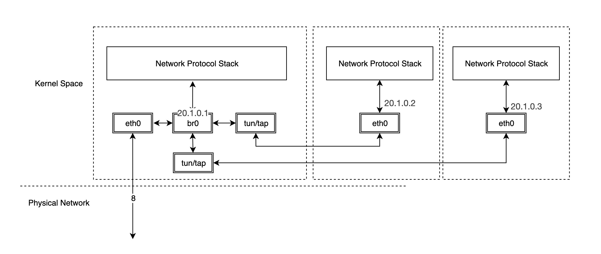
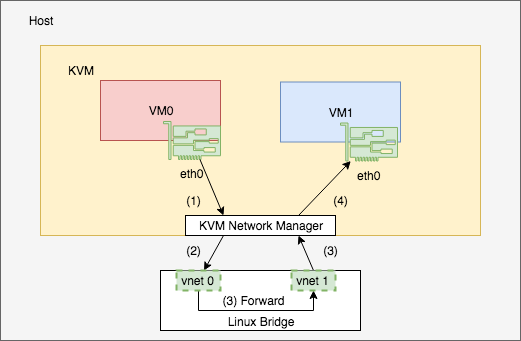
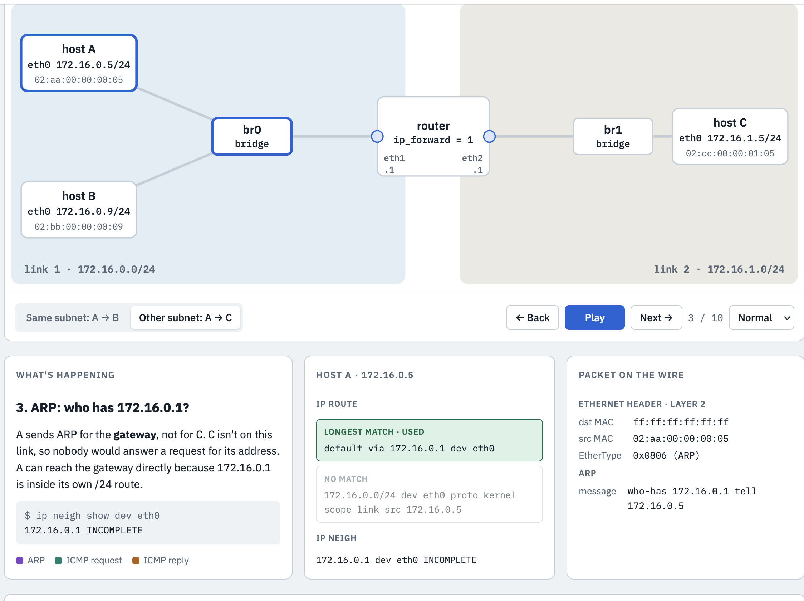

# TUN/TAP

TUN/TAP interfaces let Linux do **userspace networking**: userspace programs see raw network traffic (at the Ethernet or IP level) and do whatever they like with it.

TUN/TAP provides packet reception and transmission for user-space programs. It can be seen as a simple point-to-point or Ethernet device which, instead of receiving packets from physical media, receives them from a user-space program, and instead of sending packets via physical media, writes them to the user-space program.

The TUN/TAP device is connected to the protocol stack on one end and — instead of the physical network — to a user-space application on the other. Packets the stack sends to the TUN/TAP can be read by the application, and the application can write packets directly to the TUN/TAP.

Once in place, a TUN/TAP interface is used like any other interface: assign IP addresses, analyze its traffic, create firewall rules, point routes at it, etc.

## TUN vs TAP

Two types of virtual network interfaces are managed by `/dev/net/tun`:

| Type  | Layer | Transports      | Flags / addressing                    | `tcpdump` link type |
| ----- | ----- | --------------- | ------------------------------------- | ------------------- |
| `TUN` | L3    | IP packets      | `POINTOPOINT`, `NOARP`, `link/none`   | `RAW (Raw IP)`      |
| `TAP` | L2    | Ethernet frames | `BROADCAST`, has a MAC (`link/ether`) | `EN10MB (Ethernet)` |

**TUN** (`IFF_TUN`, "network TUNnel") transports layer 3 PDUs:

- in practice, IPv4 and/or IPv6 packets;
- `read()` gets an L3 PDU (an IP packet);
- you must `write()` L3 PDUs (IP packets);
- no layer 2 (Ethernet, etc.) is involved;
- they are `POINTOPOINT` interfaces.

TUN emulates a network device in software, operating at layer 3, so it has no relation to Ethernet frames or MAC addresses. No ARP is used since the IPs are already known, which removes the overhead of wrapping IP packets in Ethernet frames. TUN cannot bridge different LANs, but it can route traffic through a tunnel, making it suitable for VPN services.

**TAP** devices mimic physical Ethernet devices that send and receive Ethernet frames. Each TAP device has a random MAC address used as the source address. To communicate via IP, ARP is used to find the MAC address for an IP, and IP packets are wrapped in Ethernet frames. A TAP looks like an Ethernet card — but instead of real wires it exposes a handy file descriptor to an application that wants to send/receive packets.

**Why point-to-point means no L2 addressing:** on an Ethernet or Wi-Fi interface, several machines may be reachable directly, so L2 addressing is needed to say which host on the LAN a frame is for. Through a `POINTOPOINT` interface only a single machine is directly reachable, so there is no L2 addressing. A point-to-point IP interface is defined by a source address (point of attachment) and a unique destination address — once a datagram is handed to it, there is a single possible next hop.

**Broadcast traffic and "chattiness":** a layer 3 network does not pass broadcast traffic. This is both an advantage and a disadvantage. Some client/server applications rely on broadcast to communicate; those need a TAP-style network. Protocols that can't work over TUN and require TAP include DHCP, PXE boot, IPX, ZeroConf, Avahi, mDNS and DLNA.

**Summary:** TUN is slightly faster; TAP is more flexible in supported protocols and setups.

## Creating interfaces with `ip tuntap`

```console
ubuntu@ubuntu:~$ ip tuntap help
Usage: ip tuntap { add | del | show | list | lst | help } [ dev PHYS_DEV ]
       [ mode { tun | tap } ] [ user USER ] [ group GROUP ]
       [ one_queue ] [ pi ] [ vnet_hdr ] [ multi_queue ] [ name NAME ]

Where: USER  := { STRING | NUMBER }
       GROUP := { STRING | NUMBER }
```

A persistent interface can be assigned to a user (or group) to give a non-root user access:

```sh
# To a user
sudo ip tuntap add dev tun0 mode tun user john
# Or to a whole group
sudo ip tuntap add dev tap0 mode tap group doe

# Delete
sudo ip tuntap del dev tap0 mode tap
```

### TUN example

The interface is initially down and without an IPv4 address:

```console
26: tun0: <POINTOPOINT,MULTICAST,NOARP> mtu 1500 qdisc noop state DOWN group default qlen 500
    link/none
```

Configure an IP address and bring it up:

```sh
sudo ip addr add 192.168.66.3/24 dev tun0 &&
sudo ip link set up dev tun0
```

### TAP example

```console
25: tap0: <BROADCAST,MULTICAST> mtu 1500 qdisc noop state DOWN group default qlen 1000
    link/ether fe:f8:da:69:30:a2 brd ff:ff:ff:ff:ff:ff
```

```sh
sudo ip addr add 192.168.66.2/24 dev tap0
sudo ip link set up dev tap0
```

Differences compared to the TUN example:

- a `BROADCAST` flag instead of `POINTOPOINT`;
- no `NOARP` anymore (we need to find L2 addresses when talking to hosts on this network);
- a `link/ether` line with an associated MAC address.

### Both up, with routes

```console
25: tap0: <NO-CARRIER,BROADCAST,MULTICAST,UP> mtu 1500 qdisc fq_codel state DOWN group default qlen 1000
    link/ether fe:f8:da:69:30:a2 brd ff:ff:ff:ff:ff:ff
    inet 192.168.66.4/24 scope global tap0
       valid_lft forever preferred_lft forever
26: tun0: <NO-CARRIER,POINTOPOINT,MULTICAST,NOARP,UP> mtu 1500 qdisc fq_codel state DOWN group default qlen 500
    link/none
    inet 192.168.66.3/24 scope global tun0
       valid_lft forever preferred_lft forever
```

```sh
sudo ip route add 192.168.66.3 dev tun0
sudo ip route add 192.168.66.4 dev tap0
```

Capturing on each shows the different link types:

```text
tcpdump: listening on tun0, link-type RAW (Raw IP)
tcpdump: listening on tap0, link-type EN10MB (Ethernet)
```

## Opening a TAP device in C

To open or create a device, first open `/dev/net/tun`, the **clone device**. (Remember: a socket — like this device — is just a file descriptor.)

```c
/* First, whatever you do, the device /dev/net/tun must be
 * opened read/write. That device is also called the clone
 * device, because it's used as a starting point for the
 * creation of any tun/tap virtual interface. */
char *clone_dev_name = "/dev/net/tun";
int tap_fd = open(clone_dev_name, O_RDWR | O_CLOEXEC);
if (tap_fd < 0) {
    error(-1, errno, "open(%s)", clone_dev_name);
}

// With the clone device file descriptor we can now instantiate
// a specific tap device by name
struct ifreq ifr = {};
strncpy(ifr.ifr_name, tap_name, IFNAMSIZ);
ifr.ifr_flags = IFF_TAP | IFF_NO_PI | IFF_VNET_HDR;
int r = ioctl(tap_fd, TUNSETIFF, &ifr);
if (r != 0) {
    error(-1, errno, "ioctl(TUNSETIFF)");
}
```

A VMM (like QEMU, Firecracker, or gVisor) opens the application side of a tap and passes all the packets to the guest VM.

## How packets flow through a TUN device

```text
+----------------------------------------------------------------------+
|                                                                      |
|  +--------------------+      +--------------------+                  |
|  | User Application A |      | User Application B +<-----+           |
|  +------------+-------+      +-------+------------+      |           |
|               | 1                    | 5                 |           |
|...............+......................+...................|...........|
|               ↓                      ↓                   |           |
|         +----------+           +----------+              |           |
|         | socket A |           | socket B |              |           |
|         +-------+--+           +--+-------+              |           |
|                 | 2               | 6                    |           |
|.................+.................+......................|...........|
|                 ↓                 ↓                      |           |
|             +------------------------+          +--------+-------+   |
|             | Network Protocol Stack |          |  /dev/net/tun  |   |
|             +--+-------------------+-+          +--------+-------+   |
|                | 7                 | 3                   ^           |
|................+...................+.....................|...........|
|                ↓                   ↓                     |           |
|        +----------------+    +----------------+        4 |           |
|        |      eth0      |    |      tun0      |          |           |
|        +-------+--------+    +-----+----------+          |           |
|    10.32.0.11  |                   |   192.168.3.11      |           |
|                | 8                 +---------------------+           |
|                |                                                     |
+----------------+-----------------------------------------------------+
                 ↓
         Physical Network
```

TUN/TAP are virtual network devices in the kernel that provide data reception and transmission for user-level programs. One end of a TUN/TAP interface such as `tun0` must connect to a user-level program; the other end connects either directly to the kernel stack or to a bridge, depending on configuration. Linux provides this through the `tun` kernel module, which exposes `/dev/net/tun` for user-level programs to read and write data from the host kernel stack.

Walking the diagram:

1. Application A sends through socket A into the network stack (1 → 2).
2. The routing match sends the packet to `tun0` (3).
3. `tun0` sees its other end is connected to application B via `/dev/net/tun` and hands the data to application B (4).
4. Application B (e.g. a VPN client) processes it and writes it back out through socket B and the stack to `eth0` and the physical network (5 → 8).

The user-level program can be thought of as **another host on the network**, connected via the TUN/TAP virtual NIC.

Rules of thumb:

- Any packet that enters the network stack goes to the router (routing decision).
- `tun0` sends packets into the network stack when it gets them from the application.
- The source IP of a packet is decided by which network interface is used to send it out.

## Example: point-to-point VPN over TUN (with SSH)

From [SSH tunnels](https://www.gabriel.urdhr.fr/2024/04/13/ssh-tunnels/). The TUN device has to be created on **both** the client and the server. You then configure IP addresses and routing tables, and possibly enable IP forwarding and configure NAT.

Server side:

```sh
#!/bin/sh
set -e

user=john
tun=tun0
local_ip=192.168.0.1
remote_ip=192.168.0.2
dev=eth0
gateway_ip=192.0.2.42

# Create and configure the TUN device:
ip tuntap add dev $tun mode tun user "$user"
ip address add "$local_ip" peer "$remote_ip" dev "$tun"

# NAT:
iptables -t nat -A POSTROUTING -s "$remote_ip" -o "$dev" -j SNAT --to "$gateway_ip"

# IP forwarding:
iptables -A FORWARD -i "$dev" -o "$tun" -j ACCEPT
iptables -A FORWARD -i "$tun" -o "$dev" -j ACCEPT
iptables -P FORWARD REJECT
sysctl -w net.ipv4.ip_forward=1

ip link set dev "$tun" up
```

```console
/ # ip address show type tun
11: tun0: <POINTOPOINT,MULTICAST,NOARP> mtu 1500 qdisc noop state DOWN group default qlen 500
    link/none
    inet 192.168.0.1 peer 192.168.0.2/32 scope global tun0
       valid_lft forever preferred_lft forever
```

Client side:

```sh
#!/bin/sh
set -e

user=john
tun=tun0
local_ip=192.168.0.2
remote_ip=192.168.0.1/32
dev=eth0
gateway_ip=192.0.2.42

ip tuntap add dev "$tun" user "$user" mode tun
ip address add "$local_ip" peer "$remote_ip" dev "$tun"

ip link set dev "$tun" up

# Keep the current routes for the:
# * SSH server;
# * for the private IP addresses.
for addr in "$gateway_ip" 172.16.0.0/12 10.0.0.0/8 ; do
    route="$(ip route get "$addr" | sed 's/^[^ ]*//' | head -n1)"
    ip route add "$addr" "$route"
done

# "Default route trick": this overrides the default route without touching it.
for addr in 0.0.0.0/1 128.0.0.0/1 ; do
    ip route add "$addr" dev "$tun"
done
```

Another point-to-point TUN, once up:

```console
13: tun0: <NO-CARRIER,POINTOPOINT,MULTICAST,NOARP,UP> mtu 1500 qdisc pfifo_fast state DOWN group default qlen 500
    link/none
    inet 10.1.1.1 peer 10.1.1.2/32 scope global tun0
       valid_lft forever preferred_lft forever
```

## Use case: VMs with TAP + bridge



A typical VM network connects the VM's NIC to the host's `br0` through TUN/TAP. `br0` acts like a physical switch: packets sent by the VM first reach `br0`, which hands them to `eth0` to send out. The packets don't need to go through the host's stack, which is very efficient.



The typical use case of a TAP interface is virtual networking. When you create a VM in KVM with a bridged network, it creates a TAP interface like `vnet0` and adds it to the Linux bridge. KVM is the userspace program that reads from and writes to the TAP interfaces. When `VM0` sends a packet to its `eth0`, KVM sends it to TAP interface `vnet0`, the bridge forwards it to `vnet1`, and KVM receives it and sends it to `VM1`'s `eth0`.

### Hands-on: QEMU VM on a TAP

**1. Create and configure `tap0` on the host** — it must be up and part of a bridge that includes the host's physical interface:

```sh
# Create a tap interface named tap0
sudo ip tuntap add dev tap0 mode tap user $(whoami)

# Bring the tap0 interface up
sudo ip link set dev tap0 up
```

**2. Create a bridge on the host** — connects `tap0` with the physical interface so traffic flows between the VM and the external network:

```sh
# Create a bridge named br0
sudo ip link add name br0 type bridge

# Add tap0 to the bridge
sudo ip link set dev tap0 master br0

# Add the host's physical network interface to the bridge
# Replace eth0 with your actual network interface name
sudo ip link set dev eth0 master br0

# Bring the bridge interface up
sudo ip link set dev br0 up
```

**3. Start a VM using `tap0`** — the method depends on the virtualization software (QEMU, KVM, VirtualBox, VMware). With QEMU/KVM:

```sh
qemu-system-x86_64 \
    -netdev tap,id=mynet0,ifname=tap0,script=no,downscript=no \
    -device e1000,netdev=mynet0 \
    -m 2048 \
    -hda your_vm_image.img
```

| Option                              | Meaning                                                  |
| ----------------------------------- | -------------------------------------------------------- |
| `-netdev tap,id=mynet0,ifname=tap0` | Network backend using `tap0`.                            |
| `-device e1000,netdev=mynet0`       | Connects the tap backend to the VM via an e1000 adapter. |
| `-m 2048`                           | Allocates 2048 MB of RAM.                                |
| `-hda your_vm_image.img`            | Disk image for the VM.                                   |

### Routing traffic into a TUN device

```sh
ip tuntap add dev tun0 mode tun
ip addr add 10.0.0.1/24 dev tun0
ip link set tun0 up

# route 192.168.1.0/24 through tun0
ip route add 192.168.1.0/24 dev tun0
```

This sets up `tun0` with IP `10.0.0.1`, and routes packets destined for `192.168.1.0/24` through it.

### Several VMs on one bridge

VM network adapters are connected to TAP devices, enabling Ethernet frame-level communication. The host bridges the TAPs with physical interfaces so VMs can reach the external network:

```sh
# Create TAP devices for VMs
ip tuntap add dev tap0 mode tap
ip tuntap add dev tap1 mode tap

# Create a bridge and add interfaces
brctl addbr br0
brctl addif br0 tap0
brctl addif br0 tap1
brctl addif br0 eth0
ip link set br0 up

# Set TAP devices up
ip link set tap0 up
ip link set tap1 up

```

TAP interfaces in a bridge operate at layer 2 and simulate Ethernet connections: packets received on a TAP can be processed by network software or forwarded to other interfaces.

## Related virtual devices: veth and bridge

From [Linux virtual devices](https://www.sobyte.net/post/2022-10/linux-virtual-devices/).

### veth pair



```sh
ip link add veth0 type veth peer name veth1
ip addr add 20.1.0.10/24 dev veth0
ip addr add 20.1.0.11/24 dev veth1
ip link set veth0 up
ip link set veth1 up
```

```console
# ping -c 2 20.1.0.11 -I veth0
PING 20.1.0.11 (20.1.0.11) from 20.1.0.11 veth0: 28(42) bytes of data.
64 bytes from 20.1.0.11: icmp_seq=1 ttl=64 time=0.034 ms
64 bytes from 20.1.0.11: icmp_seq=2 ttl=64 time=0.052 ms

--- 20.1.0.11 ping statistics ---
2 packets transmitted, 2 received, 0% packet loss, time 1500ms
```

```console
# tcpdump -n -i veth1
tcpdump: verbose output suppressed, use -v or -vv for full protocol decode
listening on veth1, link-type EN10MB (Ethernet), capture size 458122 bytes
20:24:12.220002 ARP, Request who-has 20.1.0.11 tell 20.1.0.10, length 28
20:24:12.220198 ARP, Request who-has 20.1.0.11 tell 20.1.0.10, length 28
20:24:12.221372 IP 20.1.0.10 > 20.1.0.11: ICMP echo request, id 18174, seq 1, length 64
20:24:13.222089 IP 20.1.0.10 > 20.1.0.11: ICMP echo request, id 18174, seq 2, length 64
```

There are only ICMP echo **requests** on `veth1`, no replies. `veth1` receives the echo request and forwards it to the protocol stack at the other end; the stack checks the device list, finds `20.1.0.10` is local, so it builds the echo reply and sends it to the `lo` device instead.

### Bridge

A bridge has a protocol stack attached to one end and multiple ports on the other; data is forwarded between ports based on MAC addresses.

The bridge can work at layer 2 (link layer) or layer 3 (IP). By default it works at layer 2, forwarding Ethernet frames between hosts on the same subnet; assigning an IP address to the bridge lets it work at layer 3. See [Linux bridge](linux-bridge.md).

```sh
ip link add name br0 type bridge
ip link set br0 up
```

This creates a bridge with the protocol stack on one end and nothing on the other ports — you need to connect other devices to it for any real functionality.

## Aside: creating users (Alpine)

To get a normal, non-root user for daily tasks, use busybox's built-in `adduser` or `useradd` from the `shadow` package:

```sh
adduser -h /home/john -s /bin/ash john
useradd -m -U -s /bin/ash jane

# Switch to the user
su -l joe
```

## Further reading

- [TUN/TAP (Gabriel Urdhr)](https://www.gabriel.urdhr.fr/2021/05/08/tuntap/)
- [TAP interfaces and the Linux bridge](https://cloudbuilder.in/blogs/2013/12/08/tap-interfaces-linux-bridge/)
- [Virtual networking 101: understanding TAP (Cloudflare)](https://blog.cloudflare.com/virtual-networking-101-understanding-tap)
- [TUN/TAP tunnels](http://rrendec.mindbit.ro/post/tun-tap-tunnels/)
- [SSH tunnels](https://www.gabriel.urdhr.fr/2024/04/13/ssh-tunnels/)
- [Kernel docs: tuntap.txt](https://www.kernel.org/doc/Documentation/networking/tuntap.txt)
- [Linux virtual devices (sobyte)](https://www.sobyte.net/post/2022-10/linux-virtual-devices/)
- [Linux virtual network interfaces (sobyte)](https://www.sobyte.net/post/2022-01/linux-virtual-network-interfaces/)
- [Tun/Tap interface tutorial](https://hechao.li/2018/05/21/Tun-Tap-Interface/)

Videos:

- [VPN Tun/Tap and sockets, routing, tunnels and TLS](https://www.youtube.com/watch?v=XKV0fSxrCmg&t=182s)
- [Create a Cisco IPsec protected tunnel interface!](https://www.youtube.com/watch?v=NBUa-HA-1TE)
- [Can you explain what a "Network Tunnel" does?](https://www.youtube.com/watch?v=Dw-SQ48jbGY)
- [How IPsec site-to-site VPN tunnels work](https://www.youtube.com/watch?v=ll-DNG1-zjU)
