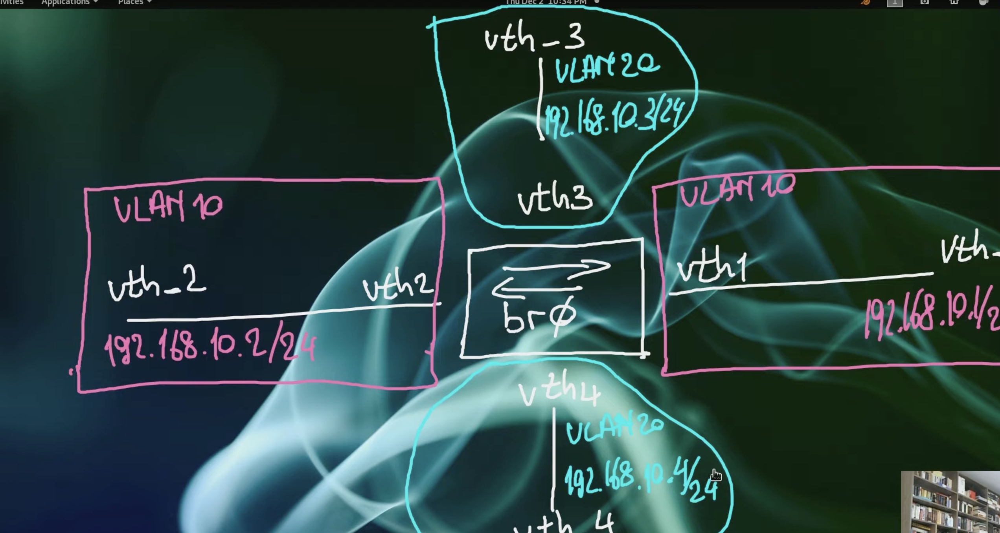

# VLAN

## What is a VLAN?

A **LAN** is a grouping of two or more devices on a network. A **VLAN** (virtual LAN) is a subgroup within a local network: splitting one physical network into multiple isolated logical networks. VLANs make it easy for network admins to separate a single switched network into groups that match the functional and security requirements of their systems.

- A VLAN is a **broadcast domain** partitioned and isolated at layer 2, so a physical network can hold multiple (up to 4096) independent networks.
- Each VLAN is identified by a number, often called a **tag**; frames are tagged to identify which virtual network they belong to.
- VLANs let administrators group hosts under the same switch or across different switches.
- On Linux, use a VLAN to separate subnets between VMs, namespaces, or hosts.

See also: [Ethernet frames](ethernet.md), [VXLAN](vxlan.md) (VLANs' scaled-up successor), [Linux bridge](linux-bridge.md).

## Switching fundamentals

A switch makes forwarding decisions based on MAC addresses: it reads the destination MAC of an arriving frame and checks its MAC address table to pick the outgoing port, so data only goes to the intended recipient — minimizing unnecessary traffic.

Switch functions:

1. **Address learning**
2. **Forwarding and filtering** — the destination MAC is compared to the forward/filter MAC database:
   - **Known unicast** → forwarded out that port only.
   - **Unknown unicast** → forwarded out all active ports except the one it arrived on (**flooding**).
   - **Multicast and broadcast** → forwarded out all active ports except the originating port.
3. **Loop avoidance** — STP.

Domains:

- Each switch port is its own **collision domain**. Switches at layer 2 eliminate much of the scaling problem by filtering out collisions; transmissions are governed by switch behavior and the broadcast domain.
- A **broadcast domain** is the area over which a broadcast frame propagates. Connecting two switches makes a larger broadcast domain: every device on either switch (and on any further attached switch) receives the broadcast.
- A **broadcast frame** is addressed to everyone on the local network. A switch always **floods** broadcast frames — but a switch never *originates* broadcasts (broadcasting isn't a switch function).
- Routers do **not** forward layer 2 unicast, multicast and broadcast frames.

### ARP

- Hosts use ARP to discover the hardware (MAC) address of a local peer for a given destination IP — so they can put the correct destination MAC in the layer 2 frame to reach the destination IP in the layer 3 packet.
- Simplified: host `10.0.0.7` broadcasts *"who has 10.0.0.1, tell 10.0.0.7"*; `10.0.0.1` replies with a short *"here"* packet. `10.0.0.7` sends to the hardware address in the reply and caches it for a relatively long time; after the cache expires, it asks again.
- Keeping ARP within LAN and VLAN segments is a matter of network security.

## How VLANs separate traffic

- Traffic arriving on a switch port in one VLAN is only ever forwarded out ports in the **same** VLAN — a switch never lets traffic cross a VLAN boundary. A frame arriving on a port in VLAN 10 can only leave a port in VLAN 10.
- If Host A (VLAN 10) sends a frame to Host B's MAC, it is still flooded only to ports in VLAN 10 — even if a MAC table entry for Host B exists in VLAN 30. It's as if each VLAN has its own independent MAC address table: the source address table maps port ↔ MAC **per VLAN**, enabling more advanced forwarding decisions.
- Example: if PC1 (VLAN 1) sends an ARP request, the switch sees it came from VLAN 1, so only PC2 and the router interface `192.168.1.254` (both in VLAN 1) see the frame.
- Layer 2 unicast, multicast and broadcast never cross VLAN boundaries: traffic on VLAN 1 isn't seen by nodes on VLAN 2. Only the switch is aware of the VLAN.
- VLANs therefore behave much like routed segments: nodes in a VLAN share a common addressing scheme, and traffic for another VLAN must go through a **router**. Devices in separate VLANs can't communicate by default; devices in the same VLAN can.
- Routers between VLANs filter broadcast traffic, enhance security, perform address summarization, and mitigate congestion.

### Aims of 802.1Q

- VLANs are supported over all IEEE 802 LAN MAC protocols, over shared-media LANs as well as point-to-point LANs.
- They make it easy to administer logical groups of stations that communicate as if on the same LAN — including moves, adds and changes of members.
- Traffic between VLANs is restricted: switches forward unicast, multicast and broadcast only on segments serving the traffic's VLAN.
- As far as possible, VLANs stay compatible with existing switches and end stations.
- If all switch ports transmit and receive untagged frames (to/from non-VLAN-aware devices), switches work in plug-and-play ISO/IEC 15802-3 mode, and end stations communicate throughout the bridged LAN.

## Tagging (802.1Q)

**Who inserts VLAN tags?** Switches do. Switches can assign VIDs based on port or protocol, and use the trunking protocol to modify the Ethernet frame by adding the VLAN ID.

802.1Q adds a **4-byte tag** to the Ethernet frame, inserted 12 bytes in — right after the source MAC (per 802.1D), before the original EtherType. Because the frame is changed, the EtherType seen first changes too: IP packets normally have EtherType `0x0800`, but over a trunk the field after the source MAC reads `0x8100`.

```text
┌───────────────────────────────────────────────────────────────────────────┐
│                                                                           │
│   Normal Ethernet Frame:                                                  │
│   ┌────────────┬────────────┬──────────┬─────────────────┬─────┐          │
│   │  Dst MAC   │  Src MAC   │ EtherType│     Payload     │ FCS │          │
│   │  6 bytes   │  6 bytes   │ 2 bytes  │                 │     │          │
│   └────────────┴────────────┴──────────┴─────────────────┴─────┘          │
│                                                                           │
│   802.1Q Tagged Frame:                                                    │
│   ┌────────────┬────────────┬──────────────────┬──────────┬───────┬─────┐ │
│   │  Dst MAC   │  Src MAC   │   VLAN Tag       │ EtherType│Payload│ FCS │ │
│   │  6 bytes   │  6 bytes   │   4 bytes        │ 2 bytes  │       │     │ │
│   └────────────┴────────────┴──────────────────┴──────────┴───────┴─────┘ │
│                                    │                                      │
│                    ┌───────────────┘                                      │
│                    ▼                                                      │
│            ┌───────────────────────────────────┐                          │
│            │         VLAN Tag (4 bytes)        │                          │
│            ├───────────────┬───────────────────┤                          │
│            │ TPID (0x8100) │  TCI              │                          │
│            │   2 bytes     │  2 bytes          │                          │
│            └───────────────┴───────────────────┘                          │
│                                    │                                      │
│                    ┌───────────────┘                                      │
│                    ▼                                                      │
│            ┌───────┬───────────────────────────┐                          │
│            │  TCI  │                           │                          │
│            ├───────┼─────────┬─────────────────┤                          │
│            │ PCP   │  DEI    │    VLAN ID      │                          │
│            │3 bits │ 1 bit   │   12 bits       │                          │
│            │(QoS)  │(drop)   │  (0-4095)       │                          │
│            └───────┴─────────┴─────────────────┘                          │
│                                                                           │
└───────────────────────────────────────────────────────────────────────────┘
```

| Field | Size    | Meaning                                         |
| ----- | ------- | ----------------------------------------------- |
| TPID  | 2 bytes | Tag Protocol Identifier — always `0x8100` for 802.1Q |
| TCI   | 2 bytes | Tag Control Information: PCP + DEI + VID        |
| PCP   | 3 bits  | Priority (0–7) for QoS                          |
| DEI   | 1 bit   | Drop Eligible Indicator                         |
| VID   | 12 bits | VLAN ID (0–4095; usable 1–4094)                 |

Frame fields (see [Ethernet](ethernet.md) for the full layout):

- **Preamble (8 bytes)** — alternating ones and zeros telling the receiver a frame is incoming.
- **Destination MAC (6 bytes)** — the frame's recipient.
- **Source MAC (6 bytes)** — the frame's source.
- **VLAN tag (4 bytes)** — optional 802.1Q tag differentiating traffic on the segments.
- **EtherType (2 bytes)** — which protocol is encapsulated in the payload.
- **Payload (variable)** — the encapsulated IP packet.
- **FCS (4 bytes)** — a four-octet cyclic redundancy check (CRC) in the frame footer, detecting corrupted data in the received frame.

Reference: [VLANs and Trunking (Packet Guide to Core Network Protocols)](https://www.oreilly.com/library/view/packet-guide-to/9781449311315/ch04.html)

## Port types

```text
┌─────────────────────────────────────────────────────────────────────────────┐
│                                                                             │
│   ACCESS PORT                        TRUNK PORT                             │
│   ───────────                        ──────────                             │
│                                                                             │
│   • Connects to end device           • Connects switches together           │
│   • One VLAN only                    • Carries multiple VLANs               │
│   • Frames are UNTAGGED              • Frames are TAGGED                    │
│                                                                             │
│      PC                                 Switch ════════ Switch              │
│       │                                        tagged    │                  │
│       │ untagged                               frames    │                  │
│       ▼                                                  ▼                  │
│   ┌────────┐                              ┌─────────────────────┐           │
│   │ Switch │                              │ VLAN 10 │ VLAN 20  │            │
│   │ Port 1 │                              │  tag    │   tag    │            │
│   │VLAN 10 │                              └─────────────────────┘           │
│   └────────┘                                                                │
│                                                                             │
│   Switch adds tag                    Tags preserved between                 │
│   when receiving,                    switches                               │
│   removes when sending                                                      │
│                                                                             │
└─────────────────────────────────────────────────────────────────────────────┘
```

### Access ports (untagged / port-based VLANs)

- An access port is a member of **only one** VLAN. Untagged VLANs are based on physical ports: no extra information is added to the frame; each port is identified as belonging to a specific VLAN. This divides one physical switch into multiple logical switches.
- If a device is connected to a port in a single VLAN only, the port should be untagged.
- Ports facing end hosts (workstations, printers, servers) are typically access ports. Since switches don't add a tag when sending out an access port, hosts can operate **without any knowledge** of their VLAN.
- An untagged port with PVID 10 accepts untagged traffic and assigns it VLAN 10 (and, on many switches, won't accept frames already tagged with VLAN 10).

### Trunk ports (tagged VLANs)

- Ports connected to other network devices (switches, routers) are typically **trunk** ports. Multiple tagged VLANs share the same trunk port.
- When sending out a trunk port, the switch tags each frame (inserting the tag between the source MAC and Type fields) so the other end knows its VLAN. An access port carries a single VLAN, so there's no need to tag traffic leaving it.
- What Cisco calls a **trunk port**, other vendors call a **tagged port** — referring to the VLAN tag added to all traffic leaving it.

### Native VLAN

> The native VLAN is the answer to how a switch processes traffic it receives on a trunk port **without** a VLAN tag.

Without a tag, the switch doesn't know the VLAN, so it associates the untagged traffic with the configured native VLAN: the VLAN that any untagged traffic received on a trunk port is assigned to.

## Linux VLAN interfaces (802.1Q sub-interfaces)

```sh
ip link add link eth0 name eth0.2 type vlan id 2
ip link add link eth0 name eth0.3 type vlan id 3

# Create VLAN 10 on eth0
ip link add link eth0 name eth0.10 type vlan id 10
# Result:
#   eth0     - Physical interface (untagged)
#   eth0.10  - Virtual interface for VLAN 10 (tagged)
```

A VLAN interface is a **child** of a physical interface that handles tagged traffic. Each `eth0.X` is an independent network interface with its own IP address:

```text
eth0 (parent)
 ├── eth0.10  (VLAN 10 interface)
 ├── eth0.20  (VLAN 20 interface)
 └── eth0.30  (VLAN 30 interface)
```

```sh
ip link add link eth0 name eth0.10 type vlan id 10
ip addr add 192.168.10.1/24 dev eth0.10
```

```text
┌─────────────────────────────────┐
│           IP Stack              │
│        192.168.10.1/24          │
└───────────────┬─────────────────┘
                │
┌───────────────▼─────────────────┐
│         eth0.10 (VID 10)        │  ← VLAN interface
└───────────────┬─────────────────┘
                │
┌───────────────▼─────────────────┐
│             eth0                │  ← Physical NIC
└─────────────────────────────────┘

No bridge involved!
```

From [anracom's VLAN-aware bridge notes](https://linux-blog.anracom.com/tag/vlan-aware-bridge/):

> VLANs are based on VLAN IDs (integer numbers) and a corresponding tagging of Ethernet packets – and on analyzing these tags at certain devices/interfaces or ports. In real and virtual Ethernet cards so-called sub-interfaces associated with VLAN IDs typically send/receive tagged packets into/from VLANs. In (virtual) bridges, ports can be associated with VLAN IDs and open only for packets with matching "tags". A VLAN ID assigned to a port is called a "VID". An Ethernet packet normally has one VLAN tag, identifying to which VLAN it belongs. Such a tag can be set, changed or removed in certain VLAN-aware devices.
>
> A packet routed into a sub-interface gets a VLAN tag with the VLAN ID of the sub-interface. Such tagging sub-devices can be defined for virtual Ethernet NICs like the endpoints of veth devices.

### How the kernel routes tagged frames to VLAN interfaces

Each physical device (`eth0`) has a **VLAN group** — a table mapping VLAN IDs to VLAN interfaces:

```text
┌────────────────────────────────────────────────────────────────────────────┐
│                                                                            │
│   eth0 (struct net_device)                                                 │
│   ┌─────────────────────────────────────────────────────────────────────┐  │
│   │                                                                     │  │
│   │   vlan_info ──────────► struct vlan_info                            │  │
│   │                         ┌────────────────────────────────┐          │  │
│   │                         │  grp (vlan_group)              │          │  │
│   │                         │  ┌──────────────────────────┐  │          │  │
│   │                         │  │ vlan_devices_arrays      │  │          │  │
│   │                         │  │                          │  │          │  │
│   │                         │  │  [VID 10] ──► eth0.10    │  │          │  │
│   │                         │  │  [VID 20] ──► eth0.20    │  │          │  │
│   │                         │  │  [VID 30] ──► eth0.30    │  │          │  │
│   │                         │  │  ...                     │  │          │  │
│   │                         │  └──────────────────────────┘  │          │  │
│   │                         └────────────────────────────────┘          │  │
│   └─────────────────────────────────────────────────────────────────────┘  │
│                                                                            │
│   When eth0.10 is created, it registers in eth0's vlan_info table!         │
│                                                                            │
└────────────────────────────────────────────────────────────────────────────┘
```

The parent maintains a table of child VLAN devices indexed by VLAN ID; when a tagged frame arrives, finding the right VLAN interface is a simple array lookup.

### VLAN sub-interfaces on veth

To create a VLAN interface on a veth endpoint, take a veth peer, create a sub-device of type `vlan` and give it a VID:

```sh
ip link add link veth1 name veth1.10 type vlan id 10
ip link set veth1 up
ip link set veth1.10 up
```

- The main device and its sub-devices may only become fully operational once the **peer** device is also up.
- A veth endpoint may get just one IP address, shared between all its VLAN sub-interfaces and its trunk interface.
- A veth endpoint has just one MAC, also shared among all sub-interfaces — so the MAC/IP tuple doesn't uniquely identify any of a veth's VLAN interfaces or its neutral trunk interface.

### The importance of working ARP

Broadcasts can't leave a VLAN unless a router connects the VLANs. ARP needs the sender's broadcast to reach its target, and the reply to make it back — so your VID and PVID settings must allow the returning answer to reach the original sender. Among other things this requires special settings on trunk ports that send untagged packets from different VLANs to a target and receive untagged packets back. **Without working ARP, all higher-layer communication with VLAN members fails.**

Since broadcasts (e.g. for ARP) can't cross VLAN borders, overall traffic can be reduced significantly in some setups.

## Bridge VLAN filtering

VLAN filtering gives a Linux bridge the capabilities of a VLAN-aware switch: each bridge port can be assigned to one or more VLANs, and traffic only flows between ports with the same VLANs. VLANs may be tagged or untagged; VLAN headers are stripped or added as packets enter or leave the bridge. With `vlan_filtering` on, the bridge filters outgoing packets by target MAC, packet tag and the VID of the target port. VLAN rules can differ for incoming and outgoing packets on a port!

Routing **between** VLANs is done by creating a VLAN device on top of the bridge.

### Concepts

| Term                  | Meaning                                                                                                                       |
| --------------------- | ----------------------------------------------------------------------------------------------------------------------------- |
| **Tagged / untagged** | A tagged port always sets a VLAN tag on egress; an untagged port always removes it on egress (packets leave toward the outside stripped of tags). |
| **VLAN ID**           | Checked on egress: if the packet's VID isn't in the bridge VLAN table for the egress port, it's dropped before being sent.     |
| **PVID**              | Port VLAN ID: tags all **untagged** ingress traffic on (access) ports with this VID. A dynamic entry is added to the bridge VLAN table and the port is added as untagged. PVID has no effect on already-tagged packets — they keep their tag. |
| **Port-based VLANs**  | Packets get a VLAN tag based on the bridge port the device is connected to (i.e. via PVID).                                   |

The following are bridge-port properties as named in MikroTik RouterOS:

- **Ingress filtering** — by default, VLANs not in the bridge VLAN table are dropped on egress; this drops them on **ingress** instead.
- **EtherType** — by default a VLAN-aware bridge filters by the C-TAG (`0x8100`); other tags are treated as untagged. The selected EtherType is used for VLAN filtering and tagging/untagging.
- **VLAN tunnelling** — if a packet's EtherType doesn't match the bridge's, ingress packets are treated as untagged, letting you encapsulate VLANs into another VLAN (and divert specific traffic through different devices).
- **Tag stacking** — with `tag-stacking=yes`, a packet already tagged with a matching EtherType gets **another** tag with the PVID on top, for all ingress packets.

### `bridge vlan` flags

- `pvid` — the VLAN is the PVID at ingress: untagged frames are assigned to it.
- `untagged` — the VLAN is treated as untagged on egress.
- `master` — the setting applies to the software bridge; the default, used for any port other than the bridge itself.
- `self` — needed when adding a VLAN on the bridge device (`br0`) itself.

Only **one PVID per port**: adding a new PVID removes the old one.

```c
// include/uapi/linux/if_bridge.h

#define BRIDGE_VLAN_INFO_MASTER      (1<<0)  // Operates on bridge device
#define BRIDGE_VLAN_INFO_PVID        (1<<1)  // VLAN is PVID
#define BRIDGE_VLAN_INFO_UNTAGGED    (1<<2)  // VLAN is untagged
#define BRIDGE_VLAN_INFO_RANGE_BEGIN (1<<3)  // VLAN range begin
#define BRIDGE_VLAN_INFO_RANGE_END   (1<<4)  // VLAN range end
#define BRIDGE_VLAN_INFO_BRENTRY     (1<<5)  // Bridge entry
```

### Default membership

```sh
ip link add br0 type bridge vlan_filtering 1
ip link set eth0 master br0
```

Every port **must** have VLAN membership to pass traffic. By default, an enslaved port gets PVID 1 automatically:

```console
$ bridge vlan show
port              vlan-id
eth0              1 PVID Egress Untagged
br0               1 PVID Egress Untagged
```

```console
81b443eaa1bc:/# bridge vlan show
port              vlan-id
veth0             1 PVID Egress Untagged
                  2000
veth1             1 PVID Egress Untagged
br0               1 PVID Egress Untagged
```

Set PVID 100 on `eth0` (untagged frames → VLAN 100):

```sh
bridge vlan add vid 100 dev eth0 pvid untagged
```

Remove the default VLAN from a port:

```sh
bridge vlan del vid 1 dev veth1
```

### Example: two VLANs on a bridge

```sh
# Create bridge with VLAN filtering
ip link add br0 type bridge vlan_filtering 1

# Add ports
ip link set eth0 master br0
ip link set eth1 master br0

# Configure VLANs on ports
bridge vlan add dev eth0 vid 10 pvid untagged
bridge vlan add dev eth0 vid 20
bridge vlan add dev eth1 vid 10
bridge vlan add dev eth1 vid 20 pvid untagged
```

```text
┌────────────────────────────────────────────────────────────────────────────┐
│                                                                            │
│   PVID (Port VLAN ID):                                                     │
│     Default VLAN for untagged frames arriving on this port                 │
│                                                                            │
│   UNTAGGED flag:                                                           │
│     Strip the tag when sending out this port                               │
│                                                                            │
│   Example:                                                                 │
│                                                                            │
│   ┌─────────────────────────────────────────────────────────────────────┐  │
│   │                          br0                                        │  │
│   │                                                                     │  │
│   │   eth0                              eth1                            │  │
│   │   VLANs: 10, 20                     VLANs: 10, 20                   │  │
│   │   PVID: 10                          PVID: 20                        │  │
│   │   Untagged: 10                      Untagged: 20                    │  │
│   └───────┬─────────────────────────────────────┬───────────────────────┘  │
│           │                                     │                          │
│           ▼                                     ▼                          │
│       ┌───────┐                             ┌───────┐                      │
│       │  PC1  │                             │  PC2  │                      │
│       │       │                             │       │                      │
│       └───────┘                             └───────┘                      │
│                                                                            │
│   PC1 sends untagged frame:                                                │
│     → Arrives on eth0 → Tagged with PVID 10                                │
│     → Bridge switches based on VLAN 10                                     │
│     → If going out eth0 → Strip tag (untagged for VLAN 10)                 │
│     → If going out eth1 → Keep tag (not untagged for VLAN 10)              │
│                                                                            │
└────────────────────────────────────────────────────────────────────────────┘
```

### Walkthrough (Red Hat)

From [Introduction to Linux bridging commands and features](https://developers.redhat.com/articles/2022/04/06/introduction-linux-bridging-commands-and-features#vlan_filter):

```sh
# Enable a VLAN filter on the br0 bridge
ip link set br0 type bridge vlan_filtering 1

ip link set eth1 master br0
ip link set eth1 up
ip link set br0 up

# Make the veth1 bridge port transmit only VLAN 2 data
bridge vlan add dev veth1 vid 2
```

Make `veth2` transmit VLAN 2 data. `pvid` assigns untagged frames to this VLAN at ingress (veth2 → bridge); `untagged` untags packets on egress (bridge → veth2):

```sh
bridge vlan add dev veth2 vid 2 pvid untagged
```

Same on `veth3` for VLAN 3. `master` (configure on the software bridge) is the default, so it has the same effect:

```sh
bridge vlan add dev veth3 vid 3 pvid untagged master
```

Enable VLAN 2 and VLAN 3 traffic on `eth1`:

```sh
bridge vlan add dev eth1 vid 2-3
```

VLAN statistics:

```sh
# Global VLAN statistics on the bridge (kernel 4.7+)
ip link set br0 type bridge vlan_stats_enabled 1

# Per-VLAN statistics when there are no port VLANs in the bridge (kernel 4.20+)
ip link set br0 type bridge vlan_stats_per_port 1

# Show per-VLAN statistics
bridge -s vlan show
```

Result:

```console
$ bridge vlan show
port              vlan-id
eth1              1 PVID Egress Untagged
                  2
                  3
br0               1 PVID Egress Untagged
veth1             1 Egress Untagged
                  2
veth2             1 Egress Untagged
                  2 PVID Egress Untagged
veth3             1 Egress Untagged
                  3 PVID Egress Untagged
```

- `ip link` adds and removes bridges and sets their options.
- `bridge` displays and manipulates the bridge's forwarding database (FDB), multicast database (MDB), and VLANs.

### Lab: two namespaces on VLAN 10



```sh
ip addr add 192.168.5.1/24 brd 192.168.5.255 dev veth11   # brd = broadcast address
```

Initial state:

```console
ubuntu@ubuntu:~$ bridge vlan show
port              vlan-id
vth1              1 PVID Egress Untagged
vth2              1 PVID Egress Untagged
vth3              1 PVID Egress Untagged
vth4              1 PVID Egress Untagged
br0               1 PVID Egress Untagged
```

Put `vth1` and `vth2` on VLAN 10:

```sh
bridge vlan add vid 10 dev vth1 pvid untagged
# same
bridge vlan add vid 10 dev vth1 pvid untagged master

bridge vlan add vid 10 dev vth2 pvid untagged
```

```console
ubuntu@ubuntu:~$ bridge vlan show
port              vlan-id
vth1              1 Egress Untagged
                  10 PVID Egress Untagged
vth2              1 Egress Untagged
                  10 PVID Egress Untagged
vth3              1 PVID Egress Untagged
vth4              1 PVID Egress Untagged
br0               1 PVID Egress Untagged
```

Pinging `netns2` from `netns1`: on ingress the untagged frame gets VLAN 10; as the bridge forwards it to `netns2`, the tag is removed (frame untagged). Since the VLANs create boundaries around the ports, hosts on other VLANs can't communicate with them.

### VLAN filtering in the bridge code

Ingress:

```c
// net/bridge/br_vlan.c

bool br_allowed_ingress(struct net_bridge *br, struct net_bridge_port *p,
                        struct sk_buff *skb, u16 *vid, u8 *state)
{
    // 1. Get VLAN ID from frame (or assign PVID if untagged)
    // 2. Check if this VLAN is allowed on this port
    // 3. If not allowed → drop
    // 4. If allowed → continue processing
}
```

Egress:

```c
// net/bridge/br_vlan.c

struct sk_buff *br_handle_vlan(struct net_bridge *br,
                                struct net_bridge_port *p,
                                struct sk_buff *skb)
{
    // 1. Check if VLAN allowed on egress port
    // 2. If port has UNTAGGED flag for this VLAN → strip tag
    // 3. If not → keep tag
    // 4. Return modified skb
}
```

**The FDB is per-VLAN** — with VLAN filtering, the FDB key includes the VLAN ID:

```c
struct net_bridge_fdb_key {
    mac_addr addr;      // MAC address
    u16      vlan_id;   // VLAN ID  ← THIS!
};
```

```text
┌───────────────────────────────────────────────────────────────────────────┐
│                                                                           │
│   FDB with VLAN:                                                          │
│                                                                           │
│   ┌────────────────────┬──────────┬─────────────┐                         │
│   │ MAC Address        │ VLAN ID  │ Port        │                         │
│   ├────────────────────┼──────────┼─────────────┤                         │
│   │ aa:bb:cc:dd:ee:01  │    10    │ eth0        │                         │
│   │ aa:bb:cc:dd:ee:01  │    20    │ eth1        │ ← Same MAC, diff VLAN!  │
│   │ aa:bb:cc:dd:ee:02  │    10    │ eth1        │                         │
│   └────────────────────┴──────────┴─────────────┘                         │
│                                                                           │
│   The same MAC can be on different ports for different VLANs!             │
│                                                                           │
└───────────────────────────────────────────────────────────────────────────┘
```

### Netfilter on bridged traffic

By default, traffic forwarded by the bridge doesn't go through iptables. To let iptables `FORWARD` rules filter layer 2 traffic:

```sh
ip link set br0 type bridge nf_call_iptables 1
```

## VLAN interfaces vs bridge port VLANs

VLAN interfaces (`eth0.10`) are **not** bridge ports and are unrelated to bridging by default: `ip link add link eth0 name eth0.10 type vlan id 10` creates a new device, a child of `eth0`, which does **not** show in `bridge vlan show`. They're regular interfaces that *can* be enslaved to a bridge like any other.

A **bridge port** is an interface enslaved to a bridge for L2 switching:

```text
br0 (bridge)
 ├── eth0  (port)
 ├── eth1  (port)
 └── veth0 (port)
```

```text
┌─────────────────────────────────────────────────────────────────┐
│                                                                 │
│   VLAN Interface (802.1Q)          Bridge Port VLAN Config      │
│   ────────────────────────         ────────────────────────     │
│                                                                 │
│   eth0                             br0                          │
│    │                                │                           │
│    ├── eth0.10 (VID 10) ◄─ DEVICE   ├── eth0 [vid 10,20]  ◄─ CONFIG
│    ├── eth0.20 (VID 20) ◄─ DEVICE   ├── eth1 [vid 10]     ◄─ CONFIG
│    └── eth0.30 (VID 30) ◄─ DEVICE   └── eth2 [vid 20]     ◄─ CONFIG
│                                                                 │
│   Can assign IP to each            Cannot assign IP to VIDs    │
│                                    (only to br0 itself)         │
└─────────────────────────────────────────────────────────────────┘
```

A VLAN interface **can** be a bridge port:

```text
                      ┌─────────────┐
                      │    br10     │  ← Bridge for VLAN 10
                      │ 192.168.10.1│
                      └──────┬──────┘
                             │ (bridge port)
                      ┌──────▼──────┐
                      │   eth0.10   │  ← VLAN interface
                      └──────┬──────┘
                             │ (parent)
                      ┌──────▼──────┐
                      │    eth0     │  ← Physical NIC
                      └─────────────┘
```

```sh
# Pattern 1: VLAN interface as bridge port
ip link add link eth0 name eth0.10 type vlan id 10
ip link add br10 type bridge
ip link set eth0.10 master br10    # VLAN interface becomes bridge port

# Pattern 2: Bridge with VLAN filtering (modern approach)
ip link add br0 type bridge vlan_filtering 1
ip link set eth0 master br0
bridge vlan add vid 10 dev eth0
bridge vlan add vid 20 dev eth0
```

## QinQ (802.1ad) — VLAN stacking

Double tagging — a VLAN tag inside another VLAN tag:

```text
┌───────────────────────────────────────────────────────────────────────────┐
│                                                                           │
│   Normal 802.1Q:                                                          │
│   ┌────────┬────────┬──────────┬──────────┬─────────┐                     │
│   │Dst MAC │Src MAC │ 0x8100   │EtherType │ Payload │                     │
│   │        │        │ VID=10   │          │         │                     │
│   └────────┴────────┴──────────┴──────────┴─────────┘                     │
│                          │                                                │
│                     Inner tag                                             │
│                                                                           │
│   QinQ (802.1ad):                                                         │
│   ┌────────┬────────┬──────────┬──────────┬──────────┬─────────┐          │
│   │Dst MAC │Src MAC │ 0x88a8   │ 0x8100   │EtherType │ Payload │          │
│   │        │        │ VID=100  │ VID=10   │          │         │          │
│   └────────┴────────┴──────────┴──────────┴──────────┴─────────┘          │
│                          │          │                                     │
│                     Outer tag  Inner tag                                  │
│                     (S-VLAN)   (C-VLAN)                                   │
│                                                                           │
│   0x88a8 = S-Tag (Service VLAN / Provider)                                │
│   0x8100 = C-Tag (Customer VLAN)                                          │
│                                                                           │
└───────────────────────────────────────────────────────────────────────────┘
```

## VLAN over VXLAN

Mapping VLANs to VXLAN VNIs so VLAN 100 on Host A can talk to VLAN 100 on Host B over L3:

```text
┌─────────────────────────────────────────────────────────────────────────────┐
│                                                                             │
│   Host A                                              Host B                │
│   ┌─────────────────────────┐                  ┌─────────────────────────┐  │
│   │ Container (VLAN 100)    │                  │ Container (VLAN 100)    │  │
│   │           │             │                  │           │             │  │
│   │           ▼             │                  │           ▼             │  │
│   │    ┌──────────────┐     │                  │    ┌──────────────┐     │  │
│   │    │   Bridge     │     │                  │    │   Bridge     │     │  │
│   │    │ VLAN 100 ────┼─────┼──────────────────┼────┼─── VLAN 100  │     │  │
│   │    │              │     │      VXLAN       │    │              │     │  │
│   │    │   VXLAN      │     │     VNI 1000     │    │   VXLAN      │     │  │
│   │    │   VNI 1000   │     │                  │    │   VNI 1000   │     │  │
│   │    └──────┬───────┘     │                  │    └──────┬───────┘     │  │
│   │           │             │                  │           │             │  │
│   │           ▼             │                  │           ▼             │  │
│   │         eth0            │                  │         eth0            │  │
│   └───────────┼─────────────┘                  └───────────┼─────────────┘  │
│               │                                            │                │
│               └─────────────── IP Network ─────────────────┘                │
│                                                                             │
│   VLAN 100 on Host A can talk to VLAN 100 on Host B over L3!                │
│                                                                             │
└─────────────────────────────────────────────────────────────────────────────┘
```

```sh
# Create VXLAN
ip link add vxlan100 type vxlan id 1000 dstport 4789 local 10.0.0.1

# Create VLAN-aware bridge
ip link add br0 type bridge vlan_filtering 1

# Add VXLAN to bridge
ip link set vxlan100 master br0
bridge vlan add dev vxlan100 vid 100

# Add container veth to bridge
ip link set veth0 master br0
bridge vlan add dev veth0 vid 100 pvid untagged
```

```text
┌─────────────────────────────────────────────────────────────────┐
│                        Host A (VTEP)                            │
│  ┌─────────────────────────────────────────────────────────┐    │
│  │                    VM / Container                       │    │
│  │                  192.168.1.10/24                        │    │
│  └────────────────────────┬────────────────────────────────┘    │
│                           │                                     │
│  ┌────────────────────────▼────────────────────────────────┐    │
│  │              VXLAN Interface (vxlan100)                 │    │
│  │                     VNI: 100                            │    │
│  │               FDB: MAC → Remote VTEP IP                 │    │
│  └────────────────────────┬────────────────────────────────┘    │
│                           │ UDP encapsulation                   │
│  ┌────────────────────────▼────────────────────────────────┐    │
│  │                  Physical NIC (eth0)                    │    │
│  │                    10.0.0.1/24                          │    │
│  └────────────────────────┬────────────────────────────────┘    │
└───────────────────────────┼─────────────────────────────────────┘
                            │
                   ┌────────▼────────┐
                   │   IP Network    │
                   │  (Underlay L3)  │
                   └────────┬────────┘
                            │
┌───────────────────────────┼─────────────────────────────────────┐
│                           │                                     │
│  ┌────────────────────────▼────────────────────────────────┐    │
│  │                  Physical NIC (eth0)                    │    │
│  │                    10.0.0.2/24                          │    │
│  └────────────────────────┬────────────────────────────────┘    │
│                           │ UDP decapsulation                   │
│  ┌────────────────────────▼────────────────────────────────┐    │
│  │              VXLAN Interface (vxlan100)                  │   │
│  │                     VNI: 100                             │   │
│  └────────────────────────┬────────────────────────────────┘    │
│                           │                                     │
│  ┌────────────────────────▼────────────────────────────────┐    │
│  │                    VM / Container                        │   │
│  │                  192.168.1.20/24                         │   │
│  └─────────────────────────────────────────────────────────┘    │
│                        Host B (VTEP)                            │
└─────────────────────────────────────────────────────────────────┘
```

## Data center / cloud: multi-tenant isolation

Multi-tenant cloud (AWS, Azure, GCP, OpenStack):

```text
┌─────────────────────────────────────────────────────────────────────┐
│                         Physical Host                               │
│  ┌───────────────┐  ┌───────────────┐  ┌───────────────┐            │
│  │   Tenant A    │  │   Tenant B    │  │   Tenant C    │            │
│  │   VM/Pod      │  │   VM/Pod      │  │   VM/Pod      │            │
│  │ 10.0.1.5/24   │  │ 10.0.1.5/24   │  │ 10.0.1.5/24   │  Same IP!  │
│  └───────┬───────┘  └───────┬───────┘  └───────┬───────┘            │
│          │                  │                  │                    │
│  ┌───────▼──────────────────▼──────────────────▼───────┐            │
│  │                      OVS / Linux Bridge              │           │
│  │                   VXLAN VNI per tenant               │           │
│  │        VNI 1000          VNI 2000       VNI 3000     │           │
│  └───────────────────────────┬─────────────────────────┘            │
│                              │                                      │
│  ┌───────────────────────────▼─────────────────────────┐            │
│  │                    Physical NIC                      │           │
│  │              VXLAN encapsulation                     │           │
│  └───────────────────────────┬─────────────────────────┘            │
└──────────────────────────────┼──────────────────────────────────────┘
                               │
                    ┌──────────▼──────────┐
                    │   Underlay Network   │
                    │   (IP Fabric L3)     │
                    └─────────────────────┘
```

Technologies used:

- **VXLAN** — tenant isolation (16M VNIs vs 4K VLANs).
- **VXLAN `COLLECT_METADATA`** — OVS/tc flower dynamic tunneling.
- **Bridge FDB** — MAC learning per VNI.
- **VXLAN ARP proxy** — reduces broadcast in the overlay.

## Further reading

"More fun with veth, network namespaces and VLANs" (anracom):

1. [Open questions](https://linux-blog.anracom.com/2024/02/14/more-fun-with-veth-network-namespaces-vlans-i-open-questions/)
2. [Two L2 segments attached to a common network namespace](https://linux-blog.anracom.com/2024/02/16/more-fun-with-veth-network-namespaces-vlans-ii-two-l2-segments-attached-to-a-common-network-namespace/)
3. [L2 segments of the same IP subnet and routes in coupling network namespaces](https://linux-blog.anracom.com/2024/02/20/more-fun-with-veth-network-namespaces-vlans-iii-l2-segments-of-the-same-ip-subnet-and-routes-in-coupling-network-namespaces/)
4. [L2 segments, same IP subnet, ARP and routes](https://linux-blog.anracom.com/2024/02/29/more-fun-with-veth-network-namespaces-vlans-iv-l2-segments-same-ip-subnet-arp-and-routes/)
5. [Link two L2 segments of the same IP subnet by a routing network namespace](https://linux-blog.anracom.com/2024/03/08/more-fun-with-veth-network-namespaces-vlans-v-link-two-l2-segments-of-the-same-ip-subnet-by-a-routing-network-namespace/)
6. [veth sub-devices for 802.1Q VLANs](https://linux-blog.anracom.com/2024/03/21/more-fun-with-veth-network-namespaces-vlans-vi-veth-subdevices-for-802-1q-vlans/)
7. [Two namespaces connected by a veth-based VLAN](https://linux-blog.anracom.com/2024/04/26/more-fun-with-veth-and-linux-network-namespaces-vii-two-namespaces-connected-by-a-veth-based-vlan/)

Notes from parts 2–3:

- A Linux bridge can itself get an IP address and work as a special NIC connected to the bridge ports.
- Packet transfer between L2 segments behind different NIC devices in the same network namespace must be allowed explicitly; by default the kernel won't do it.

Other:

- [VLAN-aware bridge (anracom)](https://linux-blog.anracom.com/tag/vlan-aware-bridge/)
- [VLANs and Trunking (O'Reilly)](https://www.oreilly.com/library/view/packet-guide-to/9781449311315/ch04.html)
- [Introduction to Linux bridging commands and features (Red Hat)](https://developers.redhat.com/articles/2022/04/06/introduction-linux-bridging-commands-and-features#vlan_filter)
