# VXLAN

> **V**irtual e**X**tensible **L**ocal **A**rea **N**etwork — "A Framework for Overlaying Virtualized Layer 2 Networks over Layer 3 Networks" ([RFC 7348](https://tools.ietf.org/html/rfc7348))

See also: [two-host VXLAN lab](linux-vxlan.md), [VLAN](vlan.md), [tunneling](tunnel.md).

## Why VXLAN?

### The VLAN problem

A VLAN is an extension to Ethernet that adds the 802.1Q header to the frame, letting devices tag traffic with a number from 1 to 4094 (the **VLAN ID**); each number is a different virtual network. Each VLAN is a broadcast domain: hosts within a VLAN communicate as within a LAN, inter-VLAN traffic can't interoperate directly, and broadcasts are restricted to the VLAN.

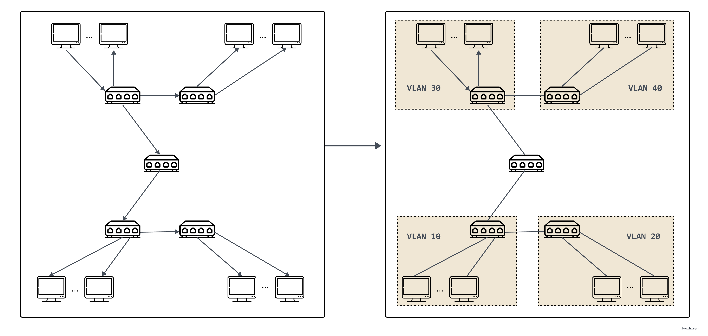

- **VLAN ID limit:** the 802.1Q spec (1998) reserves only 32 bits for the VLAN tag, of which only **12 bits** hold the VLAN ID → at most 4,094 usable VLANs (4,096 values) per Ethernet network.
- When cloud data centers emerged, even ignoring virtualization, the physical devices needing IPs alone could number tens or hundreds of thousands. 4096 VLANs is not enough.
- It is insufficient for large multi-tenant environments where each tenant may need several isolated networks (prod, dev, staging).

RFC 7348 lists the motivations as:

1. Limitations imposed by Spanning Tree and VLAN ranges.
2. Multi-tenant environments.
3. Inadequate table sizes at ToR (Top-of-Rack) switches.

### Problems overlay networks solve

1. Migration of VMs and instances within clusters, across clusters, or between data centers is common in cloud computing.
2. A single cluster can have a huge number of VMs; the resulting MAC addresses and ARP requests put tremendous pressure on network devices.
3. VLANs can only create 4096 virtual networks; public clouds and large virtualized clusters need more for isolation.

### Why VM migration matters

- **Cost reduction** — consolidate workloads onto fewer servers and shut down underutilized hardware, saving power and hardware costs.
- **Performance** — move workloads to hosts with more resources or newer hardware.
- **Resource optimization** — balance workloads across servers to avoid bottlenecks.
- **Disaster recovery and high availability** — quickly move VMs to safe environments during hardware failure or maintenance, minimizing downtime.
- **Scalability and flexibility** — add or reconfigure servers with minimal disruption.

VXLAN's layer 2 tunneling overcomes IP subnetting limitations: administrators can move VMs to **any** server in the data center regardless of its subnetting scheme, keeping a reliable L3 architecture while supporting VM mobility. Data centers gained a lot more flexibility in where to place workloads, how to connect them to virtual network services, and how to migrate multi-tier applications to the cloud (and set up hybrid cloud deployments).

## What is VXLAN?

VXLAN is a tunneling protocol that encapsulates **layer 2 Ethernet frames in layer 4 UDP packets** (MAC-in-UDP). The transport over the physical data center network is IP plus UDP.

A logical VXLAN tunnel is established between the source and destination devices. The original Ethernet frame sent by a VM is encapsulated in a UDP packet, then wrapped with the IP and Ethernet headers of the physical network. The encapsulated packet behaves like a normal IP packet and can be routed — "giving VMs in the layer 2 network the wings of routing", freeing them from the structural limits of L2 and L3 networks.

- VXLAN doesn't care what the underlay topology is: as long as it can carry UDP packets, it can provide Ethernet (L2) connectivity between remote segments.
- Fundamentally, VXLAN aggregates and tunnels multiple layer 2 (sub)networks across a layer 3 infrastructure. The base case connects two or more L3 domains and makes them look like one common L2 domain, so VMs on different networks communicate as if on the same L2 subnet.
- Unlike most tunnels, a VXLAN is a **1-to-N network**, not just point-to-point. A VXLAN device can learn the IP address of other endpoints dynamically (like a learning bridge) or use statically configured forwarding entries.
- The tunnels are **stateless**: each frame is encapsulated according to a set of rules.
- VXLAN doesn't change layer 3 addressing schemes: IP addressing rules in a physical L2 still apply to the virtual networks.

### Overlay and underlay

An **overlay network** is not new technology: it's a computer network built on top of another network, a form of network virtualization. It can't stand alone — the network it depends on is the **underlay**, so the two concepts appear in pairs. An overlay network is only possible with tunneling.

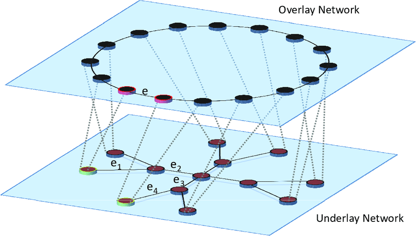

- Overlay networks use tunneling to flexibly select different underlying links and ensure stable traffic transmission.
- Different virtual topologies can be built as required without modifying the underlying network.

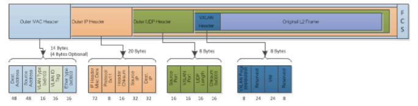

### Isolation and multi-tenancy

- The **VNI** is 24 bits → ~16 million (2²⁴ = 16,777,216) isolated segments, a 4000× increase over VLANs. Multicast and hardware limitations reduce the usable number in most deployments.
- Each VNI is a completely separate **broadcast domain**. Tenants' networks don't bleed into each other, even with the same IP ranges: Tenant A's prod-net (VNI 10001) and Tenant B's prod-net (VNI 20001) can both use `192.168.1.0/24`.
- If Customer A has a VXLAN segment with VNI 5000 in both Data Center 1 and Data Center 2, all of Customer A's VMs, containers or bare-metal servers in both DCs communicate as if on the same L2 network, though connected through L3.
- VXLAN keeps VM identity unique by combining the VM's **MAC address and VNI**. Duplicate MACs can exist in a data center — just not on the same VNI.

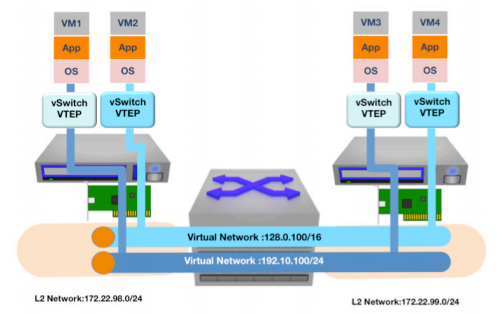

## Key components

### VTEP (VXLAN Tunnel Endpoint)

An edge device of a VXLAN network and the start/end point of a VXLAN tunnel:

- The source VTEP encapsulates the original frames from the source server into VXLAN packets and sends them over the IP network to the destination VTEP, which decapsulates them and forwards the original frames to the destination server.
- VTEPs can be virtual bridges in the hypervisor, VXLAN-aware VM applications, physical switches, or hosts in a virtualized cluster.
- A VTEP maps local VLANs to VNIs and vice versa.
- Tunnel endpoints need a mapping of **VM MAC address → VTEP IP**.
- In container setups, VTEPs on both hosts attach to the host's bridge, with containers attached to the bridge. Data leaving the containers is encapsulated and sent over the tunnel, to be decapsulated by the peer VTEP.

- **Ingress VTEP** encapsulates Ethernet frames into VXLAN packets; **egress VTEP** decapsulates them and delivers the original frame to the correct VM or host.

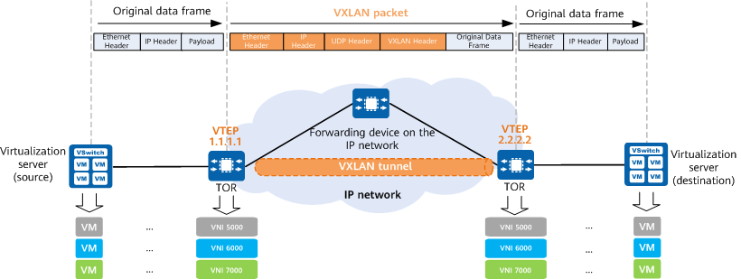

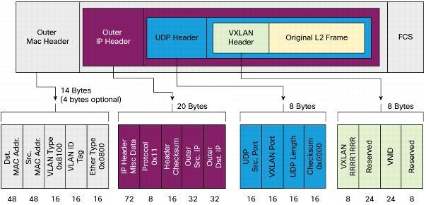

Each VM's bridge domain (BD) maps to a VNI, and one VTEP per hypervisor carries all the VNIs:

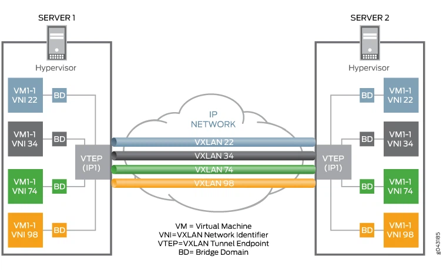

### VNI (VXLAN Network Identifier)

- A 24-bit identifier, similar to a VLAN ID, carried in the VXLAN header. Generally each VNI identifies one **tenant**.
- VMs in a logical L2 domain use the same subnet and map to a common VNI; it's the L2-to-VNI mapping that lets them communicate. VMs with different VNIs cannot communicate at layer 2.
- The VNI identifies the scope of the inner MAC frame originated by a VM; it sits in the outer header that encapsulates that frame. MAC traffic that "crosses over" is isolated by VNI.
- **Layer 2 VNI:** common VNI for intra-subnet forwarding. **Layer 3 VNI:** bound to a VPN instance for inter-subnet forwarding.

### VXLAN gateway

Forwards traffic between VXLANs, or between VXLAN networks and traditional VLAN/non-VXLAN networks. To reach outside, the gateway removes the VXLAN and UDP headers and forwards the packet; responses come back to the gateway, which re-adds the headers. Neither the source VM nor the destination equipment needs modification.

### Acronyms (RFC 7348)

| Term           | Meaning                                                                    |
| -------------- | -------------------------------------------------------------------------- |
| PIM            | Protocol Independent Multicast                                             |
| SPB            | Shortest Path Bridging                                                     |
| STP            | Spanning Tree Protocol                                                     |
| ToR            | Top of Rack                                                                |
| TRILL          | Transparent Interconnection of Lots of Links                               |
| VLAN           | Virtual Local Area Network                                                 |
| VNI            | VXLAN Network Identifier (or VXLAN Segment ID)                             |
| VTEP           | VXLAN Tunnel End Point — an entity that originates and/or terminates VXLAN tunnels |
| VXLAN          | Virtual eXtensible Local Area Network                                      |
| VXLAN Segment  | VXLAN layer 2 overlay network over which VMs communicate (= VXLAN overlay network); only VMs in the same segment can communicate |
| VXLAN Gateway  | An entity that forwards traffic between VXLANs                             |

## Frame format

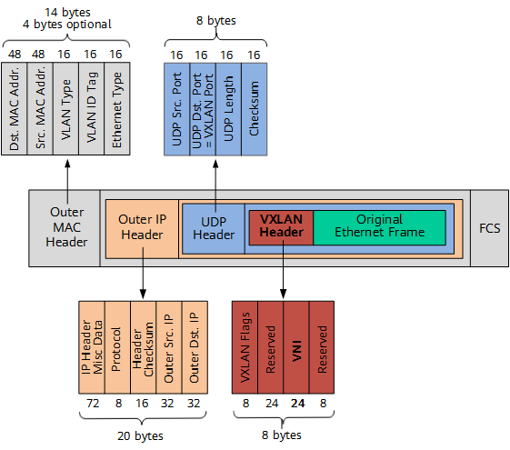

A VTEP adds these headers to the original L2 frame sent by a VM:

- **VXLAN header (8 bytes)** — a 24-bit VNI field (defines tenants), an 8-bit Flags field (`00001000`), and two reserved fields (24 and 8 bits).
- **UDP header** — the VXLAN header + original frame are the UDP payload. Destination port is fixed at **4789**; the source port is a hash of the original Ethernet frame (gives ECMP entropy).
- **Outer IP header** — source = IP of the VTEP connected to the source VM; destination = IP of the VTEP connected to the destination VM.
- **Outer MAC header** (outer Ethernet header) — source = MAC of the source VTEP; destination = MAC of the next hop toward the destination VTEP (the target VTEP or an intermediate L3 router). An outer VLAN tag is optional; if present, it may delineate VXLAN traffic on the LAN.

```text
[ Outer Ethernet ]
   ├── Outer IP Header (IPv4 or IPv6)
   ├── UDP Header (destination port 4789)
   ├── VXLAN Header (8 bytes)
   └── Inner Ethernet Frame
        ├── Destination MAC
        ├── Source MAC
        ├── EtherType
        ├── Payload
        └── FCS
```

```text
+0--------------7---------------15--------------23--------------31 -------------------------------
|           Source Port         |       Dest Port = VXLAN Port  |                 |
+---------------------------------------------------------------+             UDP Header
|           UDP Length          |        UDP Checksum           |                 |
+---------------------------------------------------------------+  -------------------------------
|  VXLAN Flags  |            Reserved_1                         |                 |
+---------------------------------------------------------------+            VXLAN Header
|                VXLAN Network Identifier       |   Reserved_2  |                 |
+---------------------------------------------------------------+  -------------------------------
```

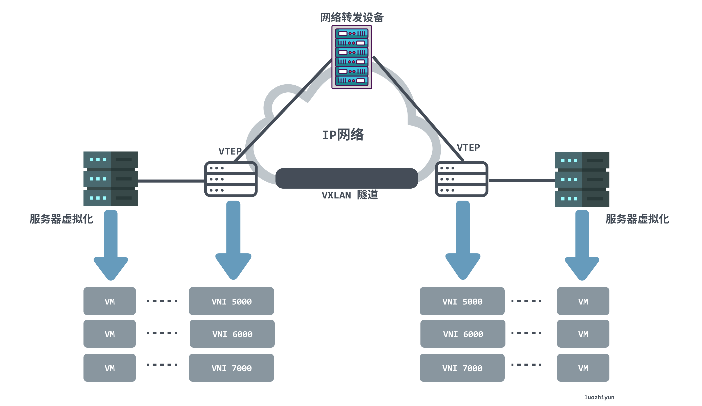

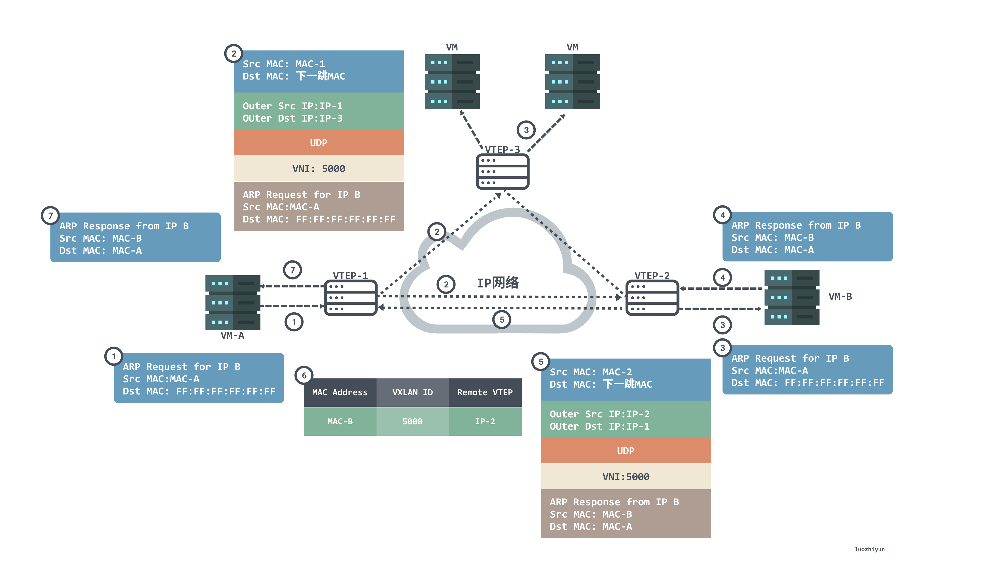

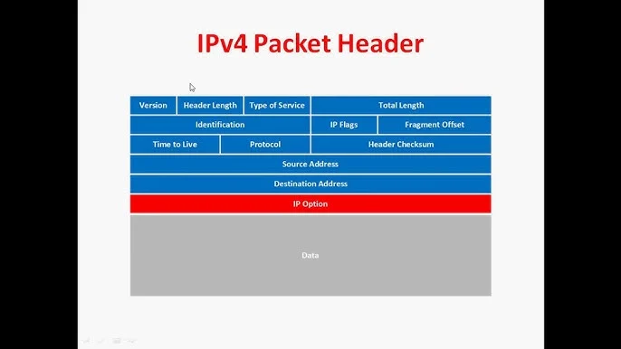

## How it works

### Unicast VM-to-VM communication

1. VM1 is unaware it's on VXLAN — no special configuration is needed. To reach VM2 on another host, it simply sends a standard MAC frame.
2. The VTEP on VM1's host checks the VNI associated with VM1, verifies the MAC is in the correct segment, and whether the destination MAC maps to a remote VTEP.
3. **Sending:** an outer header (outer MAC, outer IP, VXLAN header) is prepended, and the packet is forwarded to the remote VTEP.
4. **Receiving:** the remote VTEP checks the VNI and whether a VM on that VNI has a MAC matching the inner destination MAC. If so, it removes the encapsulation and delivers the frame to VM2.
5. VM2 is unaware of the VNI or encapsulation; it receives a normal Ethernet frame.
6. The remote VTEP **learns** the mapping inner source MAC → outer source IP, so when VM2 replies it forwards directly without flooding.

### ARP, broadcast and multicast

When a component starts communicating, it behaves as in a non-VXLAN network:

- Same subnet → ARP broadcast to locate the destination.
- Different subnet → ARP for the first-hop router (which may also be a VTEP); otherwise ARP to a VTEP.

Broadcasts are mapped to multicast:

- The VTEP encapsulates the ARP request (VXLAN + UDP + IP headers) and sends it to the **IP multicast group** associated with the VXLAN segment. Multicast addresses are `224.0.0.0`–`239.255.255.255`.
- The VNI → multicast group mapping is done at the management layer and provided to VTEPs over a management channel.
- VTEPs send IGMP membership reports upstream to join/leave the groups as needed, enabling pruning of leaf nodes with no members.
- Multicast routing protocols like PIM-SM ([RFC 4601](https://www.rfc-editor.org/rfc/rfc4601)) provide efficient multicast trees in the L3 network.
- The destination VTEP decapsulates, leaving the original frame, and locates the destination with ARP as if on a single network.
- The destination VM sends a standard ARP response, encapsulated back to the originating VTEP using **unicast** VXLAN.
- Multicast frames and "unknown MAC destination" frames also use the multicast tree, like broadcasts.

### Physical infrastructure requirements

- With IP multicast in the infrastructure, L3 routers/switches can run a multicast routing protocol.
- VTEPs **MUST NOT** fragment VXLAN packets. Intermediate routers may fragment them due to the larger frame size, and the destination VTEP **MAY** silently discard such fragments.
- To avoid fragmentation, it is **RECOMMENDED** to set the physical network's MTU to accommodate the larger encapsulated frame. VXLAN adds roughly **50 bytes** of overhead per Ethernet frame, so underlay switches are commonly configured with an MTU of at least **1600 bytes** on all participating interfaces.

### Control plane: flood-and-learn vs EVPN

- The **control plane** builds the map (routing, MAC learning, policies); the **data plane** uses the map to forward traffic at line speed.
- Classic VXLAN learns by flooding and multicast. **EVPN** (Ethernet VPN) instead uses **BGP** to exchange endpoint MAC and IP information between VTEPs.
- In a typical EVPN leaf-spine topology, each pair of leaf switches in a rack is one logical VTEP. Packets to a remote device go to the local VTEP as the first hop, are encapsulated with a VXLAN header (VNI) toward the destination VTEP's IP, and the destination VTEP extracts the original packet and routes it to the final destination.

## Summary: features, operation, use cases

**Key features**

1. **Overlay network** — L2 Ethernet frames in L3 UDP packets; logical L2 networks spanning physical boundaries.
2. **Scalability** — 24-bit VNI, over 16 million segments.
3. **Encapsulation** — the original frame is the UDP payload; the VXLAN header carries the VNI and control information.
4. **Tunneling over UDP** — traverses existing IP networks and firewalls.
5. **VTEPs** — encapsulate/decapsulate at the edges of the VXLAN network.
6. **VXLAN gateways** — convert between VXLAN and traditional VLAN networks.
7. **Multi-tenancy** — each tenant or application gets its own segment.
8. **Layer 3 support** — L2 networks spanning L3 boundaries, unlike VLANs confined to L2 domains.

**Operation:** encapsulate (frame → VXLAN header → UDP) → tunnel across the IP network to the destination VTEP → decapsulate and deliver the original frame as if on the same L2 network → gateways bridge to VLAN networks where needed.

**Use cases:** data center virtualization, cloud computing (isolated tenant networks), network segmentation (apps, business units, tenants), extending L2 across L3 boundaries — even geographically dispersed data centers — and as the overlay for SDN. It integrates with EVPN for control-plane learning instead of flooding and multicast.

## Linux configuration

From the [kernel docs](https://docs.kernel.org/networking/vxlan.html):

```sh
ip link add vxlan0 type vxlan id 42 group 239.1.1.1 dev eth1 dstport 4789
```

This creates `vxlan0`, which uses multicast group `239.1.1.1` over `eth1` for traffic with no forwarding-table entry. The destination port is set to the IANA-assigned 4789: Linux's VXLAN implementation pre-dates IANA's choice and uses its own default value for backwards compatibility, so set `dstport` explicitly.

The three basic steps:

```sh
# 1. Create a VXLAN interface
ip link add vxlan0 type vxlan id 42 dev eth0 dstport 4789
# 2. Assign an IP address
ip addr add 192.168.100.1/24 dev vxlan0
# 3. Bring up the interface
ip link set vxlan0 up
```

### Point-to-point between two hosts

A virtual layer 2 network (VNI 42) across two hosts, even if separated by the internet:

```sh
## On host A:
sudo ip link add vxlan42 type vxlan id 42 dev eth0 remote 203.0.113.2 dstport 4789
sudo ip addr add 10.244.1.1/24 dev vxlan42
sudo ip link set vxlan42 up

## On host B:
sudo ip link add vxlan42 type vxlan id 42 dev eth0 remote 203.0.113.1 dstport 4789
sudo ip addr add 10.244.1.2/24 dev vxlan42
sudo ip link set vxlan42 up

ping 10.244.1.2   # from host A
```

Traffic is encapsulated in UDP port 4789 and looks like normal packets on the wire; both hosts see each other on the same virtual L2 network.

### Connecting two Docker bridges

```console
## VM1
[root@localhost ~]#  ip link add vxlan_docker type vxlan id 200 remote 192.168.13.132 dstport 4789 dev ens33
[root@localhost ~]#  ip link set vxlan_docker up
[root@localhost ~]#  brctl addif br-87133e370c6c vxlan_docker

## VM2
[root@localhost ~]#  ip link add vxlan_docker type vxlan id 200 remote 192.168.13.131 dstport 4789 dev ens33
[root@localhost ~]#  ip link set vxlan_docker up
[root@localhost ~]#  brctl addif br-26d918129b18 vxlan_docker
```

`ip link add` creates a VXLAN interface `vxlan_docker` with VNI 200 on each VM; `brctl addif` attaches it to the Docker bridge.

### Static VTEP configuration examples

Several simple (static VTEP binding) VXLAN configurations built with Linux boxes.

#### VXLAN over a flat private network

Input:

- Two hosts on the same network: HostA (`192.168.222.5/24`) ↔ HostB (`192.168.222.9/24`), both on `eth0`.
- VMa (`192.168.56.101/24`) on HostA, bridged to HostA's interface `192.168.56.20/24`.
- VMb (`192.168.58.101/24`) on HostB, bridged to HostB's interface `192.168.58.20/24`.

Target: connectivity between VMa and VMb using VXLAN. (The VMs aren't needed to demonstrate a working VXLAN.)

HostA:

```sh
ip link add vxlan0 type vxlan id 123 dstport 4789 dev eth0
bridge fdb append to 00:00:00:00:00:00 dst 192.168.222.9 dev vxlan0
ip addr add 192.168.200.2/24 dev vxlan0
ip link set dev vxlan0 up
```

HostB:

```sh
ip link add vxlan0 type vxlan id 123 dstport 4789 dev eth0
bridge fdb append to 00:00:00:00:00:00 dst 192.168.222.5 dev vxlan0
ip addr add 192.168.200.3/24 dev vxlan0
ip link set dev vxlan0 up
```

HostA can now ping HostB at `192.168.200.3`; this traffic, including ARP broadcasts, is encapsulated in VXLAN with VNI 123.

For VM-to-VM connectivity — HostA:

```sh
ip route add 192.168.58.0/24 via 192.168.200.3
echo 1 > /proc/sys/net/ipv4/conf/vxlan0/proxy_arp
```

HostB:

```sh
ip route add 192.168.56.0/24 via 192.168.200.2
echo 1 > /proc/sys/net/ipv4/conf/vxlan0/proxy_arp
```

VMa can now ping VMb at `192.168.58.101`, encapsulated with VNI 123.

#### Internet host ↔ machine on a private network

Input:

- HostA on the internet: `85.85.85.85` (`eth0`).
- HostB on a private network: `192.168.222.5/24`.
- GatewayA on the private network: `192.168.222.1/24`, masquerades all outgoing traffic.

Target: connectivity between HostA and HostB over VXLAN using `192.168.200.0/24`.

HostA:

```sh
ip link add vxlan0 type vxlan id 123 dstport 4789 dev eth0
ip addr add 192.168.200.2/24 dev vxlan0
ip link set dev vxlan0 up
```

HostB:

```sh
ip link add vxlan0 type vxlan id 123 dstport 4789 dev eth0
bridge fdb append to 00:00:00:00:00:00 dst 85.85.85.85 dev vxlan0
ip addr add 192.168.200.3/24 dev vxlan0
ip link set dev vxlan0 up
```

Gateway:

```sh
iptables -t nat -A PREROUTING -p udp -s 85.85.85.85 --dport 4789 -j DNAT --to-destination 192.168.222.5
```

HostB can now ping HostA at `192.168.200.2`.

To avoid the port-forwarding setup on the gateway, set the **source** port of outgoing VXLAN packets to 4789 too. By default Linux uses a random (hash-derived) source port; it can be pinned at creation:

```sh
ip link add vxlan0 type vxlan id 123 dstport 4789 srcport 4789 4790 dev eth0
```

#### VXLAN over the internet, the weird way

A strange setup that had to be reproduced with Linux tools. Goal:

- Traffic between a host with a private IP and an internet host should be encapsulated in VXLAN.
- Remote VTEP address: `85.85.85.85`.
- Traffic **inside** VXLAN should target the same IP, `85.85.85.85` — the most problematic part.

Input:

- Internet HostA: `85.85.85.85`, VNI 123. No access to this host.
- Test HostB with private IP `192.168.222.5/24`, reaching the internet via a gateway.
- VMa, bridged with HostB's `vxlan0` (!!!) interface: `192.168.200.101/24`.

VMa:

```sh
ip route add default via 192.168.200.100
```

HostB:

```sh
sysctl -w net.ipv4.ip_forward=1
ip link add vxlan0 type vxlan id 123 dstport 4789 srcport 4789 4790 dev eth0
bridge fdb append to 00:00:00:00:00:00 dst 85.85.85.85 dev vxlan0
ip addr add 192.168.200.100/24 dev vxlan0
ip link set dev vxlan0 up
```

The important part was setting the VXLAN source port to the static value `4789`.

Now, packets from VMa to `85.85.85.85` arrive on HostB's `192.168.200.100` and are routed via `eth0` as normal traffic, **bypassing** VXLAN. To force VMa's traffic through `vxlan0`, configure a source routing policy on HostB:

```sh
echo "200 myvxlan" >> /etc/iproute2/rt_tables
ip rule add from 192.168.200.101 table myvxlan

ip route add default via 192.168.200.100 dev vxlan0 table myvxlan
```

With traffic inside the VXLAN channel, HostB starts ARP broadcasts to learn where to send packets. Here ARP was disabled on the far side, so add a static entry linking the upstream IP to a random MAC:

```sh
arp -i vxlan0 -s 85.85.85.85 2a:5e:9e:99:39:96
```

Now there's a bidirectional channel between VMa and HostA over the internet, encapsulated in VXLAN. A captured outgoing packet from VMa to `85.85.85.85` looks strange:

- Ethernet: src = MAC of HostB's `eth0`, dst = MAC of the gateway.
- IP: src = HostB `192.168.222.5`, dst = `85.85.85.85`.
- UDP: src port 4789, dst port 4789, VXLAN with VNI 123.
- VXLAN Ethernet: src = MAC of HostB's `vxlan0`, dst = the random MAC we set.
- VXLAN IP: src = VMa `192.168.200.101`, dst = `85.85.85.85`.
- The rest as created by VMa.

## VXLAN in Kubernetes

Kubernetes needs a virtual network connecting pods across nodes:

- Each pod gets its own IP address.
- Kubernetes expects all pods on all nodes to talk to each other directly (a flat network).
- That isn't trivial across multiple hosts, so **CNI** (Container Network Interface) plugins implement it. Some — Flannel (VXLAN mode), Calico (VXLAN mode) — use VXLAN overlays to create isolated virtual networks across compute nodes. Each tenant or namespace can get isolated L2 segments over a shared L3 underlay.

**Challenge:** nodes are typically connected via an L3 network, and each node gets its own pod subnet:

```text
Node A                               Node B
--------                             --------
Pod A1 (10.244.1.2)                  Pod B1 (10.244.2.2)
```

The pods are in different subnets on different hosts, yet must talk as if on the same LAN.

**Solution:** Flannel or Calico sets up a VXLAN interface (`flannel.1`, `vxlan.calico`, etc.) on each node; each node acts as a **VTEP**. A cluster typically uses a **single VNI** for the whole pod overlay, so all nodes share one virtual L2 segment spanning the cluster.

### Packet flow

1. Pod A1 on Node A sends a packet to Pod B1 on Node B; it goes to Node A's VXLAN interface.
2. The CNI's VTEP on Node A encapsulates the frame with a VXLAN header (including the VNI).
3. It is sent as a UDP packet over the regular L3 network to Node B.
4. Node B's VXLAN interface decapsulates it and forwards it to Pod B1 via its veth pair.

Result: pods communicate as if on the same Ethernet network, though on different physical hosts.

### Routing

Each node keeps a routing table mapping pod subnets to nodes. The source node looks up the destination pod IP, encapsulates the packet, and sends it to the right node:

```console
$ ip route show
10.244.1.0/24 via 192.168.1.2 dev vxlan0
10.244.2.0/24 via 192.168.1.3 dev vxlan0
```

- `10.244.1.0/24` — subnet for Node 1; `10.244.2.0/24` — subnet for Node 2.
- `192.168.1.x` — node IPs.

### CNI plugins

**Flannel (VXLAN backend)** — each node gets a VTEP and a pod subnet; pod traffic is encapsulated and routed between nodes:

```yaml
apiVersion: v1
kind: ConfigMap
metadata:
  name: kube-flannel-cfg
  namespace: kube-system
data:
  net-conf.json: |
    {
      "Network": "10.244.0.0/16",
      "Backend": {
        "Type": "vxlan"
      }
    }
```

**Calico (optional VXLAN mode)** — uses VXLAN when IP routing isn't possible or desirable (network restrictions); otherwise it can route with **BGP**. See [Kubernetes](kubernetes.md).

### Monitoring and troubleshooting

```bash
# Capture VXLAN packets between nodes
tcpdump -i eth0 udp port 4789

# Check the VXLAN interface
ip link show vxlan0

# Check node routing tables
ip route show

# Connectivity test between pods
kubectl exec -it pod-a -- ping 10.244.2.15
```

Also verify the Flannel/Calico configuration uses the correct VXLAN backend.

### Security considerations

- VXLAN does **not** encrypt. Use IPsec or [WireGuard](wireguard.md) between nodes.
- Make sure UDP port 4789 is open between nodes.

## Further reading

- [VXLAN for cloud-scale data centers (Arista)](https://www.arista.com/en/solutions/vxlan-cloud-scale-datacenter#:~:text=Fundamentally%2C%20VXLAN%20provides%20mechanisms%20to,the%20same%20layer%2D2%20subnet.)
- [What is VXLAN (Ruijie)](https://www.ruijie.com/en-global/support/faq/what-is-vxlan)
- [VXLAN vs VLAN: what's the difference](https://www.linkedin.com/pulse/vxlan-vs-vlan-whats-difference-hector-cardenas)
- [VXLAN (Huawei encyclopedia)](https://info.support.huawei.com/info-finder/encyclopedia/en/VXLAN.html)
- [VXLAN (Huawei docs)](https://support.huawei.com/enterprise/en/doc/EDOC1100335685/efe1c84?idPath=24030814|9856750|22715517|9858933|15837)
- [Understanding overlay network diagrams](https://www.commandlink.com/understanding-overlay-network-diagrams-a-key-concept-in-modern-networking/#:~:text=Overlay%20networks%20provide%20a%20virtual%20network%20layer,allows%20for%20greater%20flexibility%2C%20scalability%2C%20and%20control.&text=An%20overlay%20network%20is%20a%20virtual%20network,of%20another%20network%2C%20called%20the%20underlay%20network.)
- [A closer look at overlay and underlay networks](https://www.fs.com/blog/a-closer-look-at-overlay-and-underlay-network-3583.html)
- [Why VXLAN is necessary for cloud data centers](https://medium.com/@lixian_58397/why-vxlan-is-necessary-for-cloud-data-centers-d9b10f5fdc04)
- [VXLAN (sobyte)](https://www.sobyte.net/post/2022-07/vxlan/)
- [Why's the design: overlay network (sobyte)](https://www.sobyte.net/post/2021-12/whys-the-design-overlay-network/)
- [Kernel docs: VXLAN](https://docs.kernel.org/networking/vxlan.html)
- [RHEL 8: using a VXLAN to create a virtual layer 2 domain for VMs](https://docs.redhat.com/en/documentation/red_hat_enterprise_linux/8/html/configuring_and_managing_networking/assembly_using-a-vxlan-to-create-a-virtual-layer-2-domain-for-vms_configuring-and-managing-networking)
- [Creating a simple VXLAN overlay with namespaces and bridges](https://medium.com/@mdshofiur/creating-a-simple-vxlan-overlay-network-using-linux-network-namespaces-and-bridges-7116039b4882)
- [How to create overlay networks using Linux bridges and VXLANs](https://ilearnedhowto.wordpress.com/2017/02/16/how-to-create-overlay-networks-using-linux-bridges-and-vxlans/)
- [VXLAN (SUSE)](https://documentation.suse.com/smart/virtualization-cloud/html/vxlan/index.html)
- [VXLAN training (support.tools)](https://support.tools/training/networking/vxlan/)
- [Kubernetes VXLAN (support.tools)](https://support.tools/training/networking/kubernetes-vxlan/)
- [Linux bridge tutorial (netdev 2.2)](https://netdevconf.info/2.2/slides/prabhu-linuxbridge-tutorial.pdf)

Azure (cloudtrooper):

- [Designing your SD-WAN and firewall into Azure hub and spoke](https://blog.cloudtrooper.net/2023/11/24/designing-your-sdwan-and-firewall-into-azure-hub-and-spoke/)
- [What language does the Azure Gateway Load Balancer speak?](https://blog.cloudtrooper.net/2021/11/11/what-language-does-the-azure-gateway-load-balancer-speak/)

NetworkLessons:

- [VXLAN static ingress replication](https://networklessons.com/vxlan/vxlan-static-ingress-replication)
- [VXLAN flood and learn: multicast data plane](https://networklessons.com/vxlan/vxlan-flood-and-learn-multicast-data-plane)
- [VXLAN multicast anycast RP](https://networklessons.com/vxlan/vxlan-multicast-anycast-rp)
- [MP-BGP EVPN VXLAN ARP suppression](https://networklessons.com/vxlan/mp-bgp-evpn-vxlan-arp-suppression)
